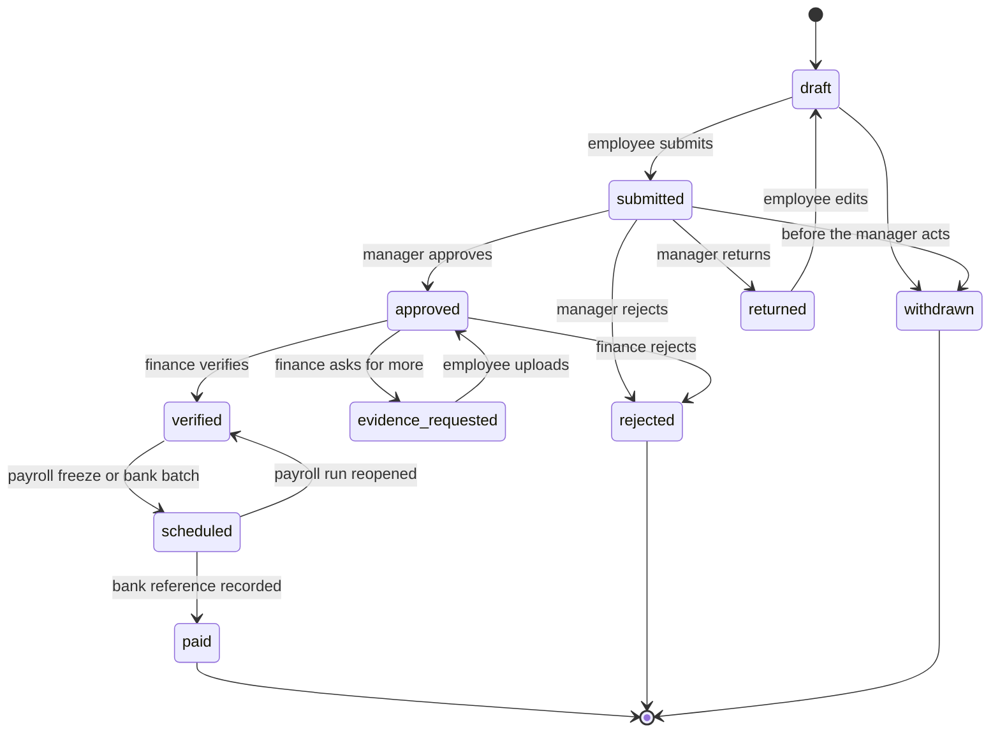

# Expenses, reimbursements and advances: design

Stages X1 and X2 are built (see Build status below); X3 to X6 are designed, not built. Exported on 14 Nov 2026 from the live claude.ai document, which is the version to edit: [Expenses, reimbursements and advances: design](https://claude.ai/artifact/SCLwr2gcdk2d6C46EoP4Nn).

## Build status

Built on 14 Nov 2026 (`V47__expenses_claims.sql`, `ExpenseService`, `ExpenseController`, the Expenses page):

- **X1.** The `expenses` module, the four permissions, the Finance role, categories with limits, and the `expenses.submit_within_days` setting.
- **X2.** Claims, lines, receipts and other evidence, the policy checks at submission, the manager's decision with cuts, per-item evidence review, and finance verification.

Where the build differs from the design above:

- Endpoints live under `/api/org/expenses/...`, like the other modules. Evidence review takes the claim's version.
- Claims belong to a membership (as leave does), not an employment.
- V47 holds only what X1 and X2 use. The payment, advance and loan tables arrive in later migrations.
- HR Admin also holds `expense.approve` at Organization scope, as it holds `leave.approve`. A role can only be granted by someone who holds all its permissions, so without it HR could no longer grant Manager. Only an Org Admin can grant Finance.
- The database keeps a submitted claim, its lines and files (a delete trigger), and evidence reviews can only be added.
- Each line records at submission whether it needs evidence, so a later change to a category never alters a claim already submitted.
- Approval routing is configurable (V48): a designated approver for a person or a department (Expenses, Approvers), a setting to switch the manager step off (`expenses.manager_step`), and a setting for a second finance approver above an amount (`expenses.second_finance_above`, 0 for never). The approver must hold `expense.approve`; a rule that would make someone approve their own claims is refused. The claim records the approver and the number of finance approvals it needs at submission.
- Organization-defined roles are built (V49, `RoleService`, User management → Roles): an Organization's owner makes roles named `custom_<name>` from permissions they hold themselves. Payroll, user/role administration, tenant and billing permissions stay with the system roles, so the payroll maker-checker rule cannot be dodged. A role someone holds cannot be deleted; editing one refreshes its holders' sessions.
- **X3, first part (V50, `ExpensePayouts`, Expenses → Payments).** Finance gathers verified claims into a batch, downloads a bank file (same layout as the salary file; needs a bank account on record and a fresh step-up where required), and marks the batch paid with the bank reference. Claims in an open batch are `scheduled`, then `paid`; cancelling an open batch returns them to `verified`. Nobody puts their own claim in a batch. Works without Payroll. Payment through the payroll run is built too (next entry). Loan payout is recorded by hand (bank reference), not by bank file.
- **X3, rest (V53, `ExpenseRunClaims`).** When a run is frozen it takes up each person's verified claims: they become `scheduled` (so no bank batch can have them) and are recorded in `expense_run_claim`. The payslip gets one line per category, kind `reimbursement` (component `REIMB`, added to the library on first use): paid with the salary, outside gross, not taxable, not wages, and not in TDS. Net pay is gross less deductions plus the expenses, so the bank file pays them to the salary account. The payslip screen and PDF show them in their own table; the journal debits each category's ledger. Reopening a run gives its claims back to `verified`; approving it pays them (`paid`, shown as "Salary of <month>"); a held payslip's claims go back to `verified` and are taken up by the run after release. Claims verified after the freeze wait for the next run or a bank batch. Not built: a per-person choice between the salary and a bank batch, and the claimant's own payslip showing the claim numbers.
- **X4 (V51, `LoanService`, Expenses → Advances and loans, Loan approvals, Loans, Loan types).** Salary advances (1 to 3 months, no interest) and loans (up to 60 months, simple interest on the reducing balance), from types an Organization sets (largest amount, longest term, rate, months of service, how many open). A request goes to the manager (or designated approver) and then to finance (`loan.manage`, held by Finance and the Owner); nobody decides their own. Finance records the payout (bank reference, fresh step-up where required) and the schedule is fixed: equal principal each month plus the month's interest, starting no earlier than the month after the payout. Payroll then takes the instalments due as the `LOAN_EMI` deduction (added to the Organization's component library on first use, paise kept). Deductions of a month may not take more than 50% of gross pay: the instalment gives way, `loan_emi_capped` warns, and approving the run settles the schedule, splitting a part-paid instalment so the rest stays due at the end. Held pay is not settled, so its instalments come in the run after release. Finance can skip a month (the schedule gains one at the end), record an early repayment (the remaining instalments are worked out again over the same months), or write off the balance (someone other than the person who paid it out, with a reason). Needs the Payroll module.
- **X4, second approver (V55).** `loans.second_finance_above` (rupees, 0 never): a loan or advance asked for above it needs two different people with `loan.manage`. The count is fixed when it is asked for. The first approval keeps the request with finance and shows who gave it; the second person (not the first, not the borrower) completes it. The first approver may still reject. Applies to requests made after the setting changes.
- Not built in X4: expense advances set against claims, alerts after two carried months, and a manager cut-line. The 50% cap uses gross pay, not "wages" in the Code on Wages sense, and does not yet count voluntary deductions apart from the loan: the payroll consultant should confirm both. The loan interest perquisite and the exit settlement are X5 (below).
- **X5 (V52, `LoanService.perquisite`, `ExitSettlement`).** The exit settlement now reads Expenses live: verified claims not yet paid show as an earning (`reimbursement`), and the active loan principal still due shows as a demand (`recovery`), both marked "From Expenses, now:" and refreshed whenever the settlement is prepared again (amounts HR typed by hand are kept). The loan balance is asked for separately, not netted from final wages: the payroll consultant should confirm. A loan charged less than the State Bank rate is a perquisite: each month, the balance at the start of the month times the gap, a twelfth of a year, counted only when the person's loans together are above ₹2,00,000 (all of it, not the excess). Finance can mark a loan exempt (treatment of a specified illness) with a reason of at least 10 characters (`loan.manage`, not their own). The market rate is the dated Organization setting `loans.perquisite_rate_bp` (hundredths of a percent, from 1 April), default 0: with 0 nothing is worked out, and the payslip warns `loan_perq_rate_missing` when a cheap loan over the threshold exists. The benefit joins taxable pay, shows as the information line `LOAN_PERQ`, is projected over the rest of the year in TDS, and appears on Form 130 Part B as "of which perquisite". The rate, the ₹2 lakh threshold and the all-or-nothing reading need the consultant's sign-off before an Organization relies on them.
- **X5, exit tasks (V54, `ExitTasks.sync`).** The default exit task "Clear open advances, loans and expense claims" carries `auto_check = 'expenses'`: it shows what is open in Expenses (claims not yet paid or closed, advances and loans with instalments due), completes itself when both are clear, and opens again if something comes up later. A task a person did or skipped is left alone. It checks each time the exit's tasks are read, not on a timer. An Organization's own template tasks do not carry the check unless it is set in the database.
- A setting, `expenses.when_no_approver` (`finance` by default, or `refuse`), decides what happens to a claim from someone with no manager or designated approver.
- Not built yet: audit sampling, the yearly count of missing-receipt statements, notifications, and the whole of X3 to X6. By default a claim from someone with no active manager goes straight to finance; set `expenses.when_no_approver` to `refuse` to stop that.

## Purpose and scope

A new **Expenses** module lets employees claim money back and borrow against pay. Finance gets a record of what is owed in both directions, payroll pays and recovers it, and the exit settlement reads it instead of HR typing it in by hand.

Today the app points at this module without having one:

- The exit checklist (`ExitDefaults`) asks the leaver to "Submit pending expense claims" and finance to "Clear open advances, loans and expense claims". Nothing in the app does either.
- The settlement's `reimbursement` and `recovery` lines (`ExitSettlement`) come from amounts typed on clearance tasks.
- The PF ECR's field 11, "Refund of advances", is fixed at 0 until loans and advances exist.
- The payroll design defers "loans and advances". The feature checklist lists reimbursement payout and loans with an EMI schedule as Sell features.

**Release 1 covers:**

1. Expense claims: categories with limits, receipts, manager and finance approval.
2. Payout of approved claims in the next payroll run, or off-cycle by bank file.
3. Salary advances and loans: request, approval, disbursal, EMI recovery through payroll, prepayment, and the interest perquisite.
4. Recovery of what is still owed at exit, through the full and final settlement.

**Left out of release 1:** travel requests and bookings, per diems by city, corporate cards and card-feed matching, mileage by GPS, receipt OCR, multi-currency claims, and export to accounting systems beyond the existing journal CSV. Flexible benefit plans (LTA, fuel, phone as a tax-free component) stay in payroll.

## Where it plugs in

Expenses is a separate module that can be sold alone. Claims work without Payroll, paid by bank file. Advances and loans need Payroll on, because their EMIs are deductions on a payslip.

| Touches | What changes |
| --- | --- |
| `Modules` / `platform.tenant_module` | A new `expenses` module (V47 widens the check, as V19 did for leave). `@RequiresModule(EXPENSES)` on the new controllers. Turning it off hides the screens; open claims and loan balances stay and still reach exit and payroll |
| Payroll run | At freeze, approved unpaid claims become `reimbursement` lines, and EMIs due that month become `deduction` lines. The snapshot records which claim and which instalment each line pays, so a reopened run gives them back |
| `pay_component` | A fifth kind, `reimbursement`: never wages under the Code on Wages, not ESI, not taxable, not prorated. Shipped components `REIMB` (claims), `ADV_REC` and `LOAN_EMI` (deductions) and `LOAN_PERQ` (an `info` line that carries the taxable perquisite into income tax) |
| Exit settlement | `ExitSettlement` reads approved unpaid claims (owed to the employee) and outstanding advance and loan balances (owed by them) as computed lines. Clearance-task amounts stay for anything else, such as an unreturned laptop |
| Exit tasks | "Submit pending expense claims" links to My expenses. "Clear open advances, loans and expense claims" shows the live balances and completes itself when they reach zero |
| Income tax (`AnnualTax`) | The loan perquisite is added to salary income for the year, month by month |
| PF ECR | Field 11, "Refund of advances", carries any PF advance refund once that loan type exists. It stays 0 for employer loans, which are not PF advances |
| Tax certificates (Form 130 Part B) | The perquisite appears under perquisites |
| Roles and permissions | New permissions `expense.claim` (everyone), `expense.approve` (managers, for their reports), `expense.finance` (verify and pay), `expense.setup`, `loan.manage`. A new Finance role holds the last three |
| Settings framework (V18) | Policy values (limits, submission window, receipt threshold) are settings by Organization, location or grade, from a date |
| Documents | Receipts are stored like onboarding documents, checked by `FileSniffer`, with the same size limits |

## Expense claims

A claim is one report holding one or more expense lines. Each line has a category, a date, an amount and usually a receipt. The manager approves the claim and finance verifies it. Payment then goes through payroll or a bank file.

### Categories and policy

The Organization keeps its own categories. Release 1 ships five: Travel, Local conveyance, Meals, Internet and phone, Other. Each category says:

| Setting | Example | Notes |
| --- | --- | --- |
| Limit per expense | ₹2,000 for Meals | Above it, the line needs a reason and is flagged to the approver |
| Limit per month | ₹1,500 for Internet | Counted on expense dates across all of the employee's claims |
| Receipt needed above | ₹500 | Below it, a receipt is optional |
| Distance based | Local conveyance at ₹12 per km | The employee enters km; the amount is worked out and locked |
| Who can claim | Grades, departments, locations | Uses the existing `AppliesTo` rules |
| GST fields | GSTIN and tax amount | Optional; kept so finance can claim input credit later |

Limits are values in the settings framework, so they can differ by location or grade from a date. A change never alters a claim already submitted, because the claim keeps the limits it was checked against.

### Lifecycle

The statuses are `draft` → `submitted` → `approved` (manager) → `verified` (finance) → `scheduled` (in a payroll run or bank batch) → `paid`. A claim paused for more evidence on a line is `evidence_requested`. The other statuses are `returned`, `rejected` and `withdrawn`.



A returned claim goes back to the employee as a draft. Reopening a payroll run moves a scheduled claim back to verified.

- **Draft.** The employee adds lines as expenses happen. Camera upload from the installable app resizes the photo on the phone.
- **Submit.** All lines must be in the submission window. The default is expenses up to 60 days old; older lines are refused with the date. Duplicate checks run here: the same amount, date and category in another claim, or the same receipt file hash, are flagged, not blocked.
- **Manager.** The approver is the manager, as in leave, with one approver in release 1. They can approve the claim, reject it with a reason, or return it with a note for changes. They can also cut a single line, which approves a lower amount with a reason. With no manager, the claim goes straight to finance.
- **Finance.** Finance checks receipts against lines, can cut or reject lines with a reason, and verifies. The person who submitted a claim can never approve or verify it.
- **Withdraw.** The employee can withdraw before the manager acts. After that, they ask the approver to return it.

An advance taken for a trip can be set against a claim. The claim's payable amount drops by what the advance covers, and the advance closes when it is fully settled (see Advances and loans).

### Evidence and verification

Evidence is checked item by item, so one bad receipt never sends a whole claim back. The pattern copies tax proofs (V17), where each declared item has its own `proof_status` and review note.

**What counts as evidence.** Each line holds one receipt and any number of supporting documents. Each file has a kind:

| Kind | Example | Required when |
| --- | --- | --- |
| Receipt | Bill, invoice, ticket | Above the category's receipt amount |
| Proof of travel | Boarding pass, toll slip | The category says so (Travel by default) |
| Pre-approval | Manager's email or approved trip | Over the category limit, or the category is marked "needs approval first" |
| Missing-receipt declaration | The employee's signed statement of why the bill is lost | Instead of a receipt, up to a set amount (₹2,000 by default) and a set count per year |
| Loan evidence | Doctor's certificate, hospital estimate, insurance claim status | The loan purpose is a Rule 18 illness, so the perquisite exemption can apply |

Each category says which kinds it needs. The rule is shown on the line before the employee submits.

**Checks when the claim is submitted.** Policy breaks are either warnings or blocks, as in Zoho Expense ([Zoho](https://www.zoho.com/expense/help/expenses/submitting-expenses/)):

- **Blocking.** A required receipt is missing with no declaration. A line is outside the submission window. A file fails `FileSniffer`. The employee must fix these before submitting.
- **Warning.** The amount is over the limit, with a reason. A possible duplicate (same amount, date and category, or the same file hash). A receipt date that differs from the line date by more than 3 days. The claim goes ahead, the flags are shown to every approver, and an approver who passes a flagged line must write a comment.

**Per-item review.** Finance marks each piece of evidence `accepted`, `rejected` (with a reason) or `more needed` (with a note). Asking for more evidence pauses only that line. The claim moves to `evidence_requested`, and the employee uploads the file on that line and sends it back without re-entering anything. The other lines stay verified. Finance can also pay the accepted lines now and hold the rest. A line whose evidence is rejected is cut to ₹0.

**Approval routing by risk.** Most claims take the default route: manager, then finance. Two triggers add a step, like Zoho's custom approval criteria ([Zoho](https://www.zoho.com/expense/help/custom-approval)):

- The claim total is over a set amount (₹25,000 by default). A second finance approver must verify it.
- The claim has more than 2 warnings, or uses a missing-receipt declaration. The finance verifier cannot be the same person who passed it at the manager step.

**Audit sampling.** Finance can set a share of claims (5% by default) to be re-checked after payment by someone other than the verifier. A failed check opens a recovery against the employee as an `ADV_REC` instalment, with the reason in the audit log.

**Advances.** Settling an advance needs the same evidence as a claim. The open advance's balance stays on the employee until the receipts are accepted. Keka works the same way: an advance of ₹20,000 against ₹17,000 of receipts leaves ₹3,000 to settle ([Keka](https://help.keka.com/hc/en-us/articles/39946616133649-Tracking-Managing-Your-Expenses)).

## Reimbursement payout

Verified claims are paid with salary by default, or straight away by bank file when finance chooses. The Organization picks the default in Setup → Expenses.

**Through payroll.** Claims verified on or before the pay group's input cut-off join that month's run when it is frozen. Each claim becomes one `REIMB` line on the payslip, labelled with the claim number. The run marks them `scheduled`, and marking the run paid marks them `paid` with the run's bank reference. Reopening the run puts them back to `verified`. Holding someone's pay holds their reimbursements too. A claim verified after the cut-off waits for the next month.

**Off-cycle.** Finance selects verified claims and creates a payment batch. The app writes an HDFC-style bank file with the same layout as the salary file. Marking the batch paid with the bank reference marks each claim `paid`. Claims in an open batch cannot join a payroll run, and the other way round.

**Tax treatment.** A reimbursement of an expense incurred for work, backed by a bill, is not salary income. So `REIMB` is not taxable, not wages, not ESI wages and not prorated. It appears on the payslip but outside gross. Categories the Organization marks as personal (for example a phone allowance paid without bills) are not claims; they belong in payroll as taxable components. Setup refuses a category marked both "no receipt" and "not taxable" above ₹0, and asks finance to choose.

**Accounting.** The journal CSV debits each category's ledger, set on the category, and credits the salary or bank account.

**Employee view.** My expenses shows each claim's status and who holds it. A paid claim shows the payslip or batch that paid it.

## Advances and loans

Advances and loans share one record and one flow. They differ in how they are paid back:

| Type | Paid back by | Typical use | Interest |
| --- | --- | --- | --- |
| Expense advance | Expense claims set against it, then any rest as one deduction | Travel | None |
| Salary advance | 1 to 3 monthly deductions | An emergency before pay day | None |
| Loan | EMIs over up to 60 months | Personal, medical, vehicle | 0% or a set rate, simple interest on the reducing balance |

Each Organization sets which types it offers, and for each: the maximum (a fixed amount or a multiple of monthly gross), the longest term, the interest rate, the service needed (for example 6 months), and how many can be open at once.

### Flow

1. **Request.** The employee asks for an amount, a term and a purpose. The screen shows the EMI schedule before they submit. HR can also record one on the employee's behalf.
2. **Approve.** The manager approves, then finance (holder of `loan.manage`). Over a set amount, a second finance approver is needed, as with weakening settings changes.
3. **Disburse.** Finance pays by bank file or with the next salary as a one-time line. The schedule starts in the month finance chooses, and never before the month after disbursal.
4. **Recover.** Each payroll run takes the instalment due as `LOAN_EMI` or `ADV_REC`. The instalment is fixed when the schedule is made and stored per month, so the run does not recalculate it.
5. **Close.** A loan closes when its balance is 0, whether by EMIs, by prepayment (a bank transfer finance records, or an extra one-time deduction) or by write-off (a reason and a second approver).

### Rules the run enforces

- **Net pay cap.** All deductions in a month must not take more than 50% of wages (Code on Wages s.18(4)). The cap counts every deduction allowed under s.18(2), including income tax, PF, ESI and PT, not only the EMI (see Sources). If the EMI would cross it, the run takes what fits, moves the rest to a new instalment at the end of the schedule, and raises a warning.
- **Skips.** HR can skip a month (for example in a month of loss of pay). The schedule moves out by one month.
- **Holds.** Held pay still records the EMI as due. It is taken when the pay is released.
- **Unpaid months.** In a month with no payslip, the instalment carries forward. After 2 carried months, finance is alerted.

### Interest perquisite

A loan from the employer below the market rate is a taxable perquisite. From 1 April 2026 the rule is Rule 15(5)(a), Table IV of the Income-tax Rules 2026, which replaced Rule 3(7)(i) of the 1962 Rules. The method is unchanged. Interest is worked out at the SBI rate for a loan of the same purpose, as on the first day of the tax year, on the maximum balance outstanding each month. The interest the employee actually pays is subtracted. ([ClearTax](https://cleartax.in/s/interest-free-employer-loan-taxability), [Taxscan](https://www.taxscan.in/top-stories/employer-loan-tax-rule-in-income-tax-rules-draft-2026-sbi-rate-method-explained-1442868))

Two exemptions apply:

- **Small loans.** The threshold rose from ₹20,000 to **₹2,00,000** in aggregate. It is all or nothing: above it, the whole balance counts. ([greytHR](https://www.greythr.com/admin/answers/VLrbNymeRGumZFOefm5pjA), [emicalculator.net](https://emicalculator.net/?p=8546))
- **Medical loans.** Loans for treating the illnesses specified in Rule 18 are exempt. Any part later reimbursed by insurance and not repaid to the employer becomes taxable. ([ClearTax](https://cleartax.in/s/interest-free-employer-loan-taxability))

So the engine checks the aggregate of all the employee's open loans each month, not each loan alone. A medical exemption applies only once finance has accepted the evidence (see Evidence and verification).

The SBI rates are statutory rule data in `app.payroll_rule`, dated by tax year. They are marked draft until the consultant signs them off, like the other rules. Each month the run computes the perquisite as an `info` line, `LOAN_PERQ`, which income tax adds to salary. It is shown on the payslip and in Form 130.

### At exit

When an exit is accepted, finance sees the outstanding balance of every advance and loan on the clearance task. The settlement takes the full balance as a `recovery` line. If the settlement cannot cover it, the rest becomes a demand on the employee, as notice shortfalls are today. It is never taken from wages beyond the limit.

## Screens and API

The screens follow the existing page conventions, and each is registered in `pageRegistry.js` behind the `expenses` module.

| Screen | Who | What it does |
| --- | --- | --- |
| My expenses | Everyone | Drafts, claims by status, add a line with camera or file, submit, withdraw. Open advances and loans with the schedule and balance; request a new one |
| Team expenses | Managers | Claims and loan requests waiting on them, with policy flags; approve, return, reject, cut a line |
| Expenses (finance) | Finance | Verify queue with receipt beside each line; payment batches; loans register with balances, skips, prepayment and write-off |
| Setup → Expenses | Org Admin, Finance | Categories, limits, receipt threshold, submission window, default payout, loan types and their rules |
| People → employee → Expenses | HR, Finance | One person's claims and loans; record a loan on their behalf |

Endpoints, in two new controllers (`ExpenseController`, `LoanController`), each with `@RequiresModule(EXPENSES)`:

| Method and path | Permission |
| --- | --- |
| `GET/POST /api/expenses/claims`, `PUT/DELETE /api/expenses/claims/{id}` (draft only) | `expense.claim`, own claims |
| `POST /api/expenses/claims/{id}/lines`, `POST /api/expenses/lines/{id}/receipt` | `expense.claim`, own claims |
| `POST /api/expenses/claims/{id}/submit` and `/withdraw` | `expense.claim`, own claims |
| `GET /api/expenses/approvals`, `POST /api/expenses/claims/{id}/decision` | `expense.approve`, own reports |
| `GET /api/expenses/verify`, `POST /api/expenses/claims/{id}/verify` | `expense.finance` |
| `POST /api/expenses/batches`, `POST /api/expenses/batches/{id}/paid`, `GET /api/expenses/batches/{id}/file` | `expense.finance` |
| `GET/PUT /api/expenses/setup/...` | `expense.setup` |
| `GET/POST /api/loans`, `GET /api/loans/{id}/schedule`, `POST /api/loans/preview` | `expense.claim`, own loans |
| `POST /api/loans/{id}/decision`, `/disburse`, `/skip`, `/prepay`, `/write-off` | `expense.approve` for the manager's step, `loan.manage` for the rest |

Every state change takes the version the client last read and returns 409 if it has moved, as the payroll run does. Write-off and approval above the second-approver amount go through `StepUp`.

## Schema (V47)

One migration, `V47__expenses_and_loans.sql`, follows the house rules. Every table has `tenant_id`, `unique (tenant_id, id)`, foreign keys that include `tenant_id`, and the `tenant_isolation` row-level security policy (the loop at the end of V17). Money is `numeric(12,2)` and always positive, with the direction carried by the table, never by the sign.

| Table | One row per | Key columns |
| --- | --- | --- |
| `expense_category` | Category | name, ledger, `receipt_above`, `per_km_rate`, `gst_fields`, `applies_to` jsonb, active |
| `expense_claim` | Claim | employment, number (from `NumberSeries`), status, submitted_at, manager and finance decision by/at/note, `limits` jsonb (the policy as checked), version |
| `expense_line` | Expense | claim, category, `spent_on`, amount, `approved_amount`, km, merchant, GSTIN, tax, note, `over_limit_reason`, receipt hash |
| `expense_payment` | Payment of a claim | claim, `run_id` or `batch_id` (exactly one), amount, status |
| `expense_batch` | Off-cycle bank batch | status, created by, paid_on, bank reference |
| `loan_type` | Type an Organization offers | kind (`expense_advance`, `salary_advance`, `loan`), max amount or multiple, max months, rate, min service months, max open |
| `loan` | Advance or loan | employment, type, amount, rate, months, purpose, status, decisions, disbursed_on, first_month, `perq_exempt` reason, version |
| `loan_instalment` | Month of a schedule | loan, month, principal, interest, status (`due`, `taken`, `skipped`, `carried`), payslip line taken by |
| `loan_settlement` | Repayment outside payroll | loan, kind (`claim`, `prepayment`, `exit`, `write_off`), amount, source id, note |

Evidence adds two tables. `expense_line` and `loan` no longer hold a document id themselves:

| Table | One row per | Key columns |
| --- | --- | --- |
| `evidence_file` | Uploaded file | owner kind (`expense_line`, `loan`, `claim`), owner id, kind (`receipt`, `travel_proof`, `pre_approval`, `missing_receipt_declaration`, `loan_evidence`), document id, sha256, uploaded by and at |
| `evidence_review` | Decision on a file or a request for one | file id or owner id, status (`accepted`, `rejected`, `more_needed`), note (required unless accepted), reviewed by and at; a later row supersedes an earlier one, so the history stays |

Also: `expense_category.evidence_rules` jsonb (which kinds are needed and above what amount), `expense_line.flags` jsonb (the warnings raised at submission, with any approver comment), `expense_claim.sampled_at` and `sample_result`, and `loan.perq_exempt` set only from an accepted `loan_evidence` file.

The claim and loan status checks, sketched:

```sql
status text not null default 'draft' check (status in
  ('draft','submitted','returned','evidence_requested','approved','verified','scheduled','paid','rejected','withdrawn'))
-- a rejected or returned claim says why
check (status not in ('rejected','returned') or decision_note is not null)
-- approved amount never above what was claimed
check (approved_amount is null or approved_amount <= amount)
-- a loan's instalments add up to its amount (checked in a deferred constraint trigger)
```

Other changes in V47:

- `platform.tenant_module`: the module check gains `'expenses'`. Existing Organizations get it `off`; turning it on is a platform decision.
- `app.pay_component.kind` and `app.payslip_line.kind` gain `'reimbursement'`.
- `app.payslip_line` gains `source_kind` and `source_id`, so a line can name the claim or instalment it pays.
- The new permissions and the Finance role are seeded, as in V2.
- Indexes: `expense_claim (tenant_id, status)`, `expense_line (claim_id)`, `loan_instalment (tenant_id, month, status)`, and a unique `(loan_id, month)`.

## Settings, notifications and audit

**Settings** (registered in the V18 framework, by Organization, location or grade, from a date):

| Setting | Default | Weakening change needs |
| --- | --- | --- |
| `expenses.submit_within_days` | 60 | Password |
| `expenses.receipt_above` | ₹500 | Password |
| `expenses.manager_step` | On | Second person |
| `expenses.default_payout` | With salary | None |
| `loans.second_approver_above` | ₹1,00,000 | Second person |
| `loans.max_deduction_share` | 50% of wages | Platform lock: cannot go above 50% |

**Notifications** go through `Notifications` and the mail outbox:

- The approver gets one when a claim or loan is waiting on them, plus a daily digest after 3 days.
- The employee gets one when a claim is returned, rejected, verified or paid, and when a loan is approved or disbursed.
- Finance gets one when a loan instalment has been carried for 2 months, or when an exit has an open balance.

**Audit.** Every decision, cut line, skip, prepayment and write-off is written to the Organization's audit log with who, when, the reason, and the amounts before and after. Receipts are never deleted while a claim is not in `draft`. After payment they are kept for 8 years, the books-of-account period.

## Tests, stages and open questions

### Stages

Each stage ships behind the module switch and leaves the build green.

1. **X1 — Module and setup.** V47, the `expenses` module, categories, settings, permissions and the Finance role. Setup → Expenses.
2. **X2 — Claims.** Drafts, lines, evidence, policy checks, duplicate flags, manager and finance decisions, per-item review. My, Team and Finance screens.
3. **X3 — Payout.** The `reimbursement` kind, claims in the payroll run at freeze, reopen, holds, off-cycle batches and the bank file, journal lines. Built.
4. **X4 — Advances and loans.** Types, request, approvals, disbursal, schedules, EMIs in the run, the 50% cap, skips, carry-forward, prepayment, write-off, and advances set against claims.
5. **X5 — Tax and exit.** The SBI rate rule rows, `LOAN_PERQ` into `AnnualTax` and Form 130, settlement lines in `ExitSettlement`, and live exit tasks.
6. **X6 — User guide.** `docs/user-guide/expenses.md` with screenshots and the browser tests behind it. Written, with screenshots and one browser test (`59-expenses-guide`) that takes a claim from draft to paid and an advance from request to payout.

### Tests

- **JUnit.** Policy limits per expense and per month across claims; submission window; duplicate detection; the status machine refuses every illegal move; no one approves their own claim; cross-Organization reads return nothing (added to `CrossOrgSweepTest`).
- **Payroll.** New golden payslips: a reimbursement on top of salary, a loan EMI, an EMI cut by the 50% cap, and a perquisite month. Reopening a run returns claims and instalments to their earlier state.
- **Properties.** For any schedule, the instalments add up to the principal, and interest on the reducing balance is never negative.
- **Exit.** A leaver with an open claim and a loan balance gets both on the settlement, and the tasks complete when both reach zero.
- **Architecture.** The new classes sit in `core` and `web` as the ArchUnit rules expect.
- **Browser.** Submit, approve, verify, pay through a run; request and repay a salary advance.

### Open questions

- [ ] Does a voluntary loan EMI that the employee has signed for count toward the s.18(4) cap, the same way a statutory deduction does? (Payroll consultant)
- [ ] What were SBI's rates on 1 April 2026 for each loan purpose, and is a salary advance under ₹2,00,000 outside the perquisite even when repaid in a later tax year? (Payroll consultant)
- [ ] Should the Finance role be new, or should Payroll Operator and Approver take these permissions?
- [ ] Is release 1 limited to one approver, or do customers need a cost-centre head step as well?
- [ ] Should Expenses be sold alone, or bundled with Payroll the way Attendance is with Leave?
- [ ] Should GST input credit fields be in release 1, or wait for accounting export?

## How other products do it

This design matches what Indian HR suites already offer, and adds per-item evidence review, which neither describes.

| Capability | Keka | Zoho Expense | This design |
| --- | --- | --- | --- |
| Pay with salary or off-cycle | Yes, inside or outside payroll | Separate payout | Yes, default set per Organization |
| Advances settled by receipts | Yes; any rest stays open | Yes | Yes, plus EMI loans |
| Warning vs blocking policy breaks | Not described | Yes | Yes |
| Approval routed by amount or violations | Approval levels per policy | Custom criteria: total, project, violation count | Amount and warning count |
| Loans with payroll recovery | Yes | No (expenses only) | Yes, with the 50% cap and perquisite |
| Per-receipt accept, reject or ask for more | Not described | Whole report rejected and resubmitted | Yes |

Keka will not mark an expense paid outside payroll as unpaid again ([Keka](https://keka.freshdesk.com/support/solutions/articles/84000385654-once-an-expense-is-marked-as-paid-can-we-mark-it-as-unpaid-change-the-payment-date-)). This design does the same: a batch marked paid is final, and only a reopened payroll run returns claims to verified.

## Sources

- Keka: [Tracking and managing expenses](https://help.keka.com/hc/en-us/articles/39946616133649-Tracking-Managing-Your-Expenses), [Advances](https://help.keka.com/admin/using-advances-in-expenses-travel), [Paid expenses](https://keka.freshdesk.com/support/solutions/articles/84000385654-once-an-expense-is-marked-as-paid-can-we-mark-it-as-unpaid-change-the-payment-date-)
- Zoho Expense: [Submitting expenses and violations](https://www.zoho.com/expense/help/expenses/submitting-expenses/), [Custom approval](https://www.zoho.com/expense/help/custom-approval), [Audit](https://www.zoho.com/om/expense/help/managing-policies/audit), [Rejecting a transaction](https://www.zoho.com/expense/kb/admin/approvals/reject-transactions)
- Loan perquisite under the Income-tax Rules 2026: [ClearTax](https://cleartax.in/s/interest-free-employer-loan-taxability), [greytHR](https://www.greythr.com/admin/answers/VLrbNymeRGumZFOefm5pjA), [Taxscan](https://www.taxscan.in/top-stories/employer-loan-tax-rule-in-income-tax-rules-draft-2026-sbi-rate-method-explained-1442868), [emicalculator.net](https://emicalculator.net/?p=8546)
- Deductions cap, Code on Wages s.18: [Nyaaya](https://nyaaya.org/legal-explainer/what-can-employers-deduct-from-employees-wages/), [TaxTMI](https://www.taxtmi.com/article/detailed?id=16583)

The tax and wage points come from secondary sources and still need the payroll consultant's sign-off, like the other rules.
