# Employee Onboarding — Implementation Design

Oct 11, 2026

## Summary and scope

Onboarding turns an offer into a working employee record: HR adds a joiner, the joiner fills in their own details and documents before day one, HR verifies them, and on the joining date the person becomes an active employee with a login, a shift and leave. Because every customer runs onboarding differently, every part of it is set per Organization: which flow a joiner follows, which sections and fields appear and which are required, the Organization's own fields, documents, checklists, verifiers, letters, policies, employee code patterns and messages. Each Organization starts with working defaults, so nothing must be configured before the first joiner. It is about 130 hours of work and builds the employee record (`app.person`) that payroll, reporting lines and manager views all wait for.

It builds on what exists at commit `ebbeff0` of sohamdatta/myapp: invitations and memberships, the `employee.read` / `employee.write` permissions already seeded but unused, attendance assignments, and leave balances with joiner proration.

**In scope now**

- The employee record: person, employment (joining date, designation, department, reporting manager, employee code, work location), contacts, addresses, family and nominees, bank account, statutory identifiers, and the Organization's own fields.
- Configuration per Organization, with defaults: flows chosen by rules (department, location, employment type, designation), sections and fields shown, hidden or required, custom fields, verification levels and verifiers, document types, checklist templates with triggers, reminders and approvers, employee code series, letter templates, policies to acknowledge, message templates, invitation and activation rules, retention.
- A joiner flow: an optional offer stage, an invitation before the joining date, a step-by-step form on phone or desktop, and verification of each section by one to three levels.
- Documents: upload, verification, letters generated from templates and accepted by the joiner, policies acknowledged.
- A checklist per joiner from templates: tasks for HR, IT, the manager, a buddy and the joiner, due relative to the day the joiner was added, invited, accepted the offer, or joins.
- Activation on the joining date, automatic or by HR: the Employee role, the attendance assignment and leave start that day. A rehire check against earlier employees.
- Bulk import of existing employees from a spreadsheet, so a new customer does not onboard 200 people one by one.

**Waits**

- Generating Form 11, Form 2 and Form F prefilled from the record (next, once the record exists; the data is captured now).
- Statutory returns filed with EPFO or ESIC (payroll).
- Salary figures in offer and appointment letters (compensation module); letters carry placeholders for them.
- Integrations that need a contract: background verification (SpringVerify, OnGrid, AuthBridge), DigiLocker, PAN and UAN verification, Aadhaar e-sign. The design leaves a verification hook per section so each can be added without changing the flow.
- Probation reviews and confirmation letters, onboarding surveys, asset inventory and IT account provisioning.
- Multiple legal entities: the employment row carries a nullable `legal_entity_id` so it can be added without a data migration.
- Pre-offer recruiting (requisitions, candidates, interviews): a separate product.

## How onboarding flows

A joiner moves through six states to become an active employee; the only way back is a verifier returning a section, and HR can withdraw a joiner at any point before activation. The steps drawn plain are the same for every Organization; when the invitation goes out, whether there is an offer to accept first, how many levels verify, and whether activation is automatic are each set per Organization or per flow.

```mermaid
stateDiagram-v2
    direction LR
    [*] --> Draft: HR adds the joiner
    Draft --> Offered: offer stage on
    Draft --> Invited: offer stage off
    Offered --> Invited: offer accepted
    Offered --> OfferDeclined: offer declined
    Invited --> FillingIn: joiner accepts the notice
    FillingIn --> BeingVerified: section submitted
    BeingVerified --> FillingIn: section returned
    BeingVerified --> ReadyToActivate: every required item verified (0 to 3 levels)
    ReadyToActivate --> Active: joining date, automatic or by HR
    Active --> [*]
    state "Filling in" as FillingIn
    state "Being verified" as BeingVerified
    state "Ready to activate" as ReadyToActivate
    state "Active employee" as Active
    state "Offer declined" as OfferDeclined
```

HR may withdraw a joiner at any state before Active.

Each of the nine sections (eight from the joiner, employment from HR) carries its own status, so a joiner's bank account can be with a verifier while they still fill in family details; the onboarding's state is worked out from the sections, never set by hand.

What each step does:

1. **HR adds the joiner** with name, personal email, mobile, joining date and job details. The flow is picked by the Organization's rules (HR may choose another), the rehire check looks for an earlier employee with the same PAN, email or mobile, and the checklist is copied from the flow's templates. No login yet.
2. **Offer, if the Organization uses it.** HR issues the offer letter from a template; the joiner accepts or declines through the link. A decline closes the onboarding as `offer_declined`.
3. **Invitation**, by HR's click or automatically: when the joiner is added, when the offer is accepted, or a set number of days before joining. An identity is created if the email is new, a membership with the Joiner role, and a one-time link valid for the Organization's number of days. A joiner who already has a login elsewhere signs in with it.
4. **The joiner accepts the notice**, then fills the sections the flow shows, in any order, saving drafts, and submits each one. Letters to accept and policies to acknowledge are sections too.
5. **Verification** of each section and document at one to three levels, each level by a role, a named user, or the joiner's manager, with a note on a return. A flow may set zero levels, so submitted sections count as verified. HR may also fill a section for the joiner.
6. **Ready to activate** when every required section and document is verified, letters accepted, policies acknowledged, and every required task done or skipped with a reason.
7. **Activation** on the joining date: automatically, or when HR presses Activate, as the Organization chooses. The employment becomes `active`, the Joiner role is swapped for Employee, the employee code is drawn from the matching series, the attendance assignment starts on the joining date, and leave accrues from it. No background job: a due activation is applied when anyone next reads the record or signs in.

A joiner who does not turn up is withdrawn with a reason: the membership is ended, the link stops working, and the joiner's data is deleted after the Organization's retention period, 90 days by default.

## What each Organization configures

Everything a customer would reasonably want to differ is a setting of that Organization, held in its own rows under row-level security; nothing in the code names a customer. A new Organization gets the defaults below, so it can onboard on day one and change things later.

| Area | What the Organization sets | Default |
| --- | --- | --- |
| Flows | Named flows, each chosen by rules on department, work location, employment type and designation; first match by position wins; HR may pick another per joiner | One flow, Everyone |
| Welcome | Per flow: welcome message, video link, day-one note (where and when to report), HR contact | Organization name and joining details |
| Offer stage | On or off; offer letter template; offer expiry in days | Off |
| Invitation | Manual, when added, when the offer is accepted, or a number of days before joining; link valid 1 to 120 days | Manual; 14 days |
| Sections | Per flow: which sections show, their order, title and introduction, and whether each is verified. Employment, Personal and Statutory cannot be switched off | All on, all verified |
| Built-in fields | Per field: hidden, optional or required, label, help text, editable by the joiner or by HR only; a flow can override the Organization's default | As in The default form |
| Custom fields | Any number, in any section: text, long text, number, date, single or multiple choice, yes or no, email, phone; required or optional; rules for whom they apply to; sensitive (encrypted and masked) or not; visible to the manager or not | None |
| Verification | Per flow: 0 to 3 levels; each level a role, a named user or the joiner's reporting manager, for every section or one section | 1 level, HR Admin |
| Documents | Document types with instructions, required before activation, within N days, or optional, and rules for whom they apply to | PAN card, address proof, education, relieving letter, photo |
| Checklists | Templates with rules; each task: owner (HR, IT, manager, buddy, joiner, a role or a named user), trigger (added, offer accepted, invited, joining date, activated) and offset in days, required, needs an attachment, an approver, reminder days before and repeat after due | One template of 8 common tasks |
| Employee codes | Series with prefix and suffix from tokens {YYYY} {YY} {MM} {LOC} {DEPT} {TYPE}, digits, start number, yearly reset, rules for whom each series applies to; or typed by hand | Typed by hand |
| Letters | Offer, appointment, confirmation and other templates with placeholders such as {{person.legal\_name}}; accept, accept or decline, or no response; versioned | An appointment letter with the OSH Code s.6 contents |
| Policies | Policies to read and acknowledge, as text or a PDF, before activation or within N days, with rules; versioned | None |
| Messages | Wording of each message: invited, offer issued, section returned, reminder, task assigned, due and overdue, ready, activated, welcome to the team | Plain defaults |
| Activation | Automatic on the joining date or by HR; whether activation may go ahead without a PAN | Automatic; allowed with a reason |
| Rehire check | Match on PAN, personal email, mobile, Aadhaar last four | PAN, email, mobile |
| Privacy notice | The text, published as versions | A default notice to edit |
| Retention | Days to keep a withdrawn joiner's data; years to keep exited employees (5 at least) | 90 days; 5 years |

**Rules that keep configuration safe**

- One rule syntax everywhere: a set of attributes, each with allowed values; all listed attributes must match. Flows, custom fields, document types, checklist tasks, employee code series, letters and policies all use it, so HR learns it once.
- A joiner's onboarding copies its flow, tasks and due dates when created. Changing the configuration later affects new joiners, not ones already in progress, unless HR applies the change to them explicitly.
- What the law or the record needs cannot be configured away: legal name, date of birth, joining date and PAN cannot be hidden; the PAN, IFSC, Aadhaar and UAN checks always run; nobody verifies their own section.
- Every configuration change is in the audit log with before and after values, and Setup shows a preview of the form as a joiner in a chosen flow will see it.
- Changing configuration needs the new `onboarding.configure` permission (Org Admin and HR Admin by default), separate from handling joiners.

## The default form

This is the form every Organization starts with: eight sections from the joiner and one from HR, plus Letters and Policies when the Organization has any. Each section is submitted and verified on its own, so one wrong bank account does not hold up the rest. Any field not marked as fixed below can be hidden, made optional or required, relabelled, or given help text, and the Organization's own fields are added to any section.

| Section | Fields | Filled by | Must have before activation | Checks |
| --- | --- | --- | --- | --- |
| Employment | Joining date, designation, department, reporting manager, employment type (permanent, probation, fixed-term, intern, consultant), probation end, work location, shift, weekly offs, employee code, official email | HR | All except official email | Manager must be an active employee; joining date not more than 90 days back; employee code unique (the attendance code is reused) |
| Personal | Full name as on PAN, preferred name, date of birth, gender, marital status, nationality, blood group, photo | Joiner | Name, date of birth, gender | Age 18 or more at joining unless HR overrides with a reason; name compared with the PAN name and flagged, not blocked, when different |
| Contact | Personal email, mobile, alternate mobile | Joiner | Mobile | Indian mobile 10 digits starting 6 to 9; email format |
| Addresses | Current and permanent: lines, city, state, PIN code, country; "same as current" | Joiner | Current address | PIN 6 digits; state from the fixed list of states and union territories (drives professional tax later) |
| Emergency contact | Name, relationship, mobile | Joiner | One contact | Not the joiner's own mobile |
| Family and nominees | Members (name, relationship, date of birth); nominee share for PF, gratuity, insurance | Joiner | Nothing at activation; nominations due within 30 days | Shares per scheme add up to 100%; nominees for PF limited to family where family exists (checked as a warning, the rule belongs to the scheme) |
| Bank account | Account holder, account number (entered twice), IFSC, bank and branch (filled from IFSC), cancelled cheque or passbook page | Joiner | All | IFSC 11 characters, 5th is 0; account 9 to 18 digits; holder name compared with the PAN name |
| Statutory | PAN, Aadhaar (optional), UAN if any, previous PF member number, ESI IP number if any, tax regime choice, previous employer's income this year | Joiner | PAN, or a recorded reason it is pending | PAN format AAAAA9999A with the 4th letter P for a person; Aadhaar 12 digits with the Verhoeff check, stored masked (see India rules); UAN 12 digits |
| Documents | Per the Organization's list: PAN card, address proof, education certificates, relieving letter, photo | Joiner | Those marked required | PDF, JPEG or PNG, 10 MB each; type checked from the file's bytes, not its name |

Fixed, whatever the configuration: legal name, date of birth, joining date and PAN stay required (PAN may be pending with a reason), and the format checks always run. HR can fill or correct any joiner field on the joiner's behalf; each such change is audited with HR's name, and the joiner sees it.

## India rules that shape it

Six rules change the design; each threshold is stored as dated data so a change is a row, not a release. These are read from the sources below as of 11 Oct 2026 and need a check by a labour-law consultant before launch.

| Rule | What it requires | What the design does |
| --- | --- | --- |
| Appointment letter, OSH Code s.6 | Since 21 Nov 2025 every employee gets an appointment letter with employer and employee, designation, joining date, wage components, wage period, UAN or ESIC number where available, and probation ([calcguru](https://calcguru.in/appointment-letters-and-hr-records-under-the-new-labour-codes/)) | A checklist task "Issue appointment letter" on every joiner, with the letter uploaded to the employee's documents. Generating it with pay figures waits for the compensation module |
| Register of employees, OSH Code s.33 | A register of employees may be kept electronically; records kept five years | The employee record is that register; ended employees are kept, never deleted, for at least five years after leaving |
| Aadhaar | Aadhaar cannot be made a condition of hiring (Puttaswamy, 2018); UIDAI advises masked copies ([PIB](https://www.pib.gov.in/PressReleasePage.aspx?PRID=1828797), [pietos](https://pietos.com/aadhaar-verification-for-employment/)) | Optional field. Only the last four digits are stored; the full number is checked (12 digits, Verhoeff) in memory and discarded. An uploaded copy must be the masked one, which the screen says plainly. EPFO's own Aadhaar seeding happens on the EPFO portal, not here |
| PF coverage | The wage ceiling for mandatory EPF coverage rose from ₹15,000 to ₹25,000 a month on 17 Sep 2026, S.O. 5109(E) under the Code on Social Security ([Argus Partners](https://www.argus-p.com/papers-publications/thought-paper/revision-to-epf-wage-ceiling-coverage-contributions-and-the-september-transition/), [SCC Online](https://www.scconline.com/blog/post/2026/09/17/cabinet-approves-epfo-wage-ceiling-limit-from-15000-to-25000/)) | Onboarding records UAN and previous membership; whether the joiner is covered is decided by payroll from the monthly wage against a dated ceiling table, never a constant |
| ESI coverage | Wage ceiling still ₹21,000 a month ([emgage](https://emgage.work/esic-in-2026-what-has-changed-after-the-code-on-social-security-2020/)) | ESI IP number and family details recorded; coverage decided by payroll from the same dated table |
| Personal data, DPDP Act 2023 and Rules 2025 | Rules notified 13 Nov 2025, full compliance by 13 May 2027: plain-language notice of purposes, security safeguards including encryption, access control, logs kept at least a year, breach notice ([TCSA](https://www.tcsa.in/resources/dpdp-rules-2025-implementation-roadmap)) | A notice the joiner reads and accepts before the form, versioned and recorded; encryption and masking in Security and privacy; the platform acts for the Organization as its processor |

The Organization is the employer and the data fiduciary; this product processes on its behalf. The notice text is the Organization's, with a default it can edit.

## What other products offer

The products Indian companies compare against (Keka, greytHR, Zoho People, Darwinbox, factoHR) and global ones (Workday, Rippling, HiBob, BambooHR) agree on a common core: rule-based flows, configurable fields, task templates with triggers, offer letters and number series. This design now covers that core; integrations that need a vendor contract come later. Freshteam was left out: Freshworks stopped renewals from March 2026 ([PeopleMatters](https://www.peoplematters.in/amp/news/business/freshworks-to-end-freshteam-hr-product-stop-renewals-from-march-2026-47939)).

| Feature | Offered by | Here |
| --- | --- | --- |
| Flows or templates chosen by location, department, grade or designation | [Zoho People](https://help.zoho.com/portal/en/kb/people/administrator-guide/onboarding-service/articles/candidate-onboarding-flow), [Keka](https://help.keka.com/hc/en-us/articles/39946720114449-Setting-up-Task-Templates-on-Keka), [Workday](https://doc.workday.com/admin-guide/en-us/human-capital-management/recruiting/onboarding-experience/steps--setup-onboarding-planner.html), [HiBob](https://www.hibob.com/product-briefs/personalized-onboarding/) | Now: flows and rules |
| Fields shown or mandatory, custom fields and forms | [greytHR](https://www.greythr.com/help-admin/employee-settings/configure-employee-onboarding-form/), [Zoho People](https://help.zoho.com/portal/en/kb/people/administrator-guide/onboarding-service/articles/candidate-onboarding-flow), [Darwinbox](https://explore.darwinbox.com/lp/cloud/product-tour/employee-onboarding-software) | Now: field settings, custom fields |
| Section-by-section accept or return with remarks | [greytHR](https://www.greythr.com/help-admin/employee-settings/configure-employee-onboarding-form/) | Now |
| Several levels of reviewers | [greytHR workflow](https://www.greythr.com/help-admin/workflows-use-cases/employee-onboarding-workflow-setup/), [factoHR](https://factohr.com/onboarding-software) | Now: up to 3 levels |
| Task triggers before and after joining, reminders, approver, required attachment | [Keka](https://help.keka.com/hc/en-us/articles/39946720114449-Setting-up-Task-Templates-on-Keka), [BambooHR](https://www.bamboohr.com/product-updates/onboarding-task-and-notifications-updates) | Now |
| Pre-joining portal with welcome message, video, contact | [Keka](https://help.keka.com/hc/en-us/articles/39946749669777-Managing-the-Candidate-Experience-Portal-on-Keka), [Zoho People](https://help.zoho.com/portal/en/kb/people/administrator-guide/onboarding-service/articles/candidate-onboarding-flow), [Workday](https://doc.workday.com/admin-guide/en-us/human-capital-management/recruiting/onboarding-experience/concept--preboarding-and-onboarding.html) | Now: welcome per flow |
| Offer letter templates, acceptance, expiry | [Keka](https://help.keka.com/hc/en-us/articles/39946797210769-What-is-the-workflow-of-moving-a-candidate-from-Preboarding-to-onboarding), [greytHR Recruit](https://www.greythr.com/help-admin/recruit/manage-documents-forms-greythr/), [factoHR](https://factohr.com/onboarding-software) | Now: letters with accept or decline |
| E-signature of letters | [greytHR via Zoho Sign](https://www.greythr.com/help-admin/recruit/send-offer-letters-digital-signature/), [Zoho People](https://help.zoho.com/portal/en/kb/people/administrator-guide/onboarding-service/articles/candidate-onboarding-flow) | Later: needs an e-sign provider |
| Policy acknowledgement | [HiBob](https://www.hibob.com/product-briefs/personalized-onboarding/), [Darwinbox](https://explore.darwinbox.com/lp/cloud/product-tour/employee-onboarding-software), [factoHR](https://factohr.com/onboarding-software) | Now |
| Buddy or mentor | [Darwinbox](https://explore.darwinbox.com/lp/cloud/product-tour/employee-onboarding-software), [Workday](https://doc.workday.com/admin-guide/en-us/human-capital-management/recruiting/onboarding-experience/steps--setup-onboarding-planner.html) | Now: a buddy per joiner, buddy tasks |
| Employee number series with tokens and yearly reset | [Zoho People](https://help.zoho.com/portal/en/kb/people/administrator-guide/settings/employee-information/articles/employee-id-generation), [Keka](https://help.keka.com/hc/en-us/articles/39946565641745-How-to-setup-an-employee-number-series-on-Keka) | Now |
| Editable message templates | [Zoho People](https://help.zoho.com/portal/en/kb/people/administrator-guide/onboarding-service/articles/onboarding-automation) | Now, shown in the app until email exists |
| Rehire check | [greytHR](https://www.greythr.com/help-admin/core-hr/onboarding-new-employees-guide) | Now |
| Prefilled statutory forms (PF, ESI, nominations) | [Darwinbox](https://explore.darwinbox.com/lp/cloud/product-tour/employee-onboarding-software), [factoHR](https://factohr.com/onboarding-software), [greytHR self-service](https://www.greythr.com/help-ess-web/get-started-greythr-ess-portal/complete-onboarding-process) | Next |
| Background verification | [Keka](https://help.keka.com/hc/en-us/articles/39946751240849-Background-verification-for-Preboarding-Candidates), [Darwinbox with SpringVerify](https://support.springworks.in/portal/en/kb/articles/darwinbox-integration-flows-configuration-options) | Later: a hook per section |
| DigiLocker documents, PAN and UAN verification | Through marketplace apps, such as [TruBlu on Darwinbox](https://marketplace.darwinbox.com/en-US/apps/430169/trublu:-your-id-and-background-verification-partner/features); APIs from [Cashfree](https://www.cashfree.com/docs/api-reference/vrs/v2/digilocker/digilocker-integration.md) | Later |
| Probation policy and confirmation | [Keka](https://help.keka.com/hc/en-us/articles/39946697294225-Configuring-and-Managing-Probation-Policies), [greytHR](https://www.greythr.com/help-admin/letter-use-cases/generate-confirmation-letters-hr/) | Later; probation end is recorded now |
| Asset and IT account provisioning | [Rippling](https://www.rippling.com/blog/how-rippling-runs-it-new-hire-onboarding), [factoHR](https://factohr.com/onboarding-software) | Later; checklist tasks cover it now |
| Onboarding surveys and check-ins | [HiBob](https://www.hibob.com/onboarding-software/), [Rippling](https://www.rippling.com/blog/automated-onboarding-workflows) | Later |
| Onboarding dashboards | [Keka](https://help.keka.com/admin/preboarding-overview), [Darwinbox](https://darwinbox.com/blog/whats-brewing-latest-from-darwinbox-tech-labs-onboarding) | Now: tiles and filters on the Joiners list |

## Data model

The employee is a `person` (the human, as this Organization knows them), joined to a login by `membership.person_id`, which V1 reserved for exactly this. One `employment` row per stint, so a rehire is a second row on the same person; anything that changes over a stint (designation, department, manager) is a dated row, like attendance assignments. Migration `V5__employee_onboarding.sql`; every table has `tenant_id` and FORCE RLS, as before.

| Table | Holds | Key rules |
| --- | --- | --- |
| `person` | Legal and preferred name, date of birth, gender, marital status, nationality, blood group, photo, personal email, mobile | One per human per Organization; never deleted |
| `employment` | Person, membership (null until the login exists), employee code, joining date, type, probation end, status (`onboarding`, `active`, `exited`), exit date, `legal_entity_id` (null for now) | At most one live employment per person; joining date fixed once active |
| `job_assignment` | Employment, effective from, designation, department, reporting manager (an employment) | Add-only and dated, like `attendance_assignment`; a manager cannot report to themselves, directly or through a loop |
| `department` | Name, parent department, head | A tree; no loops |
| `person_address` | Person, kind (`current`, `permanent`), lines, city, state code, PIN, country, effective from | A change is a new row |
| `emergency_contact` | Person, name, relationship, mobile, order | At least one before activation |
| `family_member`, `nomination` | Members; nominations per scheme (`pf`, `gratuity`, `insurance`) with a share | Shares per scheme total 100 |
| `bank_account` | Person, holder, account number encrypted, last four, IFSC, bank, branch, verified by and at, effective from | Add-only: a new account closes the old one from a date, so payroll knows which account a month was paid to |
| `statutory_id` | Person, kind (`pan`, `aadhaar`, `uan`, `pf_member`, `esi_ip`), value encrypted, last four, verified by and at | Aadhaar keeps last four only and no encrypted value; PAN unique per Organization |
| `tax_regime_choice` | Person, tax year, regime, chosen at | One per tax year; changeable until payroll locks the first month |
| `document_type` | Per Organization: name, required at activation or within N days, which employment types | Seeded with PAN card, address proof, education, relieving letter, photo |
| `document`, `document_content` | Metadata (type, file name, content type, size, SHA-256, status, verified by, note) and the encrypted bytes, separately | Replacing a document adds a row; the old one stays, marked superseded |
| `onboarding` | Person, employment, status, invited at, notice version and accepted at, submitted at, activated at, withdrawn reason | One open onboarding per person |
| `onboarding_section` | Onboarding, section, status (`not_started`, `draft`, `submitted`, `returned`, `verified`), note, who and when | The joiner cannot verify; HR cannot verify a section the joiner has not submitted, unless HR filled it |
| `checklist_template`, `checklist_template_task` | Templates with rules; per task: owner, trigger event and offset, required, attachment needed, approver, reminders, rules | Every template whose rules match the joiner is used |
| `onboarding_task` | Copied from the template at creation: title, owner, assignee, due date, done by and at, skipped reason | Required tasks done or skipped with a reason before activation |
| `privacy_notice` | Version, text, published at | A new version never changes an accepted one |

Configuration lives in its own tables, one set per Organization, read when a joiner is added and when the form is drawn. Rules for whom something applies to are one JSON column, `applies_to`, in every table that has them, validated by the application.

| Table | Holds |
| --- | --- |
| `onboarding_settings` | One row per Organization: offer stage, when to invite, link validity, automatic or manual activation, activation without PAN, rehire match fields, retention |
| `onboarding_flow` | Name, rules, position, welcome message, video link, day-one note, HR contact, number of verification levels |
| `verification_step` | Per flow and level: a role, a named user or the manager, for all sections or one |
| `section_setting` | Per flow and section: shown, order, title, introduction, verified or not |
| `field_setting` | Per built-in field, for the Organization or one flow: hidden, optional or required, label, help, who edits |
| `custom_field`, `custom_field_value` | The Organization's own fields with type, choices, limits, rules, sensitivity; values per person, encrypted when sensitive |
| `employee_number_series`, `employee_number_counter` | Code patterns with tokens and rules; one counter per series, expanded prefix and year, taken under a row lock |
| `letter_template`, `issued_letter` | Versioned templates with placeholders; each letter issued as a PDF document, with the joiner's response |
| `policy`, `policy_acknowledgement` | Versioned policies with rules and due point; who acknowledged which version and when |
| `message_template`, `notification` | Wording per event and channel; in-app notifications made from it |
| `section_review` | Every verify or return at every level, so the section's status is the latest decision |

Encrypted values use AES-256-GCM in the application with a key from `APP_DATA_KEY`; each ciphertext carries a key id so the key can be rotated. The database never sees a full PAN or account number in clear, so a database dump or a support session reading tables shows only the last four.

The full SQL, tested on PostgreSQL 16, is on the Schema tab.

## Permissions

Onboarding uses the `employee.read` and `employee.write` permissions already seeded, plus one new permission and one new role. Full PAN, account numbers and documents need `employee.sensitive`; everyone else sees the last four digits and no files.

- **New permission `employee.sensitive`**: see full statutory numbers and bank accounts, open documents. Granted to Org Admin and HR Admin (tenant), Payroll Operator (assigned, for the bank file), Employee (self).
- **New system role Joiner** (`joiner`, not assignable by hand): `employee.read` self, `employee.write` self limited to onboarding sections, `employee.sensitive` self. Given with the invitation; swapped for Employee on activation.

* **New permission `onboarding.configure`**: change flows, forms, fields, checklists, letters, policies, messages and settings. Granted to Org Admin and HR Admin (tenant). An Organization that wants one person to set things up and others only to run onboarding gives the second group a role without it.
* **Verifiers named in a flow** may verify the sections of their level for the joiners they are assigned to, without `employee.write`; they see values masked unless they also hold `employee.sensitive`.

| Role | Joiners and onboarding | Employee record | Bank, PAN, documents |
| --- | --- | --- | --- |
| Org Admin | Create, verify, activate, withdraw | All, read and write | Full |
| HR Admin | Create, verify, activate, withdraw | All, read and write | Full |
| Manager | Sees joiners who will report to them and their checklist; ticks tasks assigned to them | Team: job, contact, joining date | Last four only, no documents |
| Payroll Operator | No | Assigned: read | Full, for the bank file and returns |
| Payroll Approver, Auditor | No | Read | Last four only |
| Employee | Their own onboarding until activation | Own: read; changes to bank, address and family go to HR to verify | Own, full |
| Joiner | Their own sections only | Own, while onboarding | Own, full |
| Support (read or write) | Read only | Read | Last four only, never documents, even with a write grant |

Whoever is assigned a checklist task can mark it done without `employee.write`, so an IT admin who is otherwise an ordinary employee can tick "Laptop issued". Nobody verifies their own onboarding, and a manager's reporting line can only be changed by `employee.write` at tenant scope.

## Screens

Two new sidebar pages, **People** for HR and **My onboarding** for a joiner, in the existing look: underline tabs, tiles, tables that turn into lists on a phone. A joiner sees only My onboarding until activation; the joiner's form must work on a phone, since most will fill it there.

**HR: People → Joiners**

1. **Joiners list.** Tiles: joining this week, waiting on the joiner, waiting on HR, overdue tasks. Table: name, joining date, designation, manager, progress (sections verified out of 9, tasks done out of n), status. Filters by status and joining month.
2. **Add joiner.** One short form: name, personal email, mobile, joining date, designation, department, manager, employment type, work location, shift, checklist template. Two buttons: **Save** (draft, no invitation) and **Save and invite**. The invitation link is shown to copy, as user invitations are today, until email exists.
3. **Joiner page.** Header with name, joining date, a countdown, status and the actions that fit the status (Invite, Resend link, Activate, Withdraw). Tabs:
   1. **Details**: each section as a card with its status chip; open a card to see the values (masked unless `employee.sensitive`), then **Verify** or **Return** with a note.
   2. **Documents**: required and uploaded, a viewer, Verify or Reject with a note.
   3. **Checklist**: tasks grouped by owner with due dates, overdue in amber; tick, skip with a reason, reassign, add a one-off task.
   4. **History**: every change and decision from the audit log.
4. **Activate.** Lists what blocks activation, if anything, and what will happen: Employee role granted, attendance from the joining date, leave from the joining date. Activation before the joining date is scheduled, not immediate.

**HR: People → Employees** lists everyone with an employment; an employee's page has the same Details and Documents tabs, a Job tab with dated history (designation, department, manager), and an Exit action that sets the exit date and ends the membership on that day.

**HR: People → Setup**, for `onboarding.configure`, one tab per area of the configuration table:

1. **Flows**: list in order with their rules in words (Interns at any location); drag to reorder; each flow opens on its welcome content, sections (switch, order, title, verified), verification levels and its field overrides.
2. **Form**: every section with its built-in fields and custom fields; per field a three-way switch hidden, optional, required, a label and help text; Add field opens the custom field form with type, choices and rules. **Preview as joiner** shows the form for a chosen flow, on a phone frame.
3. **Documents, Checklists, Letters, Policies, Messages**: lists with an editor each; letters and messages show the placeholders available and a sample filled from a test joiner.
4. **Employee codes**: series with a live example of the next code; **Departments**: a tree; **Settings**: invitation, activation, rehire, retention and the privacy notice.

Every screen saves a change with who and when, and shows the last change in a line under its title.

**HR: People → Import**: upload a CSV of existing employees, map columns once (as device import does), preview row by row with the reasons a row cannot be used, then import as active employees without an onboarding flow. Invitations for them are sent separately, in bulk.

**Joiner: My onboarding**

1. **Welcome.** The Organization's name, joining date, manager, location, and the privacy notice to read and accept; nothing else is open until it is accepted.
2. **Progress.** A list of the eight sections with their status chips and a single bar: done, returned with a note, still to do. Returned sections sit at the top with HR's note.
3. **A section.** One short form per screen, saved as a draft on every field change, **Submit for checking** at the foot. Clear help on why each statutory field is asked for and who sees it.
4. **Documents.** Upload from the phone's camera or files, see each document's status.
5. **Your first day.** Tasks owned by the joiner (bring originals, sign the appointment letter), reporting time and address.

**Manager: My team → Joining soon** (only when they have joiners): name, joining date, their tasks with ticks.

## API

Two groups, in the same style as attendance and leave: the caller's own under `/api/org/onboarding/me`, everyone's under `/api/org/people`. The Organization always comes from the session, never the URL.

| Method | Path | Purpose |
| --- | --- | --- |
| GET | `/onboarding/me` | The caller's onboarding: status, sections with status and notes, tasks they own, the notice to accept |
| POST | `/onboarding/me/notice` | Accepts the current notice version |
| GET, PUT | `/onboarding/me/sections/{section}` | Reads or saves a draft of one section |
| POST | `/onboarding/me/sections/{section}/submit` | Submits a section for checking |
| GET, POST | `/onboarding/me/documents` | Lists, uploads a document (multipart) |
| GET | `/onboarding/me/documents/{id}/content` | The caller's own file |
| GET, POST | `/people/joiners` | Lists joiners; adds one (optionally `invite: true`) |
| GET | `/people/joiners/{id}` | One joiner: sections, documents, tasks |
| PUT | `/people/joiners/{id}/sections/{section}` | HR fills or corrects a section, audited |
| POST | `/people/joiners/{id}/sections/{section}/verify`, `/return` | Verifies or returns with a note |
| POST | `/people/joiners/{id}/documents/{docId}/verify`, `/reject` | Decides a document |
| POST | `/people/joiners/{id}/invite`, `/activate`, `/withdraw` | Invitation link; activation (now or on the joining date); withdraw with a reason |
| POST | `/people/tasks/{taskId}/done`, `/skip`, `/reassign` | Checklist actions; the assignee may mark done |
| GET | `/people/employees`, `/people/employees/{id}` | Employees and one record |
| POST | `/people/employees/{id}/job` | A dated job change: designation, department, manager |
| POST | `/people/employees/{id}/exit` | Exit date and reason |
| GET | `/people/documents/{id}/content` | A file, for `employee.sensitive`; every view audited |
| GET, POST, PUT | `/people/departments`, `/people/document-types`, `/people/checklists`, `/people/notice` | Setup |
| POST | `/people/import/preview`, `/people/import` | Bulk import of existing employees |

Configuration, all under `/api/org/people/setup`, needing `onboarding.configure` to change and `employee.read` at tenant scope to read:

| Method | Path | Purpose |
| --- | --- | --- |
| GET, PUT | `/settings` | Invitation, activation, rehire, retention, offer stage |
| GET, POST, PUT | `/flows`, `/flows/{id}` | Flows with rules, welcome, sections, verification steps |
| PUT | `/flows/order` | The order flows are tried in |
| GET, PUT | `/fields`, `/flows/{id}/fields` | Built-in field settings for the Organization or a flow |
| GET, POST, PUT | `/custom-fields`, `/custom-fields/{id}` | Custom fields |
| GET, POST, PUT | `/document-types`, `/checklists`, `/letters`, `/policies`, `/messages`, `/number-series` | The other configuration lists |
| GET | `/preview?flow=` | The form as a joiner in that flow would see it |
| POST | `/number-series/{id}/example` | The next code the series would give, without taking it |

Responses carry masked values (`"panLast4": "234F"`, `"accountLast4": "6789"`) unless the caller has `employee.sensitive`, in which case a separate `GET …/reveal` call returns the full value and is audited, so a full number never sits in a list response.

## Security and privacy

The rule is: full identifiers and files are encrypted in the application, shown only on request to those with `employee.sensitive`, and every such view is in the audit log.

- **Encryption.** PAN, UAN, PF member number, ESI IP number, bank account numbers and document bytes are AES-256-GCM encrypted before they reach PostgreSQL, with the tenant id bound in as associated data so a value copied to another Organization's row will not decrypt. Aadhaar is never stored in full.
- **Keys.** `APP_DATA_KEY` (32 bytes, base64) from the environment, with a key id stored beside each value; rotation re-encrypts in the background and a second key is accepted while it runs. Without the key the app refuses to start rather than store anything in clear.
- **Masking.** List and detail responses carry last four only; full values come from a separate reveal call, audited with who, what and why (a short reason the screen asks for).
- **Uploads.** Type checked from the first bytes (PDF, JPEG, PNG only), 10 MB limit, file names stripped to safe characters, images re-encoded to drop location data. Files are served with `Content-Disposition: attachment` and `X-Content-Type-Options: nosniff`, never inline from the API's origin.
- **Storage.** Document bytes live in `document_content`, a separate table, so the main queries never load them; when the database passes a few gigabytes they move to object storage with the same encryption, and only the storage key changes.
- **Invitation links** for joiners expire 14 days after sending or at the joining date plus 7 days, whichever is later; they work once, as user invitations do.
- **Support sessions** see masked values only and cannot open documents, even with a write grant.
- **Retention.** Records of exited employees are kept at least five years after exit (registers under the labour codes) and then deleted on a schedule the Organization can lengthen. A withdrawn joiner's data, who never joined, is deleted after 90 days. Deletion is logged without the deleted values.
- **Notice.** The joiner accepts a versioned notice before the form opens; what was accepted, and when, is kept with the onboarding.
- **Breach readiness.** Audit records and access logs kept at least one year; a runbook for notifying the Organization, which notifies its people and the Data Protection Board.

## Build steps

About 132 hours in thirteen steps. Steps 1 to 5 and 11 (72 hours) give a working onboarding on the seeded defaults; each later step adds one configurable area, so the order can follow what the first customers ask for.

1. **Schema and encryption, 12 h.** V5 migration with RLS; Joiner role, `employee.sensitive`, `onboarding.configure`; the encryption helper with key ids; validators for PAN, Aadhaar (Verhoeff), IFSC, UAN, PIN, mobile as pure classes; defaults seeded for every new and existing Organization.
2. **Employee record, 10 h.** Person, employment, dated job assignments, departments; People → Employees; reporting lines with loop checks. This also gives managers their team, so the empty Manager views in attendance and leave start working.
3. **Configuration core, 16 h.** Settings, flows with rules and the rule matcher (pure, tested on its own), section settings, field settings with the Organization and flow layers, custom fields and their validation.
4. **Joiners, sections and verification, 14 h.** Add joiner with flow choice, invitation by click or rule, section drafts, submit, verification at 0 to 3 levels, returns, HR edits audited, the notice.
5. **Joiner screens, 12 h.** My onboarding drawn from the configuration, on desktop and phone: welcome, progress, one form per section including custom fields, returned notes.
6. **Documents, 8 h.** Document types with rules, upload with type sniffing and re-encoding, encrypted storage, viewer, verify or reject, reveal auditing.
7. **Checklists, 8 h.** Templates and tasks with rules, triggers and offsets, owners, approvers, required attachments, reminders worked out on read, the Manager's Joining soon.
8. **Letters and policies, 12 h.** Templates with placeholders, PDF rendering, issue, accept or decline, offer stage and expiry; policies with versions and acknowledgement.
9. **Employee codes, 4 h.** Series with tokens, counters taken under a row lock, live example.
10. **Messages, 6 h.** Message templates, in-app notifications and the bell; email later through the same templates.
11. **Activation, exit and rehire, 8 h.** Blocking reasons, automatic or manual activation on the joining date (checked on read and at sign-in), role swap, code drawn, attendance and leave from the joining date; exit; the rehire check.
12. **Setup screens, 14 h.** One tab per configuration area, preview as joiner, last-change lines.
13. **Bulk import, 8 h.** CSV mapping remembered per Organization, custom fields included, row-level preview and reasons, import as active employees, bulk invitations.

**Tests**

- Pure: each validator with good and bad values, including Verhoeff and the PAN 4th letter; reporting-line loop detection; due-date arithmetic.
- Database: RLS isolation for every new table; a support session reads masked values and cannot open a document; a joiner cannot read another joiner; nobody verifies their own section; activation blocked until required sections and tasks are done; encrypted columns never hold the clear value; tampering with tenant id fails decryption.
- Browser: HR adds and invites a joiner; the joiner fills every section on a 390 px phone; HR returns one, the joiner fixes it; activation; the new employee punches and applies for leave.

* Configuration: two Organizations with opposite settings run the same joiner steps side by side and each sees only its own form, fields, flows and messages; a flow override wins over the Organization default; a configuration change leaves joiners in progress untouched; the fixed fields cannot be hidden; the rule matcher is tested on every attribute and on no match falling to the default flow; two joiners activated at once never get the same employee code.

## Open questions

- [ ] Which defaults should a new Organization get? Proposed: the ones in the configuration table, plus a choice at sign-up between three starter sets (small office, factory with shifts, IT services) that differ in sections, documents and checklists.
- [ ] Should configuration be copied between Organizations (a group with four companies wants one setup)? Proposed: export and import of an Organization's configuration as a file, later.
- [ ] Is PAN required before activation, or allowed as pending with a reason? Proposed: a setting, allowed by default, flagged to payroll, since TDS without a PAN is deducted at a higher rate.
- [ ] Store documents in PostgreSQL first (proposed, simpler for one developer) or start on object storage?
- [ ] Email sending is a prerequisite for onboarding to feel finished; until then HR copies the link and the in-app notifications carry the messages.
- [ ] Which e-sign and verification providers to support first, once a customer asks: an Aadhaar e-sign provider, a background check vendor, a PAN and UAN verification API.
- [ ] A consultant's review of the India rules table before launch, especially the PF transition guidance from EPFO, which was not out as of 21 Sep 2026.
