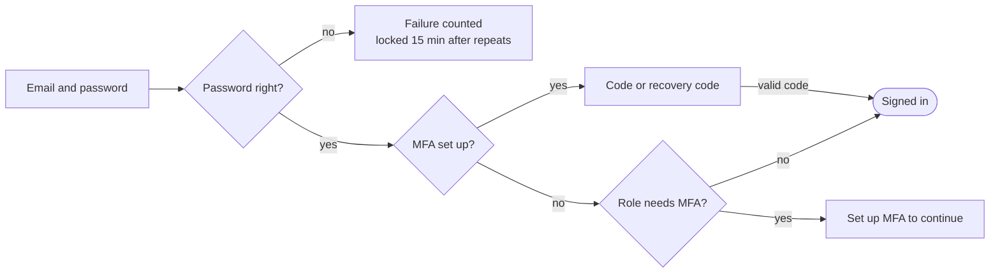

# HRMS: design for the next five releases

Oct 24, 2026 · Markdown export of the [live document](https://claude.ai/artifact/RkLD2g8gjmfVprQ5pxRwUq); edit there and export again.

## Summary

Build these five in order: green CI first (half a day), then sign-in security, then income tax filings, then PF and ESI returns, then the installable app. The first two are what a buyer tests in a demo; the middle two finish Indian payroll compliance; the app is the employee-facing differentiator and is easier once the rest is stable.

| # | Release | What it delivers | Effort (estimate) | Depends on | Migration |
| --- | --- | --- | --- | --- | --- |
| 1 | Green CI | The two fragile browser tests fixed; date and timezone guards so they cannot creep back | 0.5 day | — | none |
| 2 | Sign-in security | Email sending, password reset, email change, TOTP MFA with recovery codes, lockout and rate limits | 2–3 weeks | 1 | V27 |
| 3 | Income tax completion | Previous employer's income and TDS, challans, quarterly Form 138 return file, Form 130 Part B | 3–4 weeks | 1; uses tax declarations (V17) | V28 |
| 4 | PF and ESI returns | Monthly PF ECR text file, ESI contribution file, with pre-checks and a filing log | 1.5–2 weeks | 1 | V29 |
| 5 | Installable app (PWA) | Home-screen install, offline punch queue, web push, camera upload for proofs and documents | 3 weeks | 2 (push uses the outbox) | V30 |
| — | Email (before go-live) | Invitations and the app's notices sent by email instead of copied links: the outbox, Amazon SES from the product's domain, an email beside each in-app notice, switches per event | 1–1.5 weeks | Domain and HTTPS; built as the first part of release 2 | With release 2's schema |
| — | Domain and HTTPS (before go-live) | The product's own domain: addresses for production and UAT, their HTTPS certificates, and the sending domain release 2's email needs | 1 hour, plus DNS propagation and email DNS records | Buying the domain | none |

Migration numbers below follow the schema on `main` (V19 is the Leave module; V20 to V26 are performance management and branding), so these releases start at V27. Estimates assume one developer working with Claude and the current test discipline (JUnit against PostgreSQL plus a Playwright suite per release). Every release keeps the existing rules: maker-checker where money moves, row-level security per Organization, an audit event for every change, and statutory figures as rule data awaiting the payroll consultant's sign-off.

## 1. Green CI

`main` has been red since 24 Oct because two browser tests assume things about today's date and the server's clock; the app is right in both cases. Because the browser suites run as one chain, the first failure skips everything after it (68 to 100 of 135 tests), so a real regression would go unseen.

| Test | Fails when | Root cause | Fix |
| --- | --- | --- | --- |
| `12-payroll` › November run | From about the 22nd of any month | `10-exit` sets Nina's last day to today + 10 days; late in the month that is next month, so she is rightly in next month's run | Set her last day to the last day of the current month, or assert on her actual last day: present in the run when it falls in that month |
| `07-onboarding` › reassigned task | Server runs in India time | Expects the owner's email in the task row; the row shows her name. The email exists only in the open dropdown, so the test passes by catching the panel before it closes | Expect the person's name ("Ananya Sen"), and that the reassign panel has closed |

**Guards so this does not recur**

1. Run the browser job twice in CI: once in UTC, once with `TZ=Asia/Kolkata` for both PostgreSQL and the JVM (a matrix entry). Today only UTC is tested, yet Indian customers will often run the server in India time.
2. Add a fixed-date run: start the backend with a test clock (`APP_TEST_TODAY=2026-03-28`, read only when a test profile is on) once a week on a schedule, to catch month-end and year-end assumptions (the 28th to 31st, 31 March).
3. A lint rule for the e2e folder: `isoDay(n)` with `n` above 5 must be clamped with a helper such as `withinMonth()` or `withinTaxYear()`, as the new tax suite already does.
4. Make the chain fail loudly but locally: keep dependencies for story order, and add `--max-failures=0` plus a CI summary that lists skipped suites by name, so a skip is never mistaken for a pass.

**Done when** the full chain of 141 tests (135 plus the 6 tax tests) passes in both time zones, and a fixed-date run on 28 March passes.

## 2. Sign-in security: email, password reset, MFA, rate limits

Add a durable email outbox, then build password reset, email change and TOTP MFA on it, and widen the existing lockout with per-address rate limits. Much of the groundwork exists: V1 already has `auth.password_reset`, `auth.mfa_recovery_code`, `identity.mfa_secret_enc` and `session.mfa_at`, and sign-in already locks an identity for 15 minutes after repeated failures. What is missing is every flow that uses them, and any way to send mail.

### Email outbox

Every email is a row first, sent later by a worker, so a slow or failing mail provider never fails a user's action and nothing is lost on restart.

- **Table** `platform.email_outbox`: id, tenant_id (null for sign-in mail), to_email, template, subject, body_text, body_html, status (`queued`, `sending`, `sent`, `failed`, `suppressed`), attempts, next_attempt_at, provider_message_id, last_error, created_at, sent_at. Written in the same transaction as the change that causes it.
- **Worker**: a scheduled job every 10 seconds claims up to 20 due rows with `for update skip locked`, sends, and retries with backoff (1, 5, 15, 60 minutes, then 6 hours) up to 6 attempts. Safe to run on several servers later.
- **Provider**: SMTP through Spring's mail starter, pointed at Amazon SES (the deploy guide targets AWS). Settings `APP_SMTP_HOST`, `APP_SMTP_USER`, `APP_SMTP_PASSWORD`, `APP_MAIL_FROM`. Unset → `log` mode: mail is written to the log and the screens keep showing copy-paste links, as today.
- **Suppression**: addresses that hard-bounce or complain go to `platform.email_suppression`; later sends to them are marked `suppressed`. Release 2 records bounces from SES's notification webhook; until it is wired, the platform console can add an address by hand.
- **Templates**: the existing `app.message_template` already has a `channel` of `in_app` or `email`. Sign-in mail uses platform templates (not per Organization); Organization mail (invitations, payslip released, tax window open) gets an email row beside each in-app one, which an Org Admin can switch off per event.
- **Retention**: bodies are deleted after 30 days; the row (who, what, when, outcome) stays for the audit trail.

### Password reset

1. *Forgot password?* on the sign-in screen asks for an email. The answer is always the same ("If that address has an account, a link is on its way"), so it reveals nothing about who has an account.
2. If the identity exists and is active: a 32-byte random token, stored as its SHA-256 in `auth.password_reset`, valid 30 minutes, single use; earlier unused tokens are voided. Email: the link `/?reset=<token>`.
3. The link opens *Set a new password*. The new password must be 12 or more characters, not the email, and not in a list of the 100,000 most common passwords (bundled, no external call).
4. On success: the hash is replaced, every session of the identity is revoked, the failed-sign-in count and lock are cleared, and a "your password was changed" email goes out with a line to contact the Org Admin if it was not them.
5. Audit: `auth.password_reset_requested` and `auth.password_reset_done` in the platform audit, with IP and user agent.

The same screen serves *Change password* from the user menu, which asks for the current password instead of a token.

### Email change

The user re-enters their password and gives the new address. A verification link (24 hours) goes to the new address; the old address gets a notice with an "undo" link valid 7 days. Nothing changes until the new address is verified. Org Admins cannot change a member's sign-in email directly; they can only re-invite, which avoids taking over an account by editing an address.

### MFA with an authenticator app (TOTP)

- **Enrolment** (Profile → Security): the server makes a 20-byte secret, encrypted with the platform key (an identity spans Organizations, so not a tenant key), and returns an `otpauth://` link drawn as a QR code on the page. Enrolment completes only when the user types a valid 6-digit code. Then 10 one-time recovery codes are shown once (hashed in `auth.mfa_recovery_code`), with *Download* and *Copy*.
- **Sign-in**: password first; if MFA is enrolled, the session is created with `mfa_at` null and can only call the MFA endpoints. A valid code (RFC 6238, 30-second steps, one step of drift either way, the last used step remembered so a code cannot be replayed) sets `mfa_at`. A recovery code works once.
- **Policy**: platform users always need MFA. Each Organization chooses roles that must have it (default: Org Admin, HR Admin, payroll operator, payroll approver). A member in such a role without MFA signs in to a single screen: *Set up MFA to continue*.
- **Step-up**: approving a payroll run, downloading the bank file, revealing a PAN or bank account, and changing roles need `mfa_at` within the last 15 minutes; otherwise the screen asks for a fresh code and retries the action.
- **Lost device**: a recovery code, or an Org Admin resets MFA for the member (with a reason, audited, and the member is emailed). An Org Admin's own reset goes to the platform team through Support access.
- Code failures count towards the existing lockout.

A wrong code may be tried again, five times at most, then the session ends; after setting up MFA the person signs in through the code step.

### Lockout and rate limits

Keep the per-identity lockout and add limits per IP address and per email address, so slow guessing across many accounts is caught too.

| Endpoint | Limit | Over the limit |
| --- | --- | --- |
| Sign in | 10 a minute per IP; 30 an hour per email | 429, "Too many attempts, try again in N minutes" |
| Forgot password | 3 an hour per email; 20 an hour per IP | Same answer as success; nothing is sent |
| MFA code | 5 a session, then the session is revoked | Sign in again |
| Invitation accept, reset accept | 20 an hour per IP | 429 |

Counters live in `auth.rate_counter` (key, window start, count), pruned hourly. That suits one server today and keeps working with several. Lockout also sends the identity an email ("Several failed sign-ins, locked for 15 minutes"), throttled to one an hour.

### Schema (V27)

`platform.email_outbox`, `platform.email_suppression`, `auth.rate_counter`, `auth.email_change` (identity, new email, token hash, expires, verified_at, undo token hash, undo expires), `auth.identity.mfa_last_step` (bigint), `app.mfa_policy` (tenant, role code) with defaults inserted for existing Organizations, and email rows in `app.message_template` for the events that send mail.

### API

| Method and path | Who |
| --- | --- |
| `POST /api/auth/password/forgot`, `POST /api/auth/password/reset` | Anyone (rate-limited) |
| `POST /api/auth/password/change` | Signed in |
| `POST /api/auth/email/change`, `POST /api/auth/email/verify`, `POST /api/auth/email/undo` | Signed in; links |
| `POST /api/auth/mfa/enrol`, `POST /api/auth/mfa/confirm`, `DELETE /api/auth/mfa`, `POST /api/auth/mfa/recovery-codes` | Signed in, password re-entered |
| `POST /api/auth/mfa/verify` | A session waiting for its code |
| `POST /api/org/users/{id}/mfa/reset` | Org Admin |
| `GET` and `PUT /api/org/settings/mfa-policy` | Org Admin |
| `GET /api/platform/email` | Super Admin: the outbox, to see what failed |

### Screens

Sign-in gets *Forgot password?* and a code step; a new Profile → Security tab holds password, email, MFA and recovery codes; User management shows an MFA column with *Reset MFA*; Organization settings gets the MFA policy; the platform console gets an Email page (queued, failed, suppressed). Invitation screens keep the copy link and add "Sent to …" when mail is on.

### Tests

- JUnit: outbox retries and backoff, skip-locked claiming by two workers, suppression; reset token expiry and single use, no account enumeration (same answer and similar timing), sessions revoked on reset; TOTP against the RFC 6238 test vectors, drift, replay refused, recovery codes used once; policy blocking a role without MFA; step-up on approval; every rate limit.
- Browser: forgot and reset end to end (the test reads the link from the outbox through a test-only endpoint), MFA enrolment with a code computed in the test from the secret, sign-in with MFA, a lost device reset by the Org Admin, lockout message.

## 3. Income tax completion: Form 122, challans, Form 138, Form 130

Finish the year's tax in four pieces that build on each other: take in other employers' salary (Form 122), record each month's tax deposit (challan), produce the quarterly statement (Form 138), and give employees their certificate (Form 130). Under the Income-tax Rules 2026, [Form 122](https://www.incometaxindia.gov.in/documents/d/guest/form-122-faqs) replaces Forms 12B and 12BAA, and [Form 138](https://www.incometaxindia.gov.in/documents/d/guest/form-138-faqs) replaces Form 24Q; tax year 2025-26 still files on the old forms until its last return in May 2026.

### Form 122: other employers and other income

The employee declares it next to their Form 124 claims, under My pay → Tax declaration, as two new kinds of claim with proofs:

- **Salary from another employer this tax year** (Part B): employer name and TAN, months worked, taxable salary, PF, professional tax, and TDS already deducted. Proof: that employer's payslips or relieving statement.
- **House-property loss and other income** (Part C): loss on a let-out or self-occupied home, interest, rent, and any TDS or TCS on them.

Payroll adds the other employer's taxable salary to the year's income, and their TDS to tax already paid, so the months left are not under-deducted. Professional tax paid elsewhere counts against the ₹2,500 yearly ceiling. HR checks the proof as for any claim; the declared and verified basis and the cut-over month work as in V17.

### Challans: recording each month's deposit

TDS deducted in a month is deposited by the 7th of the next month (30 April for March; to confirm against Rule 2026 timing with the consultant). After a run is paid, payroll records the deposit:

| Field | Note |
| --- | --- |
| Run(s) covered | Usually one month; several pay groups can share a challan |
| Amount | Tax, surcharge, cess, interest, fee separately; must equal the TDS in the runs plus any interest |
| Date of deposit, BSR code, challan serial number | Identify the challan in the statement |
| Minor head | Tax deducted by a company or by others |

A run can be marked *Paid* only after its TDS has a challan, or with an accepted exception. A late deposit adds an exception with the interest due at the rule's rate. Challans are recorded by the payroll operator and approved by the payroll approver, the same maker-checker as runs.

### Form 138: the quarterly statement

One statement per TAN per quarter, built from approved runs and recorded challans:

- **Pre-checks** (blocking unless accepted): every deductee has a valid PAN (else tax at the higher rate is flagged); every month's TDS sits in a challan; challan totals match the TDS they cover; no run in the quarter is still open.
- **Contents**: the deductor block (TAN, PAN, name, address, responsible person), the challan rows, and per employee per challan the amount paid and the tax deducted. Q4 adds the year's salary detail per employee: gross, exemptions, deductions by kind, other employers' salary from Form 122, regime, tax and relief.
- **Output**: the text file the department's return preparation utility imports, plus the same data as a spreadsheet for review. The employer validates and submits it with the department's own tools; this release does not file directly.
- **After filing**: HR records the token (receipt) number and date; the statement locks. A correction is a new statement version linked to the original, with only the changed rows.
- **Due dates** shown on the screen with a reminder 10 days before: 31 July, 31 October, 31 January, 31 May.

### Form 130: the employee's certificate

Part A comes from TRACES as PDFs; the employer generates Part B, the salary computation. For each employee in the year:

1. Part B is generated from the year's approved payslips, the verified claims, Form 122 data and the regime: gross, exemptions (HRA), standard deduction, each deduction with its limit, taxable income, tax, rebate, surcharge, cess, relief, tax deducted.
2. HR uploads the Part A files downloaded from TRACES (a zip); each file is matched to the employee by PAN and quarter. Unmatched files are listed.
3. Part A and Part B are joined into one PDF, stored as an encrypted document, and released to the employee in My pay, including people who left in the year (their former-employee access already covers My exit; add a *Tax certificates* link there).
4. Release is by the payroll approver; every view is audited.

### Schema (V28)

`app.tax_other_income` (declaration, part B or C, details, amounts, proof status, as V17 items), `app.tds_challan` and `app.tds_challan_run`, `app.tds_statement` (TAN, tax year, quarter, version, status, token number, filed on), `app.tds_statement_row` (frozen per employee and challan), and `app.tax_certificate` (employment, tax year, part A document, combined document, released at). The `income_tax` rule gains the deposit due day, interest rates and the higher no-PAN rate, as draft data.

### Screens

- Payroll → **Tax filing**, a new tab with three lists: challans by month, statements by quarter (with pre-check results and the files), certificates for the year.
- Run page: a *Record challan* step after *Paid*.
- My pay → Tax declaration: *Other employers* and *Other income* sections; My pay → **Tax certificates**.

### Tests

- JUnit: Form 122 salary and TDS changing the monthly TDS for a mid-year joiner; PT ceiling across employers; challan totals must match; a run cannot be marked paid without a challan; a Q1 statement from three approved months; Q4 salary detail per employee; a correction holds only changed rows; Part B figures equal the year's last tax projection; Part A matched by PAN.
- Browser: record a challan, generate and download a quarter, release certificates, an employee downloads theirs.
- Golden files: the statement text file for a fixed sample Organization, compared byte for byte, so a format change is a reviewed diff.

## 4. PF ECR and ESI return files

Generate both monthly files from the approved run, check them before download, and keep a filing log; the data is already in the app (UAN and ESI IP numbers are stored per person, contributions are payslip lines). Both are due by the 15th of the following month.

### PF: the ECR file

One text file per PF establishment code per month, one line per member, fields in the order EPFO's [ECR II](https://www.epfindia.gov.in:443/site_docs/PDFs/EPFOUnifiedPortal/Introduction_ECR2.0.pdf) sets out:

| # | Field | From |
| --- | --- | --- |
| 1 | UAN | `statutory_id` kind `uan` (full number, decrypted only while writing the file) |
| 2 | Member name | Name as on the PF record |
| 3 | Gross wages | Payslip gross for the month |
| 4 | EPF wages | The PF wage base the engine used; 15,000 when the employer restricts to the ceiling |
| 5 | EPS wages | EPF wages capped at 15,000; 0 when not EPS-eligible |
| 6 | EDLI wages | EPF wages capped at 15,000 |
| 7 | EE share | `PF_EE` line |
| 8 | EPS contribution | The EPS part of `PF_ER`, 8.33% of EPS wages |
| 9 | ER share | `PF_ER` less the EPS part |
| 10 | NCP days | Days not paid, as whole days (EPFO does not accept half days; to agree with the consultant whether a half day rounds up) |
| 11 | Refund of advances | 0 until loans and advances exist |

All amounts in whole rupees. The separator EPFO's upload expects (`#~#` today) and the line ending are checked against a golden file, so any change shows up as a reviewed diff.

**Pre-checks** (each a blocking exception with the person named, or a warning): UAN missing or not 12 digits; EPF wages above gross; EPS wages above EPF wages or above 15,000; EDLI above 15,000; EE share above gross; a member who joined after the wage month or left before it; the file total of EE + EPS + ER not equal to the run's PF lines. Arrears (a separate arrear ECR) wait until revised pay for past months exists.

### ESI: the monthly contribution file

One spreadsheet per ESI code per month, in the columns ESIC's monthly contribution upload takes: IP number (10 digits), IP name, number of days (whole, rounded up), total monthly wages, a reason code when wages are 0, and the last working day when someone left. The reason codes (left service, retired, out of coverage, expired, non-implemented area, retrenchment) come from the exit reason, with a mapping table HR can adjust.

**Pre-checks**: IP number missing; a person covered by ESI (contribution period stickiness, as the engine already applies) with no ESI line; wages above the threshold for someone not in a running contribution period; the run's `ESI_EE` + `ESI_ER` not matching the file.

### Filing log

After uploading on the EPFO and ESIC portals, the operator records the TRRN or challan number, the date and the amount paid, and attaches the portal's receipt PDF. The month then shows as filed; a late filing shows the days late. Recording is maker-checker like challans.

### Schema (V29)

`app.statutory_filing` (kind `pf_ecr` or `esi`, registration, period, version, status `draft`, `downloaded`, `filed`, the file document, totals, reference number, paid on, receipt document, filed by, approved by), `app.esi_reason_map` (exit reason → ESIC code), and the PF rule gains `ecrSeparator` and the EPS and EDLI ceilings as data.

### Screens and API

Payroll → **Statutory filing** tab: a month grid with a row per registration (PF code, each ESI code), the state of each file, *Check and download*, *Record filing*. `GET /api/org/payroll/filings?month=`, `POST …/filings/{kind}/{registration}/{month}` (build and check), `GET …/{id}/file`, `POST …/{id}/filed`.

### Tests

Golden ECR and ESI files for the sample Organization; each pre-check firing on a crafted payslip; ceilings and EPS-ineligible members; an employee who left mid-month with the right reason code and last day; totals tying to the run; re-generation after a reopened run creating a new version.

## 5. Installable app (PWA)

Make the existing React app installable on Android and iPhone home screens, with an offline punch queue, push notifications and camera upload, instead of building separate native apps. Employees get an app icon and alerts; the team keeps one codebase, one release and the same tests. A native app can come later if a customer needs biometric punch on the phone itself.

### What the employee gets

| Feature | Detail |
| --- | --- |
| Install | *Add to home screen* prompt after the second visit on a phone; app name, icon and theme from the Organization's name |
| Fast start | The app shell (scripts, styles, fonts) is cached, so it opens without the network; data always comes fresh |
| Punch offline | A punch with no connection is queued on the phone and sent when it returns |
| Notifications | Payslip released, leave decided, task assigned, proof returned, tax window open: as phone notifications, through the outbox |
| Camera | Proofs, onboarding documents and expense receipts taken with the camera, resized on the phone before upload |
| Home screen | My attendance, My leave, My pay and My tasks as the four tabs of a bottom bar on a phone |

### How it works

- **Manifest** served per Organization at `/manifest.webmanifest` (name, short name, icons 192 and 512, `display: standalone`, theme colour, `start_url: /`). Before sign-in, a generic HRMS manifest.
- **Service worker** (Workbox, built by Vite): precaches the app shell; **never caches `/api` answers**, which hold personal data and must not outlive a sign-out. On sign-out it clears every cache and the punch queue for that person.
- **Offline punch**: the punch button writes `{direction, takenAt (device clock), position, accuracy}` to IndexedDB and shows *Saved, will send when online*. Background Sync (Android) or the next app open (iPhone) sends queued punches to `POST /api/org/attendance/me/punch` with `offline: true` and `takenAt`.
- **Server rules for offline punches**: accepted only within 12 hours of `takenAt`; checked against the location rule with the position captured at the time; the server time of arrival is stored too; source `offline`, so the day's trail says *Punched offline at 9:02, received 9:40*. If the device clock differs from the server's by more than 10 minutes at sending, the punch is flagged for HR on the attendance board. Offline punch is off until an Organization turns it on for a location, and the age and skew limits are its settings (see Configuration).
- **Push**: Web Push with VAPID keys (`APP_VAPID_PUBLIC`, `APP_VAPID_PRIVATE`). Subscriptions in `app.push_subscription` (membership, endpoint, keys, user agent, last success). The email outbox becomes a general outbox with a `channel` (`email`, `push`); a 404 or 410 from the push service deletes the subscription. iPhones receive push only once the app is installed (iOS 16.4 and later), so the screen says so.
- **Camera**: file inputs get `capture` on phones; images are redrawn on the phone to 2000 px on the long side as JPEG before upload, then the server's existing file check runs as now.
- **Updates**: a new deploy shows *A new version is ready — Reload*; it never reloads mid-form.

### Security

Tokens stay in session storage as today, so an installed app signs in again after it is closed; *Keep me signed in on this phone* (30 days, a separate refresh token bound to the device, revocable from Profile → Security) is offered only when the Organization allows it and the person has MFA. No personal data in caches; notification text carries no amounts or PAN ("Your payslip for October is ready").

### Schema (V30)

`app.push_subscription`; the outbox gains `channel`; `app.punch` gains `taken_at`, `received_at` and source `offline`; `app.work_location` gains `allow_offline_punch`; per-membership notification preferences (`app.notification_preference`: event, channel, on).

### Tests

- Browser on a phone viewport: the manifest is valid and installable (Lighthouse PWA checks in CI); the app opens with the network cut; a punch taken offline is queued and sent on reconnect, and shows *offline* in the trail; a punch older than 12 hours is refused with the reason; sign-out clears caches and the queue.
- JUnit: offline punch rules (age, location, clock skew flag); push subscriptions pruned on 410; notification preferences honoured by the outbox.

## Email (before go-live)

Today the app sends no email. Every invitation (an Organization's first Org Admin, each user,
each new joiner) shows a link that someone copies and sends by hand, and every notice (a task
assigned, a payslip released, a resignation to approve) is seen only by people who open the app.
That is workable for a pilot, not for customers.

**What it delivers**

- **Invitations by email**: the Org Admin's invitation from the Platform console, user
  invitations from User management, and joiner invitations from onboarding. The screen still
  shows the link, so it can be resent by hand if a mail is lost.
- **Notices by email**: every event that has an in-app notice today can also send an email:
  onboarding (joiner invited, offer issued, section returned, reminders, tasks assigned, due and
  overdue, joiner ready, welcome to the team), exit (resignation submitted, recommended,
  accepted or withdrawn, exit tasks, last day, settlement due, letters issued, former access
  ending), payroll (ready, sent back, payslip released), tax declarations (window open, proof
  returned) and settings (a change waiting for approval, decided, a weakening change), plus the
  performance events once that module is merged.
- **Control**: an Org Admin switches email on or off per event for the Organization; each person
  can turn off notice emails for themselves. Invitations and security mail (password reset,
  email change, MFA) are always sent.
- **Visibility**: the Platform console lists what was sent, what failed and why, and addresses
  that bounce stop being mailed.

**How it is built**: exactly the *Email outbox* designed in release 2: a mail is a row written
in the same transaction as the change that causes it, sent by a worker with retries, through
Amazon SES's SMTP endpoint, with `log` mode (no sending; links on screen, as today) when no mail
settings are given, so UAT and development need nothing. It is built first in release 2, before
password reset and MFA, which then reuse it.

**Before it can be switched on in production**

1. The domain is bought and in DNS ("Domain and HTTPS" below).
2. Amazon SES in Mumbai (`ap-south-1`): verify the domain, add the DKIM records SES gives, and
   add SPF and DMARC records.
3. Ask AWS to move the account out of the SES sandbox (until then SES only sends to verified
   addresses), giving the expected volume and how bounces are handled.
4. Create SMTP credentials in SES and put them in `deploy/env/production.env`
   (`APP_SMTP_HOST`, `APP_SMTP_USER`, `APP_SMTP_PASSWORD`, `APP_MAIL_FROM`, such as
   `no-reply@<domain>`, and `APP_PUBLIC_URL` for links). UAT keeps `log` mode, or uses a
   separate SES identity, so test mail never reaches real people.
5. Send a test mail of each kind to a Gmail and an Outlook address and check it is not marked
   as spam.

**Tests**: the outbox and worker against a fake SMTP server (sent, retried, failed, suppressed);
each invitation and notice writes exactly one row, in the same transaction; switching an event
off writes none; security mail ignores the switches; `log` mode sends nothing.

## Domain and HTTPS (before go-live)

Production (AWS Lightsail, static IP `3.6.15.236`) and UAT (Oracle Cloud) are set up without
a domain of their own yet. A domain is needed before customers use the product: browsers
only trust HTTPS for a name, not a bare IP address, and release 2's email (invitations,
password reset, MFA notices) has to be sent from a domain the product owns.

**Production done 25 Oct 2026:** `https://peopleos.nexvance.in`, DNS on Cloudflare (DNS only),
certificate from Let's Encrypt ([guide](../deploy/aws-lightsail.md), step 3). UAT and the email
records below remain.

### Before a domain existed

Each server used a free name that points at its IP address, from sslip.io: production was
`3-6-15-236.sslip.io`. Set it as `DOMAIN` in the environment's settings file
(`deploy/env/<environment>.env`); Caddy gets a real HTTPS certificate for it as usual.
This is for setting up and internal testing only: it is not shared with customers, and it
depends on sslip.io's DNS staying up. Never run with `DOMAIN=http://<IP address>` for real
data, which turns HTTPS off and sends passwords and PAN in clear text.

### When the domain is bought

| Address | Record | Points at |
| --- | --- | --- |
| `peopleos.nexvance.in` (production, done) | A, and AAAA for IPv6, DNS only | `3.6.15.236`, and production's IPv6 address |
| `uat.hr.<domain>` (demo / UAT) | A | UAT's reserved IP on Oracle Cloud |
| `<domain>` (email, release 2) | SPF, DKIM, DMARC | The mail provider's values |

1. Buy the domain, with auto-renew on and the registrar account under MFA.
2. Add the A and AAAA records above, and wait until `nslookup hr.<domain>` returns the IP.
3. On each server, change `DOMAIN` in its settings file and restart the web server:
   `deploy/hrms.sh production up -d` (or `uat`). Caddy gets the new certificate by itself.
4. On GitHub, change the `UAT_URL` variable to `https://uat.hr.<domain>` so the automatic
   UAT deploy checks the right address.
5. With release 2: add the mail provider's SPF, DKIM and DMARC records, and send from an
   address on the domain, such as `no-reply@<domain>`.

Nothing else changes: the app has no domain written into it.

## Cross-cutting

Each release is one migration, one design page in `docs/`, its own JUnit test class and its own browser suite, and lands on `main` only with CI green in both time zones.

| Release | Migration | New permissions | New settings |
| --- | --- | --- | --- |
| 2 Sign-in security | V27 | `org.security` (MFA policy, MFA reset) for Org Admin | `APP_SMTP_*`, `APP_MAIL_FROM`, `APP_PUBLIC_URL` (for links in mail) |
| 3 Income tax | V28 | `statutory.file` (exists, on payroll operator) to prepare; `payroll.approve` to approve challans and release certificates | none |
| 4 PF and ESI | V29 | `statutory.file` | none |
| 5 App | V30 | none | `APP_VAPID_PUBLIC`, `APP_VAPID_PRIVATE` |

- **Migrations**: added to `Migrator`'s list (the list is explicit; V17 showed a file outside it is silently skipped, so add a test that every file in the folder is listed).
- **Rule data**: new statutory figures (deposit dates, interest, ECR separator, ceilings) go into draft rule rows with a source note, never code, and show the existing "drafts awaiting sign-off" banner.
- **Audit**: every new action writes an audit event with a stable name (`auth.*`, `tax.*`, `filing.*`, `push.*`); sign-in events go to the platform audit, Organization events to the Organization's.
- **Encryption**: UAN, ESI IP, PAN and bank numbers are decrypted only while writing a file, never logged, and generated files are stored encrypted like other documents.
- **Modules**: releases 3 and 4 are Payroll endpoints (refused with `module.off` without Payroll); release 2 is Core; release 5 is Core, with offline punch under Attendance.
- **Rollout**: each release ships behind its settings (no SMTP → copy links as today; no VAPID → no push), so an Organization upgrades without a configuration change. MFA policy defaults to *required for admin and payroll roles* for new Organizations and *off* for existing ones, with a banner inviting the Org Admin to turn it on.
- **CI**: the time-zone matrix and the fixed-date weekly run from release 1; the test that every migration is listed; Lighthouse PWA checks from release 5; golden files for every generated statutory file.

## Configuration

The releases above fix about twenty operational values in code: lockout limits, token lifetimes, rate limits, retry schedules, offline-punch limits, reminder days. Every one of them becomes a setting with a default, a safe range and an owner, held in one of four layers; only security invariants stay fixed.

| Layer | Who changes it | Holds | Where |
| --- | --- | --- | --- |
| Statutory rules | Platform team, after the payroll consultant signs off | Figures the law sets, the same for every Organization, versioned by date | `app.payroll_rule` (exists) |
| Platform settings | Super Admin, in the console; secrets in the environment | What protects the whole service | `platform.setting`; env for secrets |
| Organization settings | Org Admin (security) or payroll roles (payroll) | Each customer's policy, within the platform's bounds | `app.org_setting` |
| Personal | Each person | Their own notifications and devices | `app.notification_preference` |

### What goes where

| Setting | Layer | Default | Allowed |
| --- | --- | --- | --- |
| TDS deposit due day, late interest, no-PAN rate | Statutory | 7th; 30 Apr for March | Rule data |
| Form 138 due dates, ECR separator, EPS and EDLI ceilings, ESIC reason codes | Statutory | As the department publishes | Rule data |
| Declaration limits, HRA cities and rates | Statutory | V17 values | Rule data |
| SMTP or SES credentials, VAPID keys | Platform (env) | None: feature off | Secrets only |
| Rate limits per IP and per email | Platform | 10 a minute per IP; 30 an hour per email | 1–100 a minute |
| Email retries and backoff; body retention | Platform | 6 tries up to 6 hours; 30 days | 1–10 tries; 7–90 days |
| Reset link, email-change link, undo link lifetimes | Platform | 30 min; 24 h; 7 days | 10–60 min; 1–72 h; 1–14 days |
| Roles that must use MFA | Organization | Admin and payroll roles | Any roles; platform users always |
| Actions needing a fresh code, and how fresh | Organization | Payroll approval, bank file, reveal PAN, role change; 15 min | Add actions; 5–60 min |
| Failed sign-ins before lock; lock length | Organization | 5; 15 min | 3–10; 5–60 min |
| Minimum password length | Organization | 12 | 12–64 (never below 12) |
| Idle sign-out; keep signed in on a phone | Organization | 30 min; off | 15–240 min; off or 7–30 days, MFA required |
| Emails per event | Organization | All on | On or off per event |
| Offline punch: per location, maximum age, clock-skew flag | Organization | Off; 12 h; 10 min | On or off; 1–24 h; 5–30 min |
| NCP days for a half day | Organization, with the consultant's default | Round up | Up or down |
| A run marked paid needs its challan | Organization | Required | Required, or a warning |
| Reminder before a filing is due | Organization | 10 days | 1–30 days |
| Notifications by channel | Personal | In app and email on | Per event, per channel; security emails always on |

### How it works

- **One registry in code** lists every setting once: key, layer, type, default, minimum and maximum, the permission that may change it, and whether changing it weakens security. Screens, validation and documentation all come from it, so a new setting is one entry plus its use.
- **Storage**: `platform.setting` and `app.org_setting` (key, value as JSON, updated by, updated at) hold only values that differ from the default; a missing row means the default. Reads go through one cached accessor (60 seconds), refreshed at once on a change.
- **Screens**: Organization settings gets *Security* (Org Admin) and *Payroll policy* (payroll admin) pages, built from the registry; the platform console gets *Platform settings*. Each field shows its default and range, and *Reset to default*.
- **Safety**: values outside the range are refused (400 with the range). A change that weakens security (a shorter password, fewer MFA roles, a longer lock-free run of failures) needs a fresh MFA code, is audited with the old and new value, and every Org Admin is emailed.
- **Fixed on purpose**: password hashing, token length, the TOTP algorithm, encryption of identifiers, row-level security, and "nobody approves their own". These are invariants, not policy.
- **Schema**: the setting tables arrived first, in V18 (built), ahead of release 2; later releases add registry entries, not tables.
- **Tests**: every registry entry has a test that its default is used when unset, that out-of-range values are refused, and that a weakening change asks for MFA and is audited.

## Open questions

**For the product owner**

- [x] Domain: `nexvance.in` (DNS on Cloudflare); production at `peopleos.nexvance.in`. UAT's name to choose when its server exists.
- [ ] Mail provider: Amazon SES (fits the AWS deploy) or another? Which sending domain, and who sets up its SPF, DKIM and DMARC records?
- [ ] Email before go-live: build the outbox and invitation and notice emails ahead of the rest of release 2, so customers are not sent links by hand?
- [ ] Should MFA be required for admin and payroll roles in existing Organizations too, after a notice period, or stay their choice?
- [ ] Offline punch: allowed by default, or off until an Organization turns it on?
- [ ] Statement filing: is producing the file for the department's utility enough for now, or is direct filing through a licensed intermediary wanted?

**For the payroll consultant**

- [ ] TDS deposit due dates and late-deposit interest under the Income-tax Rules 2026 (assumed: the 7th of the next month, 30 April for March).
- [ ] The exact Form 138 file layout and its Annexure II and III fields for Q4, and which utility version to target.
- [ ] NCP days for a half day of loss of pay: round up, or down?
- [ ] ECR field separator and EPS rounding as EPFO's portal expects today.
- [ ] ESIC reason codes for the last-working-day column.
- [ ] Sign-off on all draft rule rows, including the V17 declaration limits and the eight cities taking 50% HRA.

## Sources

- [Form 138 FAQs, Income Tax Department](https://www.incometaxindia.gov.in/documents/d/guest/form-138-faqs)
- [Form 122 FAQs, Income Tax Department](https://www.incometaxindia.gov.in/documents/d/guest/form-122-faqs)
- [Introduction to ECR II, EPFO](https://www.epfindia.gov.in:443/site_docs/PDFs/EPFOUnifiedPortal/Introduction_ECR2.0.pdf)
- [ESI return file columns, PocketHRMS documentation](https://docs.pockethrms.com/report-generation/esi-return-file)
- The repository at commit `499ec5d`: V1 auth tables, `AuthService.login`, V5 statutory ids, V13 payroll rules, V17 tax declarations.
