# Administration: user guide

For customers. How to get a new Organization started, invite people and give them roles, keep sign-in safe, change settings, brand the Organization, and read the audit log. The screenshots come from a demo Organization (Northwind Holdings); your names will differ.

## Overview

| Role | What it is for |
| --- | --- |
| Org Admin | Everything in the Organization, including users, roles, setup, settings and the logo |
| HR Admin | People, joiners, exits, attendance and leave for everyone; invites users (not payroll roles or Org Admin) |
| Payroll Operator | Prepares payroll; cannot approve it |
| Payroll Approver | Approves payroll and settlements; cannot prepare them |
| Manager | Their own team: approvals and reviews |
| Employee | Punching, leave and their own record |
| IT Admin | The IT tasks of joining and leaving checklists |
| Auditor | Reads everything, including the audit log; changes nothing |

A person can hold several roles, but never both Payroll Operator and Payroll Approver. Joiner and Ex-employee are given by the system.

## 1. Getting started (Org Admin)

A new Organization opens on **Getting started**: six steps, in order, with a progress bar. The second step, **Starting setup**, adds work locations, shifts, leave types and holidays in one go. Pick **Office**, **Factory with shifts** or **Retail and hospitality**, name your main location and its state (professional tax and holidays follow it), adjust the leave if you wish, then **Set up with this** and confirm **Set up**. **Not yet** changes nothing. A starting setup is applied once; change anything afterwards under each module's Setup.

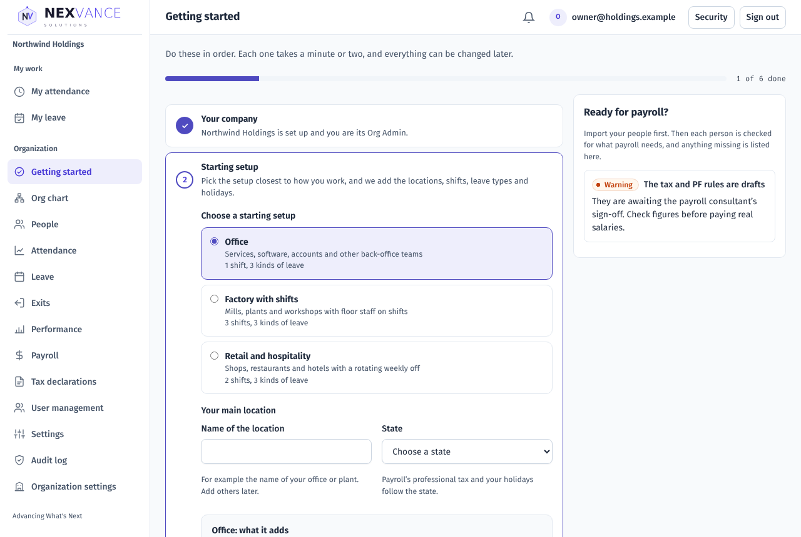

## 2. Users and roles (User management)

### Inviting

Open **User management → Invitations**. Type the email, tick the roles and choose **Create invitation**. Copy the link and send it; the person chooses a password when they open it. Links work for the days set under Settings (7 by default). Roles you are not allowed to give are greyed out. One address has one open invitation at a time; **New link** replaces it and **Revoke** stops it at once.

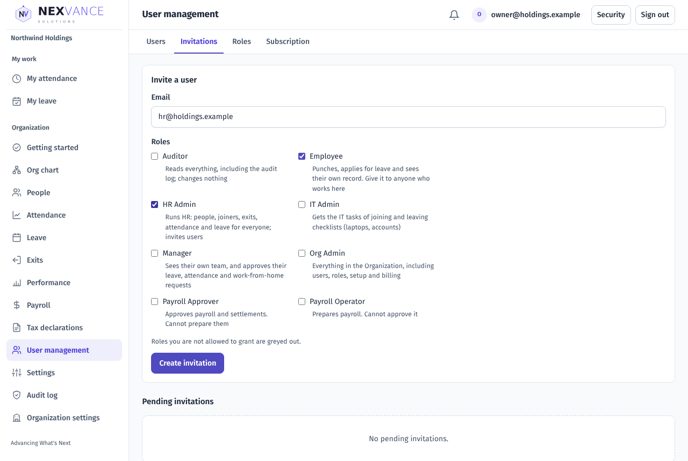

### Users

**Users** lists everyone with their roles, status and last sign-in; filter **Active**, **Suspended** or **Former**, or search by email.

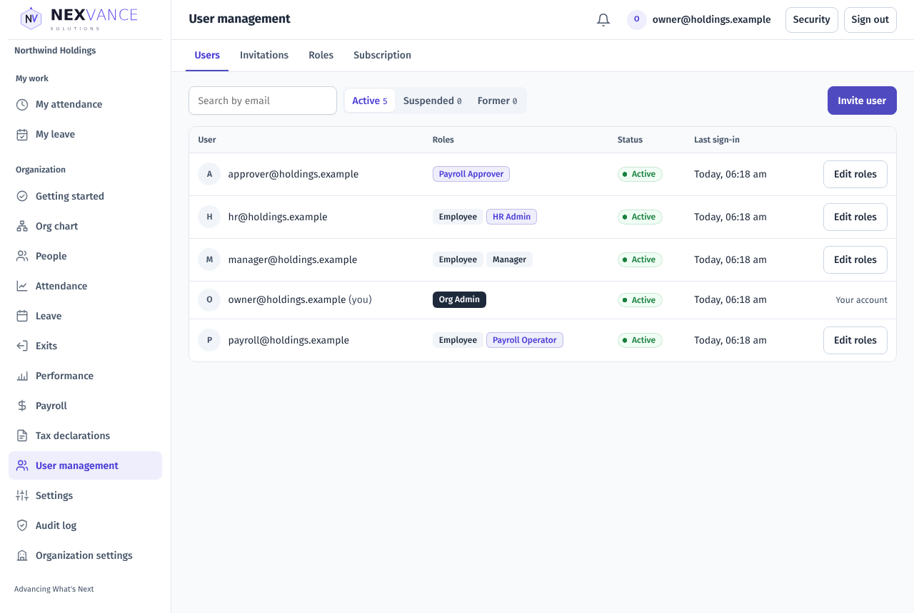

Choose **Edit roles** to change someone's roles (**Save roles**), or to **Suspend** them: a suspended person is signed out at their next click and cannot sign in until you **Reactivate** them. An HR Admin cannot suspend or change an Org Admin.

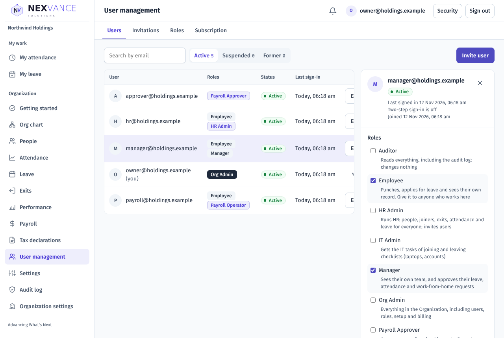

**Roles** describes each role, with its exact permissions under **Exact permissions**. **Subscription** shows the modules your Organization has: Core HR is always included; Attendance, Leave and Payroll are on, on a trial, or not included. Ask the HRMS team to change them; switching a module off hides it and keeps its records.

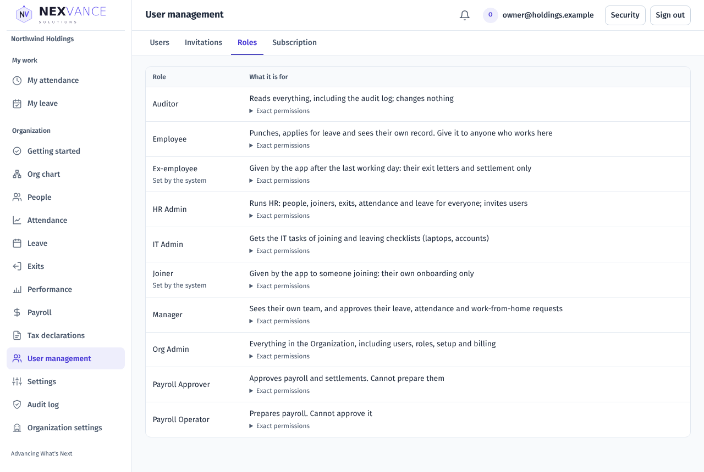

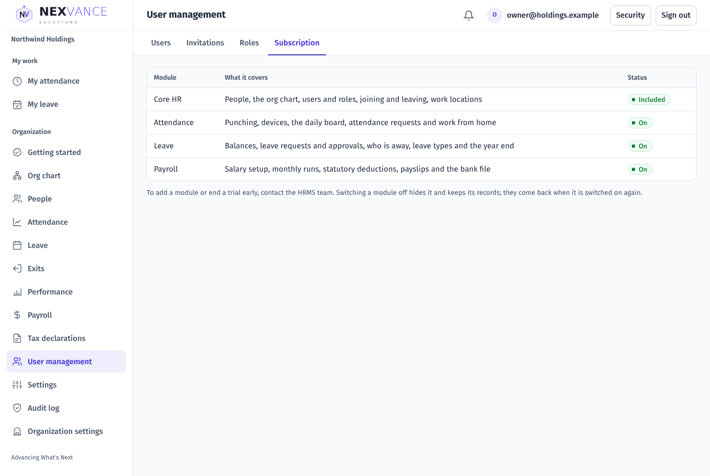

## 3. Security (everyone)

Choose **Security** at the top right.

- **Change your password:** the current one and a new one of at least 12 characters, twice.
- **Change your sign-in address:** the new address and your password; a confirmation link goes to the new address, and the old one gets a link to undo it.
- **Forgot your password?** on the sign-in page sends a reset link.

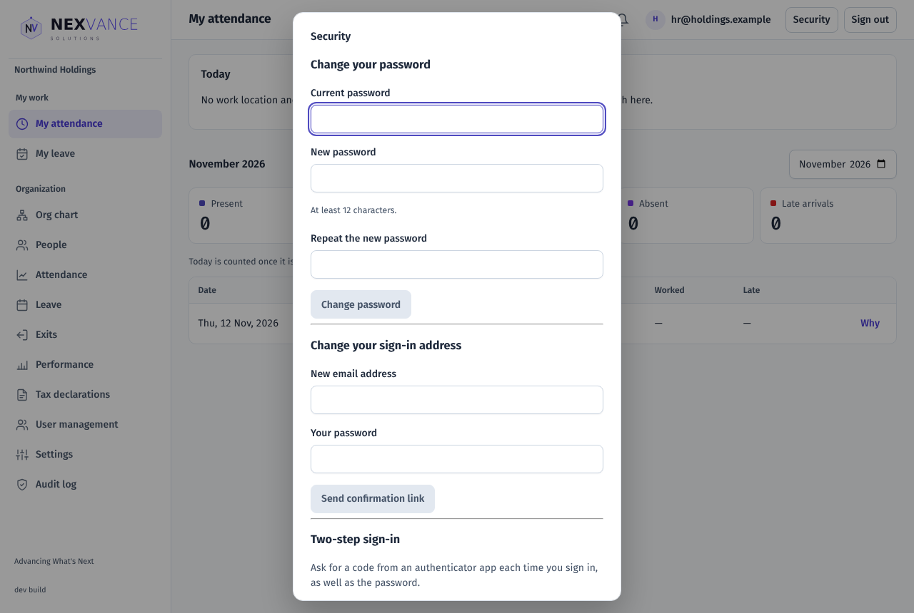

### Two-step sign-in

Choose **Set up two-step sign-in**, scan the code with an authenticator app (Google Authenticator, Microsoft Authenticator, 1Password and others), type your password and the 6-digit code, and choose **Turn on**. Save the ten **recovery codes** shown: each signs you in once if you lose your phone. From then on, signing in asks for the code after the password. **Turn off** needs your password and a code. The Org Admin can make two-step sign-in required (Settings).

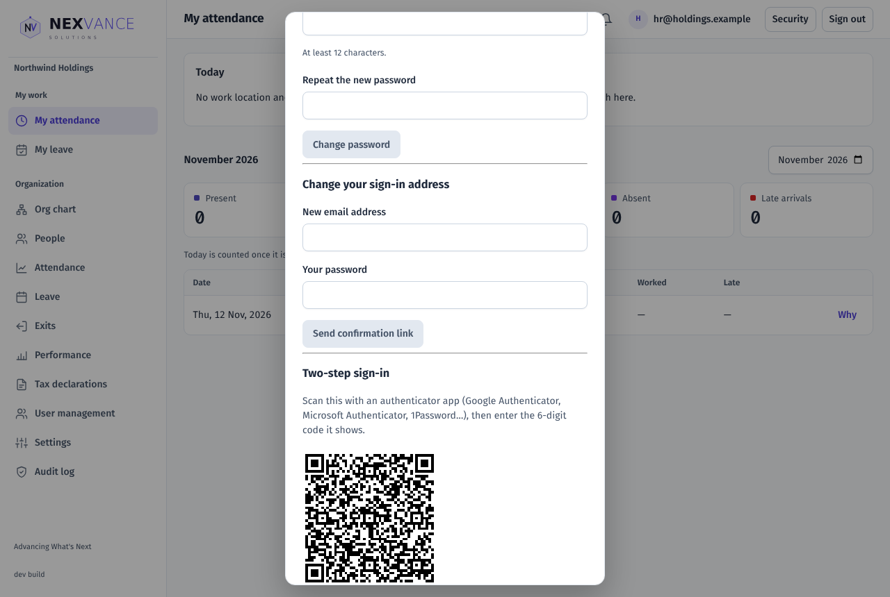

## 4. Settings (Org Admin)

**Settings** shows how the Organization works. Each value says where it comes from (**Default**, or **Set for the Organization** or a location). Choose **Change**, type the value and a reason, and **Save**.

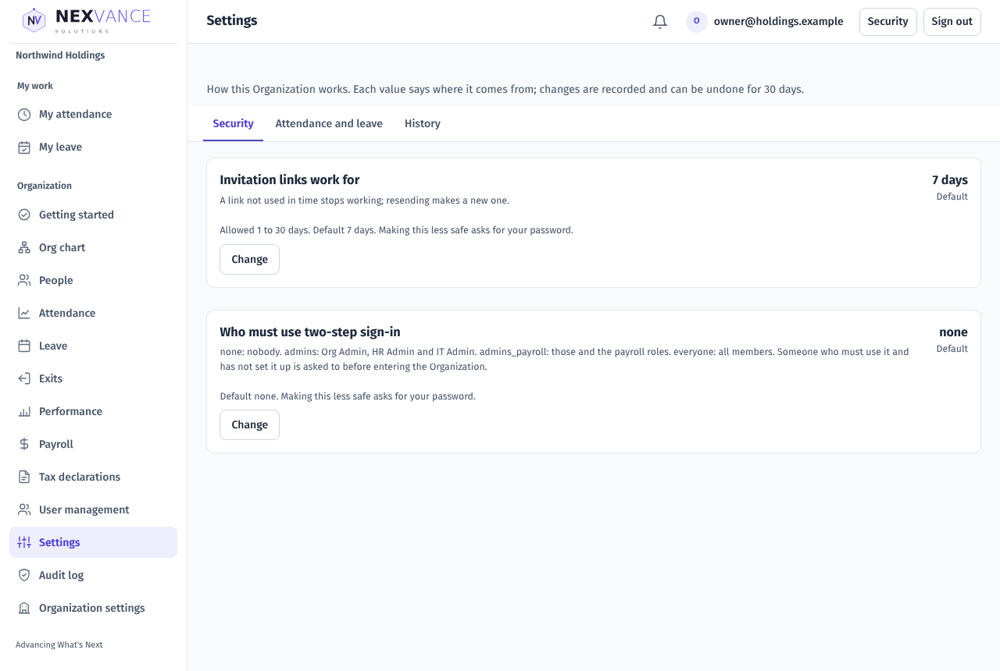

| Tab | Setting | Range | Default |
| --- | --- | --- | --- |
| Security | Invitation links work for | 1 to 30 days | 7 days |
| Security | Who must use two-step sign-in | Nobody; admins; admins and payroll; everyone | Nobody |
| Attendance and leave | How far back and ahead leave and attendance requests can be made | Days, by Organization or location | 31 back; 365 (leave) and 60 (attendance) ahead |

A change that makes the Organization less safe (longer invitation links, fewer people on two-step) asks for your password. **History** lists every change with who made it and why; **Undo** puts a value back within 30 days.

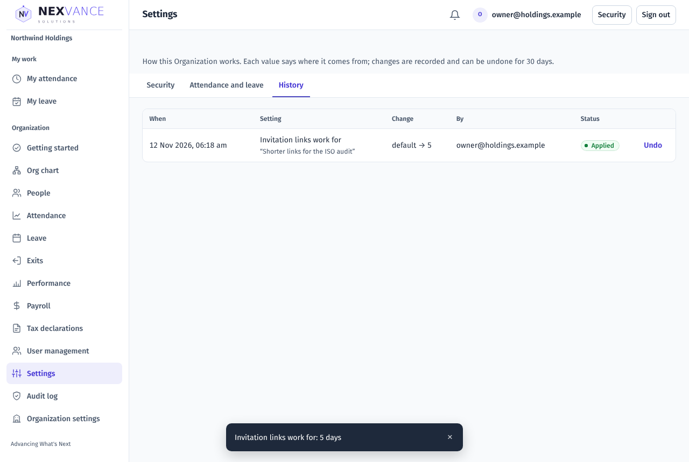

## 5. Organization settings (Org Admin)

- **Logo:** a PNG or JPEG of at most 2 MB, ideally wide, on a transparent or white background. It replaces the Nexvance logo in the sidebar for everyone; the sign-in page keeps the Nexvance logo. **Remove it** brings the Nexvance logo back.
- **Tax certificate layout:** the header line, footer text, who signs and their designation, for the Form 130 certificates. Only Western European letters can be printed. Each save is a new version; certificates already released never change.

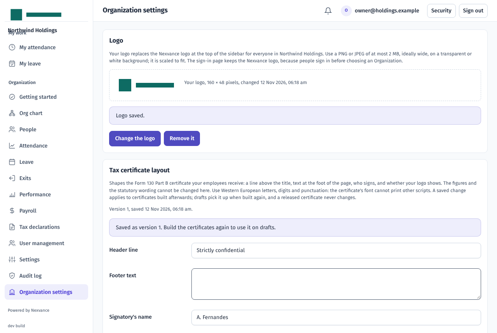

## 6. The audit log (Org Admin, Auditor)

**Audit log** lists the latest 200 events, newest first: when, who, what was done, about whom and the details. Type in **Filter** to narrow it. Platform support sessions are marked **platform support**. Employees have no audit log.

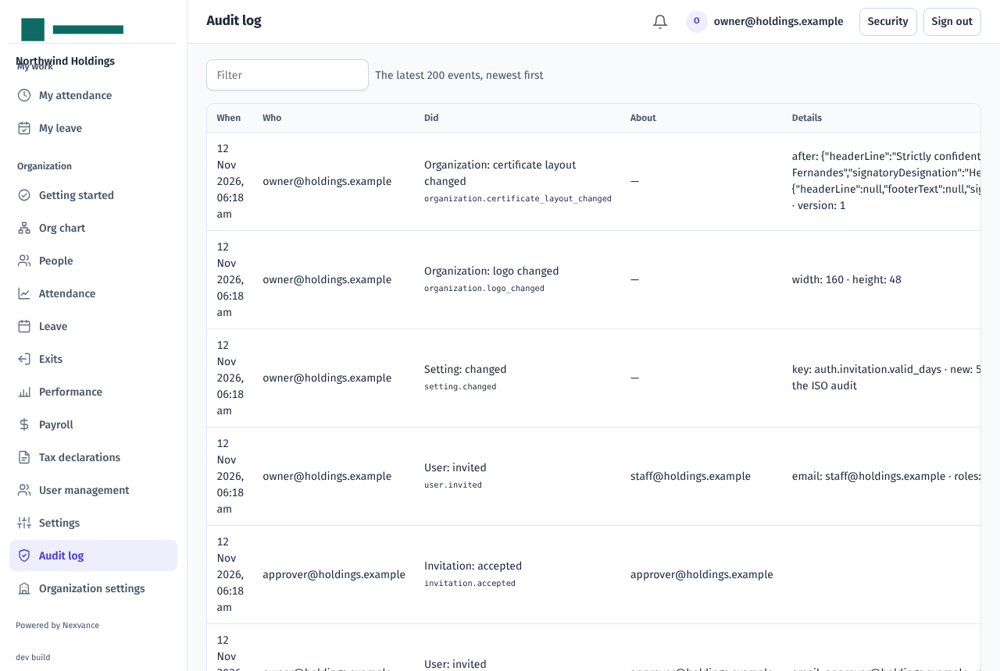

## Common questions

| Problem | What to check |
| --- | --- |
| A role is greyed out when inviting | Only an Org Admin gives Org Admin and the payroll roles. |
| "One user cannot be both Payroll Operator and Payroll Approver" | Give the two roles to different people. |
| Someone cannot sign in | They may be suspended (Users → Suspended), or their invitation expired: send a new link. |
| "The current password is not correct" | Type the password you sign in with now. |
| The new password is refused | Use at least 12 characters. |
| "That code is not right" | Check the phone's clock is right, use the newest code, or a recovery code. |
| A settings change asks for the password | It makes the Organization less safe; confirm with your password. |
| The logo is refused | Use a PNG or JPEG, at most 2 MB, at least 16 pixels. |
| A module's pages are missing | It is not part of the subscription (User management → Subscription). |
