# Attendance: user guide

For customers. How to set up attendance, punch, raise requests, and review the day. The screenshots come from a demo Organization (Northwind Foods); your names and locations will differ.

## Overview

The Attendance module records when people work, turns punches into a daily result (present, half day, absent, leave and so on), and gives managers and HR one place to review and correct the day.

| Role | What you can do |
| --- | --- |
| Employee | Punch in and out, see your own month, raise requests (correction, on duty, work from home) |
| Manager | See your team's day, approve team requests, mark the day where nobody punches |
| HR Admin / Owner | Everything above for all people, plus set-up, devices, file import and manual punches |
| Auditor | View everything, change nothing |

Attendance is switched on per Organization. If you do not see the Attendance menu, ask your administrator to turn the module on. Without it, the work calendar (locations, shifts, holidays) is still available.

## Setting up (HR Admin)

Open **Attendance → Setup** and work through the steps in this order. Then use **People** to assign everyone.

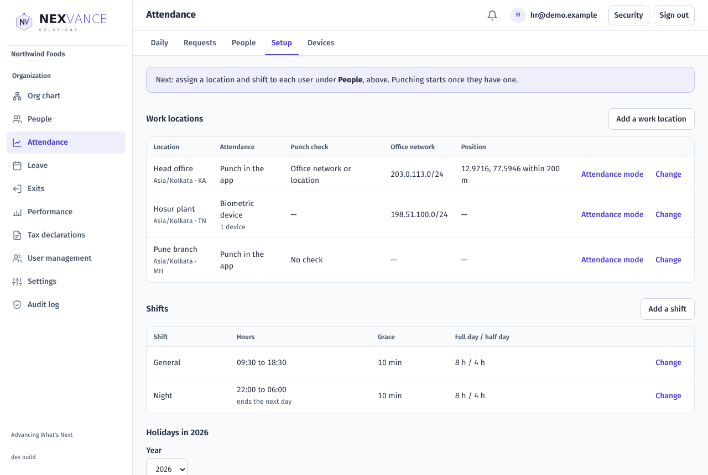

### 1. Work locations

A work location is a place people work, with its own time zone, state and rules. Choose **Add a work location** and fill in:

| Field | What it does |
| --- | --- |
| Name | Shown on the board and in reports |
| Time zone | Decides the day boundaries for people at this location |
| State | Used to pick state holidays |
| Punch check | How a punch in the app is verified (see below) |
| Active | Inactive locations cannot be assigned |

**Punch check options**

| Option on screen | Meaning | Extra fields |
| --- | --- | --- |
| No check | Punch from anywhere | None |
| Office network only | Only from listed IP addresses | Allowed IPs (single addresses or ranges like 203.0.113.0/24; IPv6 allowed) |
| Location only | Only within a radius of a point | Latitude, longitude, radius in metres. **Use where I am now** fills these from your browser |
| Office network or location | Either of the two | Both sets of fields |

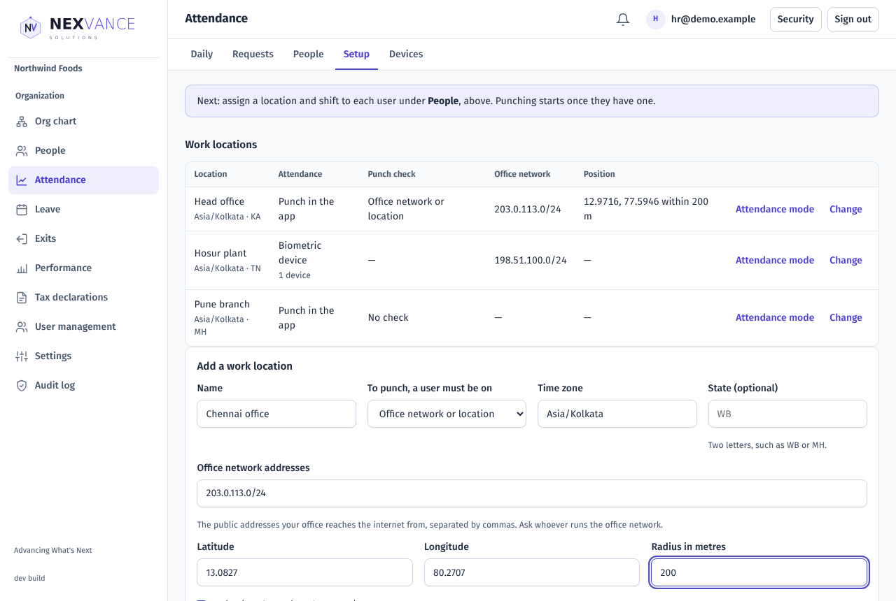

### 2. How attendance is recorded (mode)

Each location has a mode. Use **Attendance mode** on the location row, pick the mode and the date it starts, then **Change how attendance is recorded**. Past days keep the mode they had.

- **Punch in the app**: people punch on My attendance (default).
- **Biometric device**: a biometric or card device sends punches. People at this location cannot punch in the app. See [Devices and file import](#devices-and-file-import-hr-admin).
- **Present by default**: nobody punches; every working day counts as present unless a manager or HR marks an exception.

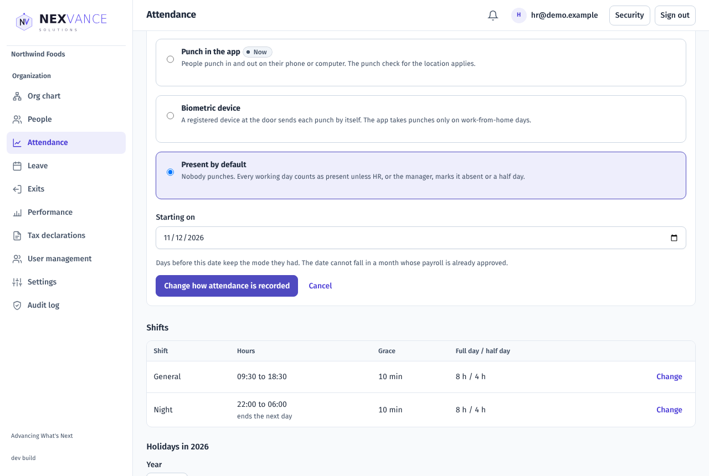

### 3. Shifts

Add a shift with a name, start and end time, **grace minutes** (late is counted only after this), and the minutes that make a **full day** and a **half day**. If the end time is earlier than or equal to the start, the shift ends the next day (for night shifts).

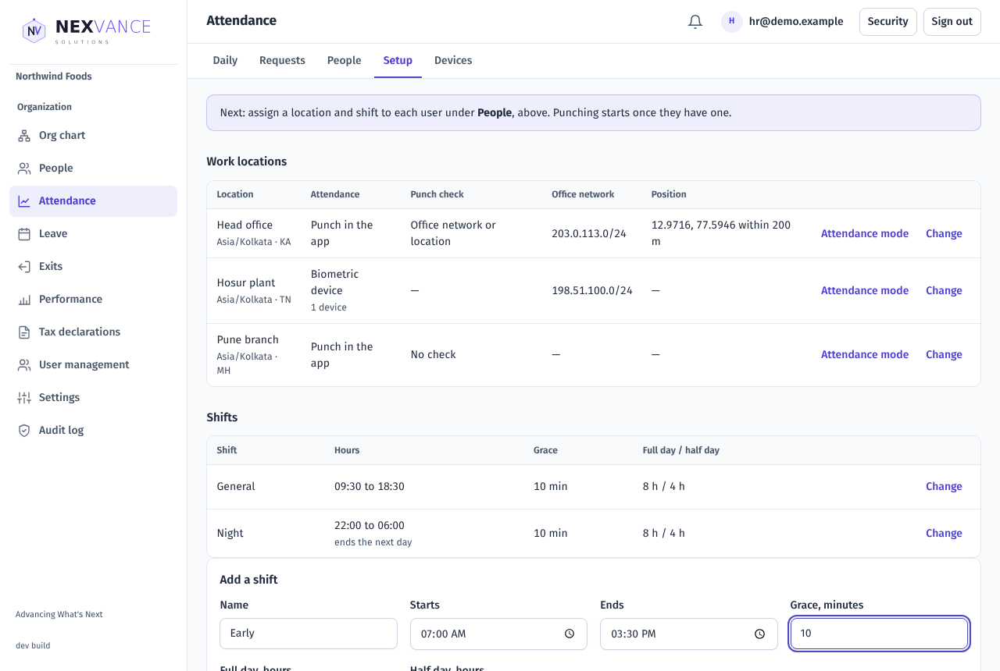

### 4. Holidays

Choose a year, then add a date and name. A holiday can apply to everyone or to one location. People do not need to punch on a holiday.

### 5. Assign people (People tab)

Select people, choose a location and a shift, set the start date, tick **weekly offs** and any **regular remote days**, then choose **Assign**. A future start date schedules a change; assigning again with the same start date corrects it. You can also type an **employee code** next to each person (needed to match device punches and imported files).

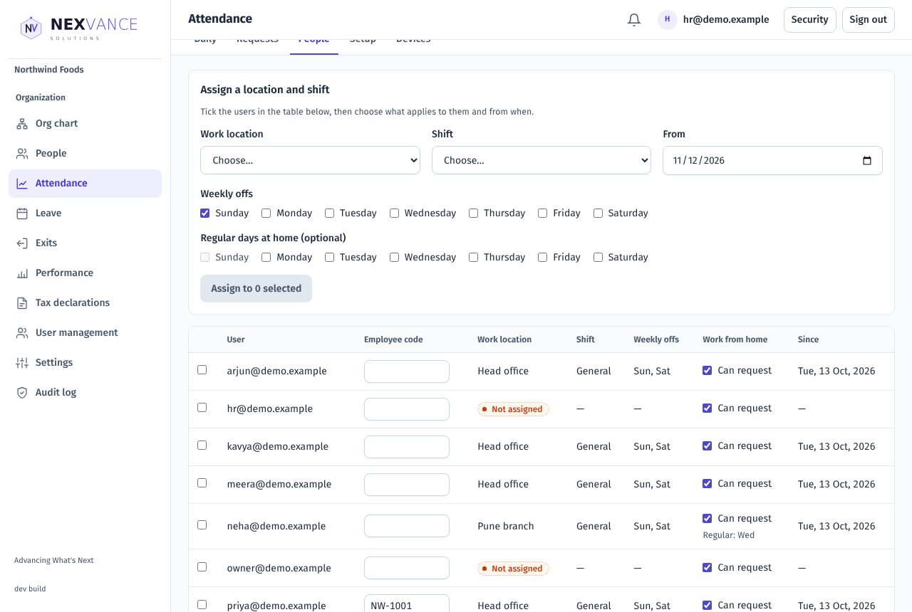

### 6. Work from home

Under Setup, **Work-from-home rules** lets you:

- turn work from home on or off for the Organization;
- require people to still punch on a home day;
- set a limit per week and per month.

In People, each person can be allowed or not allowed to request it. New users are allowed by default, so once you switch work from home on, everyone can request it until you turn it off for them. Regular remote days set at assignment need no request and do not count toward the limits.

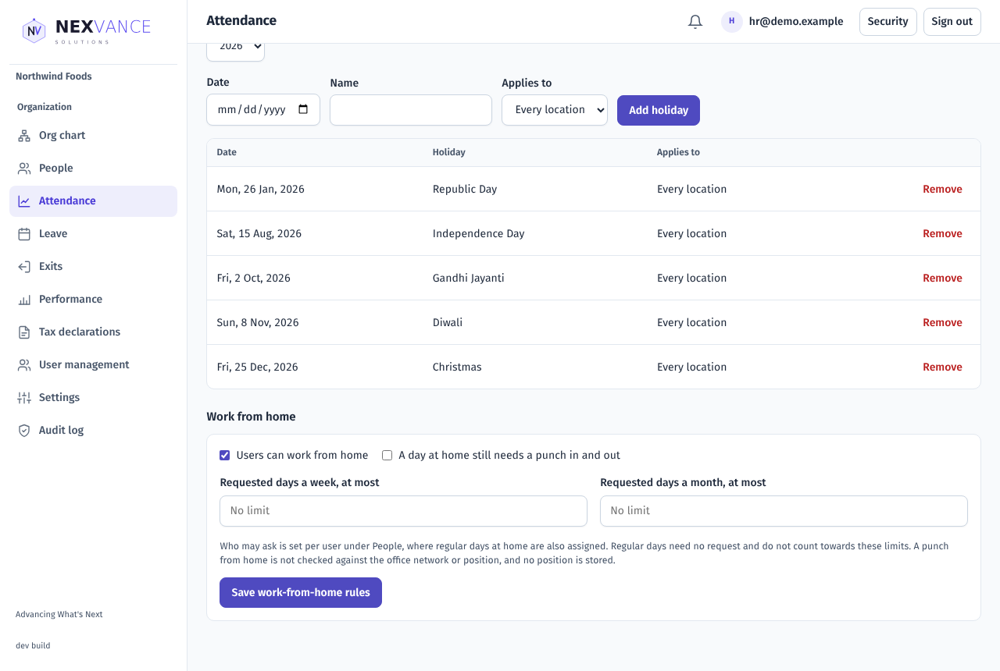

### 7. Request windows

How far back a correction can be raised and how far ahead a request can be made are Organization settings (back days up to 90, ahead days up to 365). A location can override the Organization's value.

## Devices and file import (HR Admin)

Open **Attendance → Devices**.

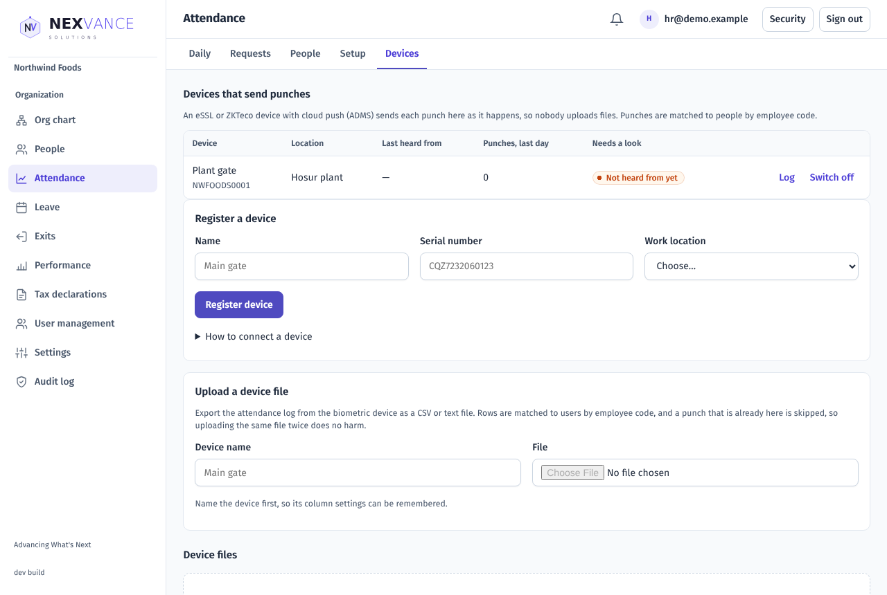

### Register a device

1. Enter a name, the device's serial number (shown under **System info** or **Device info** on the device, and on its back label) and its work location.
2. Choose **Register device**.
3. On the device, open the cloud server settings (usually **Comm. → Cloud Server Setting**, sometimes called **ADMS**). Turn on **Enable domain name** and enter the server address shown under **How to connect a device** on this tab.
4. Use port 443 with HTTPS on if the device offers it; otherwise port 8081 with HTTPS off.
5. Make each person's user ID on the device the same as their employee code in People.
6. Under Setup, set the location's attendance mode to **Biometric device**.

The device list shows when each device was last heard from. A device silent for over a day is flagged. If the location uses an office-network check, a device outside that network is turned away and shown as such. Open a device's **Log** to see every line it sent and what happened to it (taken, already here, unknown employee code, could not be read, or in the future).

Punches are matched by **employee code**, so set codes in People first. In and out alternate in the order punches arrive.

### Import a file instead

If a device cannot connect, upload its export (CSV).

1. Type the device name, then choose the file (up to 5 MB and 50,000 rows).
2. Map the columns: employee code, date and time (one column or two), optional in/out column, date format, and the device's time zone.
3. Choose **Import**. You see how many rows were imported and why the others were rejected.

The mapping is remembered for that device name. Importing the same file twice does not create duplicates. The tables below the form show recent files and how many days behind each device is.

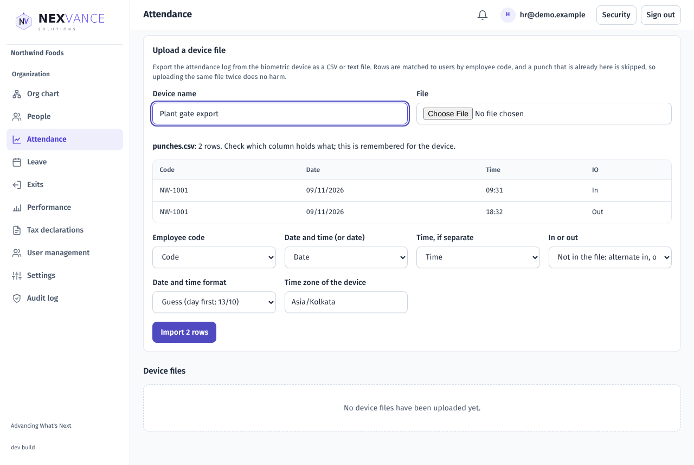

## Everyday use for employees

Open **My attendance**.

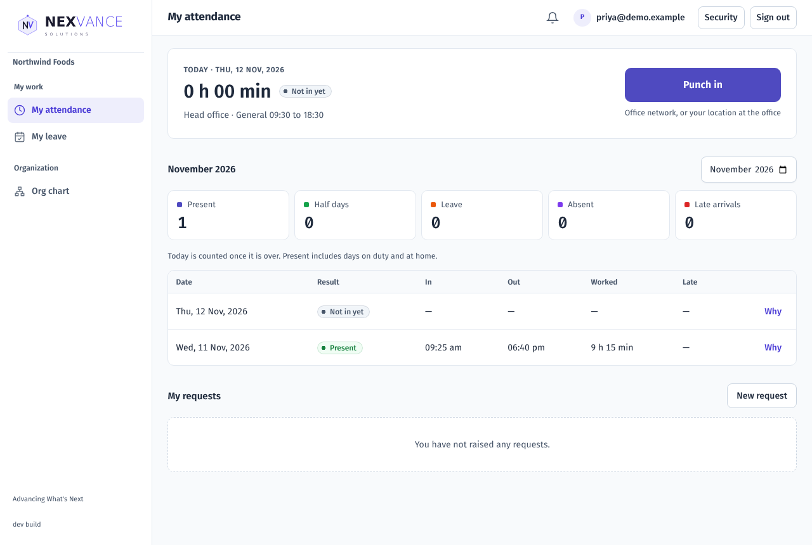

### Punch in and out

Choose **Punch in** when you start and **Punch out** when you finish. A hint under the button tells you what is checked: nothing, your office network, or your location (your browser will ask for permission; choose Allow). Wait a minute between a punch in and a punch out.

### Your month

The tiles show present days, half days, leave, absent days and late arrivals. Use the month picker to look at other months. Choose **Why** on any row to see how that day's result was worked out.

### Raise a request

Choose **New request** and pick a type:

| Type in the form | Use it when | You provide |
| --- | --- | --- |
| Correct my punches | You forgot to punch or the device missed you | Date, in and out times (out after in; only a night shift can end the next day), reason |
| On duty away from the office | You worked away from the office | From and to dates (up to 31 days), reason |
| Work from home | You will work from home | Date or range, reason. For a single day you can choose the first or second half |

Managers and HR see these as Punch correction, On duty and Work from home. Work from home appears only if your Organization allows it for you.

A reason of at least 5 characters is required. Your requests appear in the list with their status (pending, approved, rejected, cancelled). You can cancel a pending request. If a manager rejects one, their note is shown to you. A request cannot be raised for a day outside your Organization's window, and on-duty or work-from-home requests are refused for a day you are on leave. Work-from-home requests also stop at the weekly or monthly limit, and the form shows how much you have used.

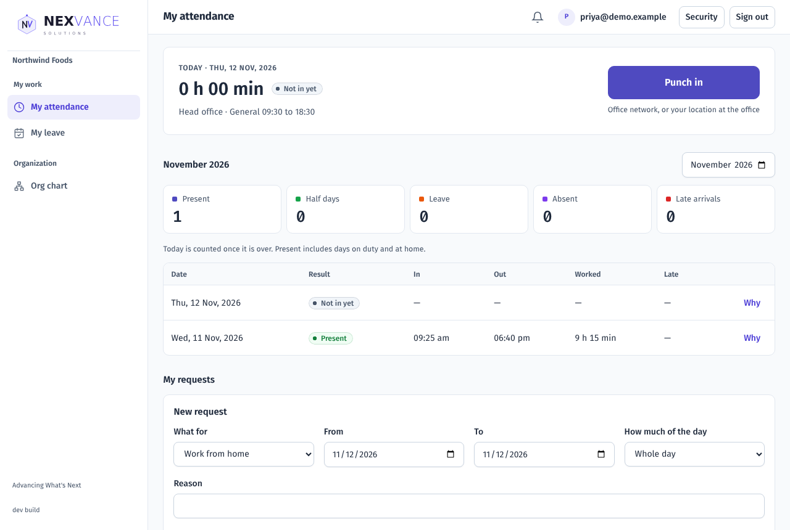

## Managers and HR

Open **Attendance**. Managers see their team; HR Admins and Owners see everyone.

### Daily board

Pick a date (not in the future). Tiles at the top count people by result and add up to the rows below. For today, unfinished days read **Working** or **Not in yet**. Choose **Details** on a row to see the punches and the steps behind the result. HR can download the monthly attendance register from here.

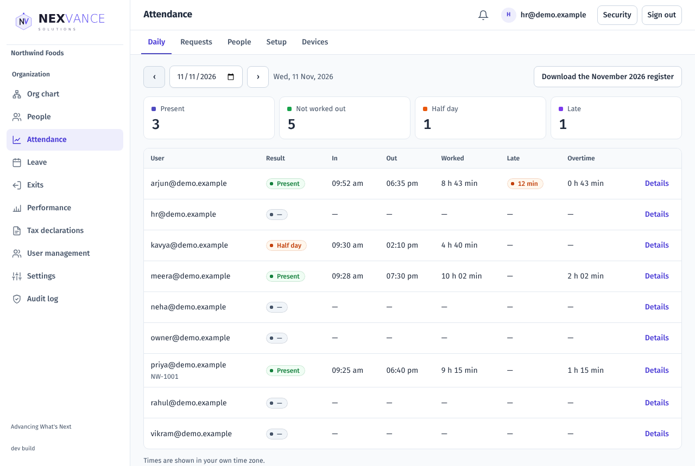

### Review requests

On the **Requests** tab, filter by Pending, Approved or Rejected. Each row shows what the person asked for and what was recorded that day so far. Choose **Approve**, or **Reject** with a note the employee will see. An approved punch correction adds the requested in and out punches to the day; approved on-duty and work-from-home days count as worked. You cannot decide your own request.

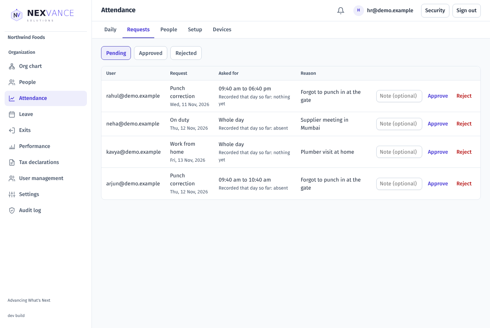

### Add a missing punch (HR)

Open **Details** on a person's row, enter the time, direction and a reason, and choose **Add punch**. The reason is kept in the audit trail.

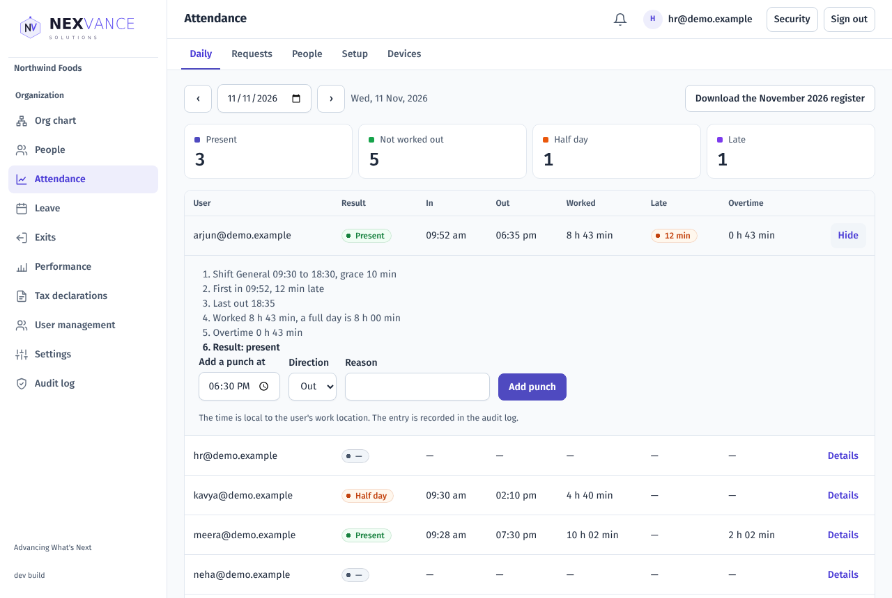

### Mark the day (locations on Present by default)

Where nobody punches, open **Details**, choose **Absent** or **Half day**, give a reason and choose **Save mark**. A later mark replaces an earlier one. To undo a mark choose **Present (take back the mark)**. You cannot mark yourself or a future day, and a reason is required.

### Audit

Changes to locations, modes, shifts, assignments, requests, marks, manual punches and imports are recorded in the audit log with who did them and why.

## How a day is worked out

The first punch in and the last punch out set the hours worked. Worked time is compared with the shift's full-day and half-day minutes.

| Result | When |
| --- | --- |
| Present | Worked at least the full-day minutes |
| Half day | At least the half-day minutes but less than full |
| Absent | Less than the half-day minutes, or no punches |
| Incomplete | A punch in with no punch out |
| Holiday / Weekly off | Set by the location's holidays and the person's weekly offs |
| Leave | Approved leave |
| On duty / Work from home | Approved request |

Late is counted only after the grace minutes. Early leave and overtime are shown against the shift end. Night shifts belong to the day they start. On Present-by-default locations the day counts as present unless marked, and late and overtime are not measured.

## Common questions

| Problem | What to check |
| --- | --- |
| No Attendance menu | The module is off for the Organization. Ask your administrator. |
| No Punch button | Your location uses a biometric device or is Present by default, so you do not punch in the app. |
| "You punched a moment ago" | Wait a minute before punching again. |
| Punch refused | Your location's punch check: use the office network or allow location in your browser. |
| Location permission denied | Allow location for the site in your browser settings and try again. |
| Device punches missing | Is the employee code set in People and the same as the user ID on the device? Is the device registered with the right serial? Check the device Log. |
| Imported rows rejected | Open the Why list on the file row: usually an unknown code or the wrong date format. |
| Cannot raise a request | The date is outside the allowed window, or you are on leave that day. |
| "The out time must be after the in time" | Check the times. Only a night shift can end the next day. |
| Cannot request work from home | It is off, you are not allowed, or you reached the weekly or monthly limit. |
