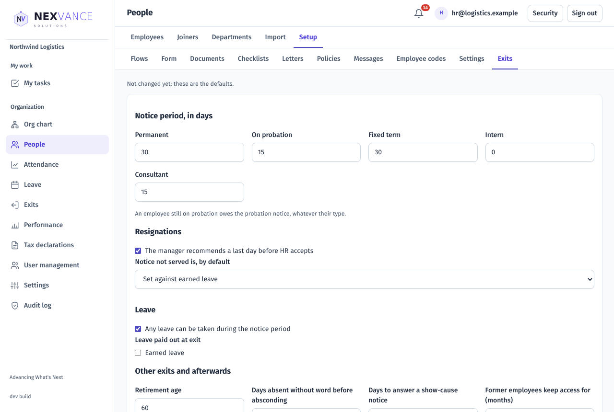
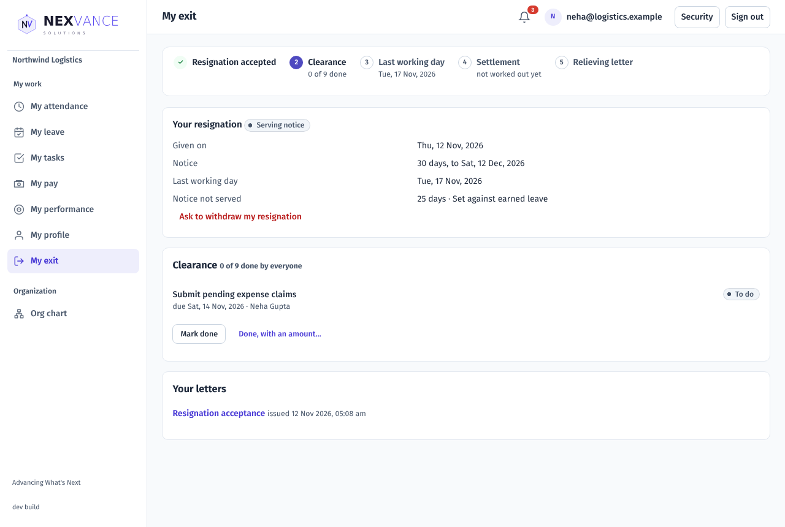
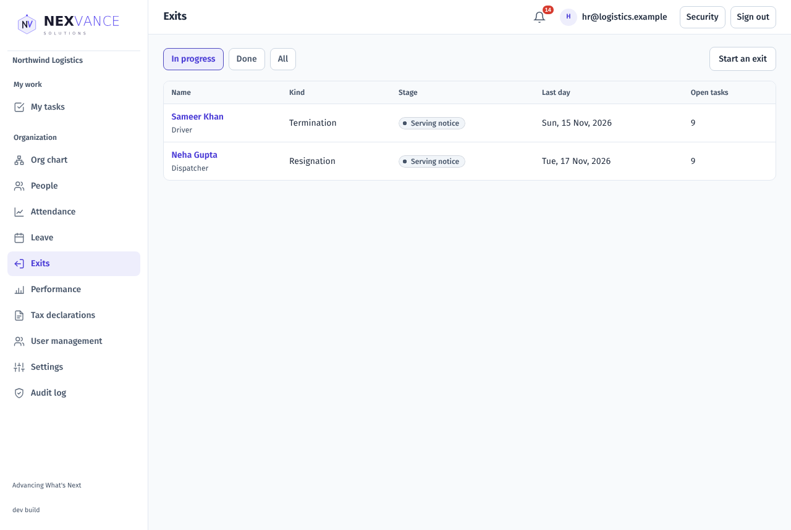
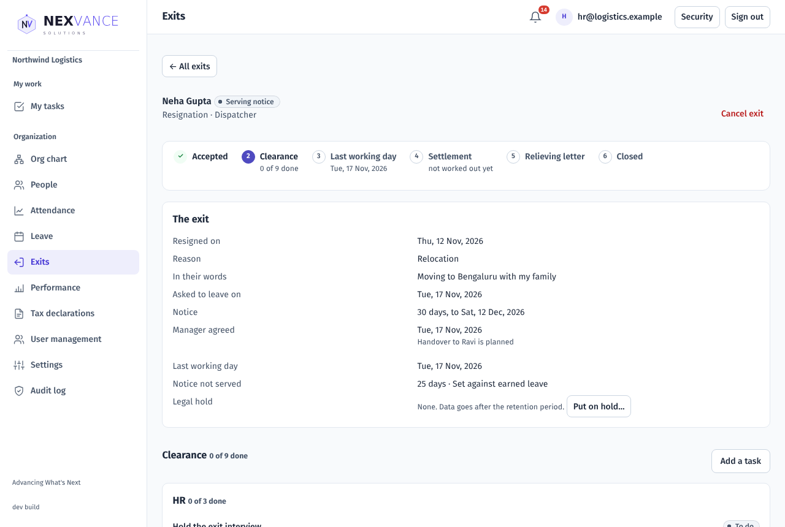
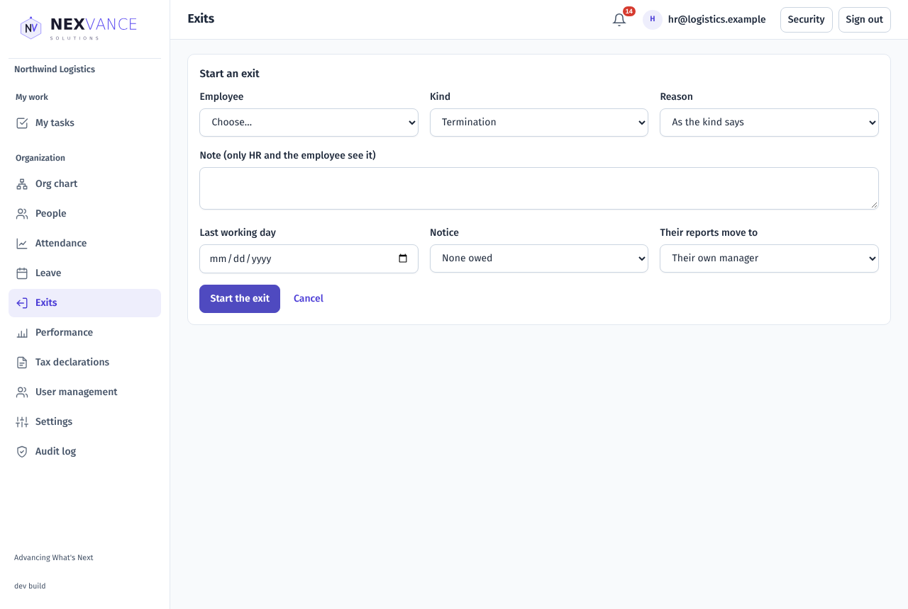
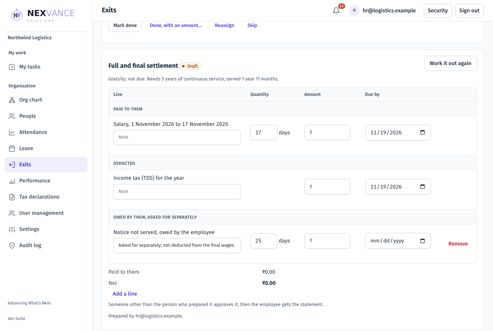
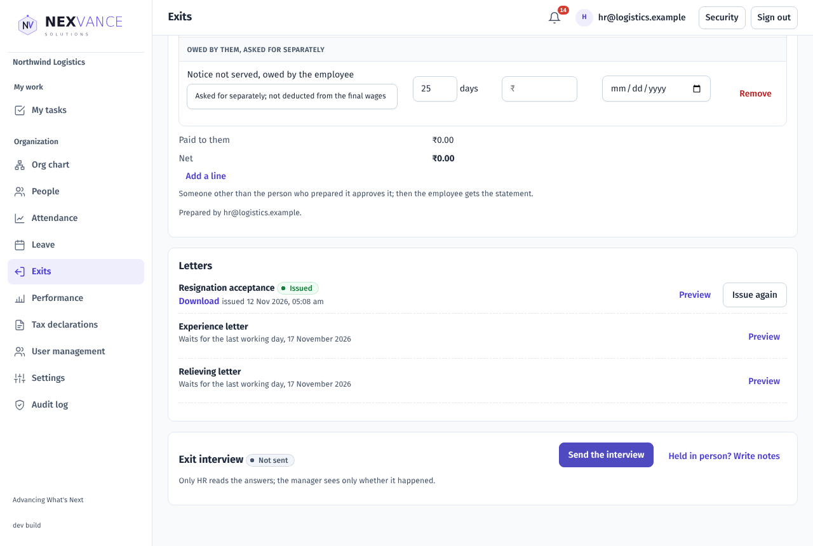

# Exits: user guide

For customers. How people leave: resigning, the manager's recommendation, HR's acceptance, clearance, the full and final settlement, letters, the exit interview and closing. The screenshots come from a demo Organization (Northwind Logistics); your names will differ.

## Overview

Every exit is one record that moves through the same steps: **Accepted → Clearance → Last working day → Settlement → Relieving letter → Closed**. Pay is never held up by clearance; clearance only gates the relieving letter.

| Role | What you can do |
| --- | --- |
| Employee | Resign, see your notice and last day, do your own clearance tasks, read your letters and settlement, answer the exit interview |
| Manager | Recommend a last working day for your team; do the tasks given to you; see whether an interview happened |
| HR Admin / Owner | Accept, start exits of every kind, clearance, settlement, letters, interview, legal hold, closing, and the exit settings |
| Auditor | Read exits; change nothing |

Nobody decides, settles or issues letters for their own exit.

## Exit settings (HR Admin)

Open **People → Setup → Exits**.

| Setting | Choices | Default |
| --- | --- | --- |
| Notice period, per employment type | 0 to 180 days each (permanent, probation, fixed term, intern, consultant) | 30, 15, 30, 0, 15 |
| The manager recommends a last day first | Tick box | On |
| Notice not served is, by default | Set against earned leave · Owed by the employee · Waived | Set against earned leave |
| Leave during notice | Any leave, or only the types you tick | Any leave |
| Leave paid out at exit | Tick the types whose balance is encashed in the settlement | None |
| Retirement age | Years | 60 |
| Days absent without word before absconding | Days | — |
| Days to answer a show-cause notice | Days | — |
| Former employees keep access for | Months | 12 |
| Exit interview questions | Text, answered as a rating 1 to 5, one of some choices (one per line), or their own words | — |

Choose **Save exit settings**.

## Resigning (employee)

Open **My exit**. It shows your notice period. Choose **Resign…**, pick the main reason, the last day you would like, and add a note if you wish, then **Send my resignation**.

Until HR accepts, you can **Withdraw my resignation** at once. After acceptance you can **Ask to withdraw**, with a reason; HR decides. After your last day nothing can be withdrawn.

## Recommending a last day (manager)

Open **Exits**, choose the person and **Recommend**. Pick the last working day; the form tells you how many days that is before the notice ends. Add a note for HR and choose **Send to HR**.

## Accepting and starting exits (HR)

**Exits** lists every open exit with its kind, stage, last day and open tasks.

Open one to see its steps, what the person wrote, the notice and the last working day.

- **Accept** fixes the last working day. If it is before the notice ends, choose how the days not served are settled: the Organization's default, waived, set against earned leave, or owed by the employee. Choose who the person's reports move to. The resignation acceptance letter is issued automatically.
- **Start an exit** records an exit HR begins: termination (notice served, paid in lieu, or none), end of contract, retirement, death, or absconding. HR's exits are accepted at once. One person can have only one open exit.
- **Absconding** can be recorded once the person has been away without word for the days in the settings. Issue the show-cause notice, then the final notice; each gives the reply days. If they come back or reply, cancel the exit.
- **Cancel exit** stops an exit whose last day has not passed, with a reason.
- **Put on hold…** marks an exit under a legal claim (a reason of 5 to 300 characters); its data is then kept past the retention period.

## Clearance

On acceptance, a clearance list is made for HR, IT, Finance, the manager and the leaver, with due dates. Each person finds their tasks under **My tasks** (the leaver under My exit). A task can be marked done with an amount owed by or to the employee; those amounts go into the settlement. Choose **Add a task** for anything extra (a title of up to 120 characters, who does it, when it is due).

## Full and final settlement

In the exit, choose **Work out the settlement**. Lines are worked out from the exit, leave and clearance: salary to the last day, leave encashed, notice pay or notice owed, gratuity where due, reimbursements and recoveries, and income tax. Type each amount (0 if nothing is due), and add other lines with **Add a line**.

Someone other than the person who prepared it chooses **Approve and send the statement**; every line needs an amount first. The employee gets the statement (PDF) in My exit. Then mark each line paid with its date and bank reference (UTR). A paid line cannot change.

## Letters and the exit interview

The **Letters** panel lists each letter for this kind of exit. **Preview** shows it filled in; **Issue** sends it to the person's documents. The relieving letter waits for the last working day and for every required clearance task.

**Send the interview** sends your questions. The employee answers in My exit, or declines. Only HR reads the answers (**Read it**); the manager sees only whether it happened. You can also record notes from a conversation.

## Closing

Once the last day has passed, clearance is done, the settlement is paid and the relieving letter is issued, choose **Close** and say whether the person could be hired again (yes, no or maybe). If something is unfinished, you are told what.

After the last working day the employment ends, the person's reports move to whoever you chose, and their login becomes a former employee's: they can open My exit only, for their letters and settlement, for the months set in the settings.

## Common questions

| Problem | What to check |
| --- | --- |
| HR cannot accept a resignation | It waits for the manager's recommendation first (or turn off the manager step). |
| "This employee already has an exit in progress" | Open the existing exit instead. |
| Leave refused during notice | The leave type is not allowed during notice (Setup → Exits). |
| "Someone other than the person who prepared it must approve it" | Ask another HR Admin or the Org Admin to approve. |
| "Give an amount (0 if nothing is due) for: …" | Type an amount on each line named. |
| The relieving letter cannot be issued | Wait for the last working day and finish the required clearance tasks. |
| "An exit can be closed once the last working day has passed" | Wait for the last day. |
