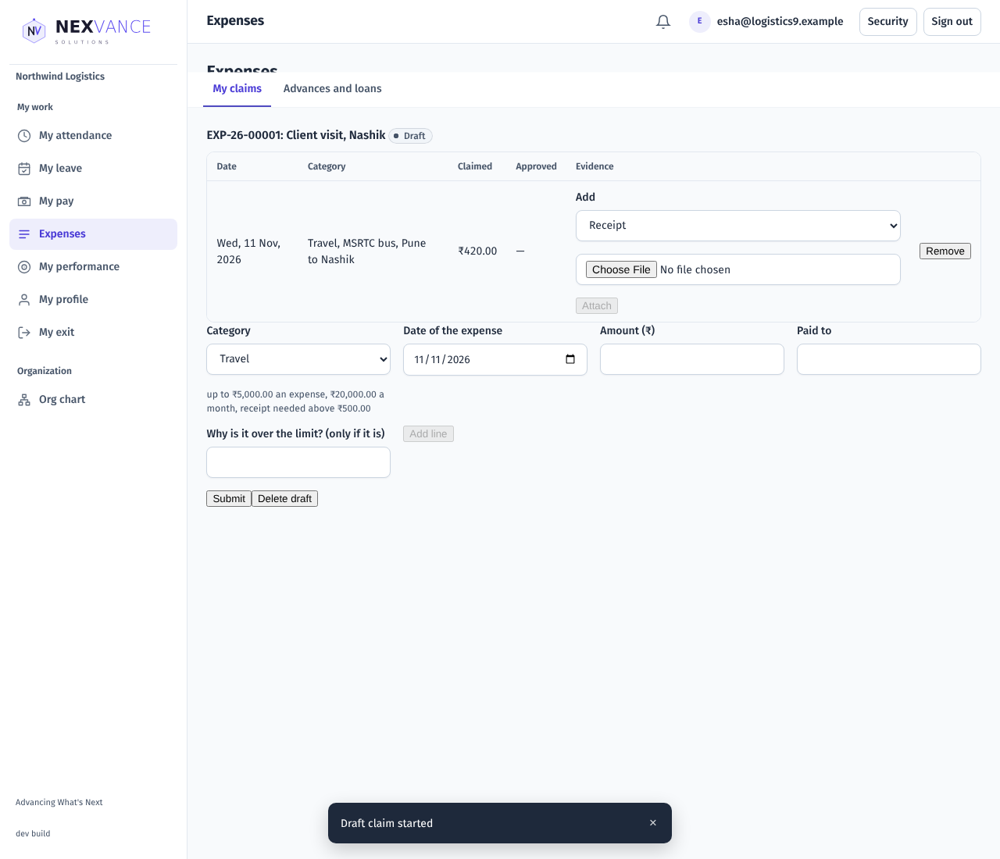
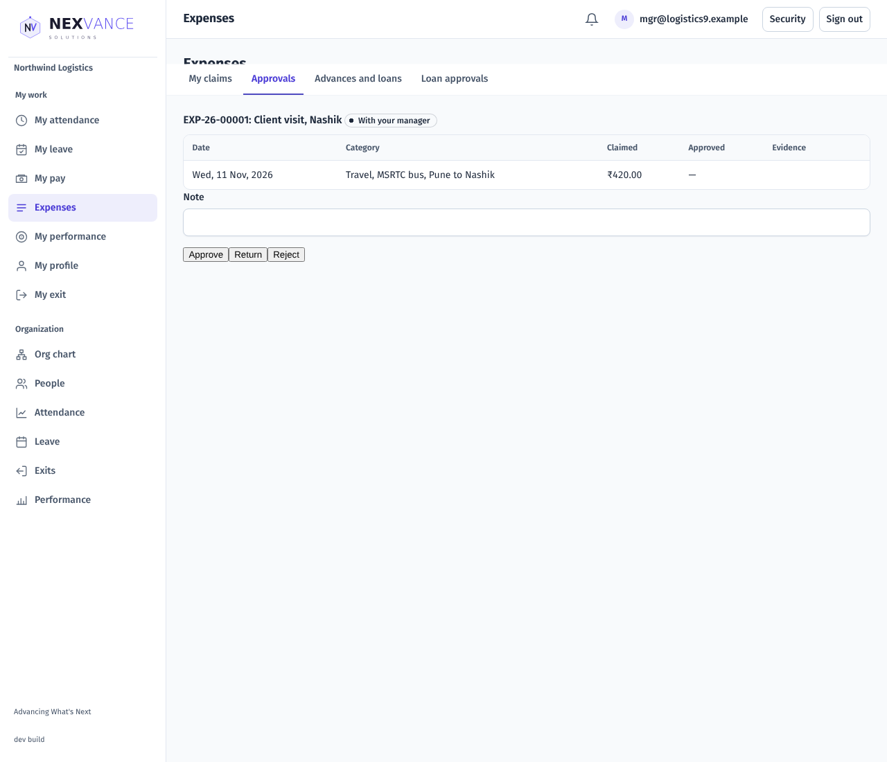
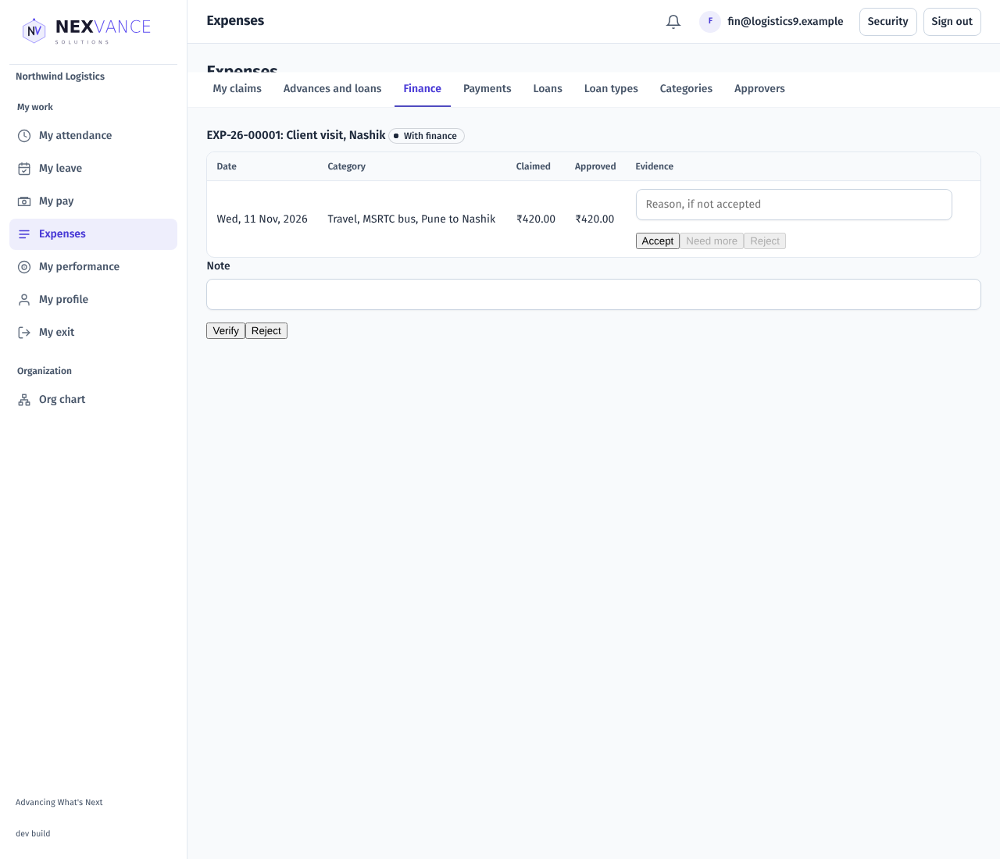
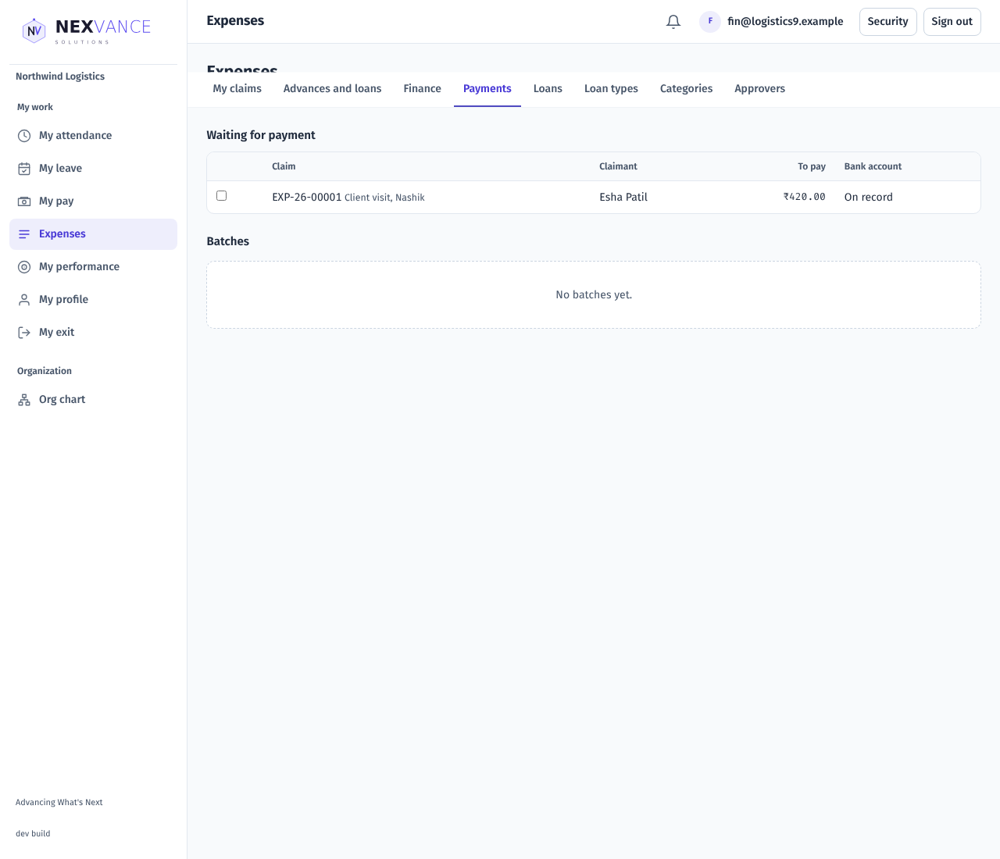
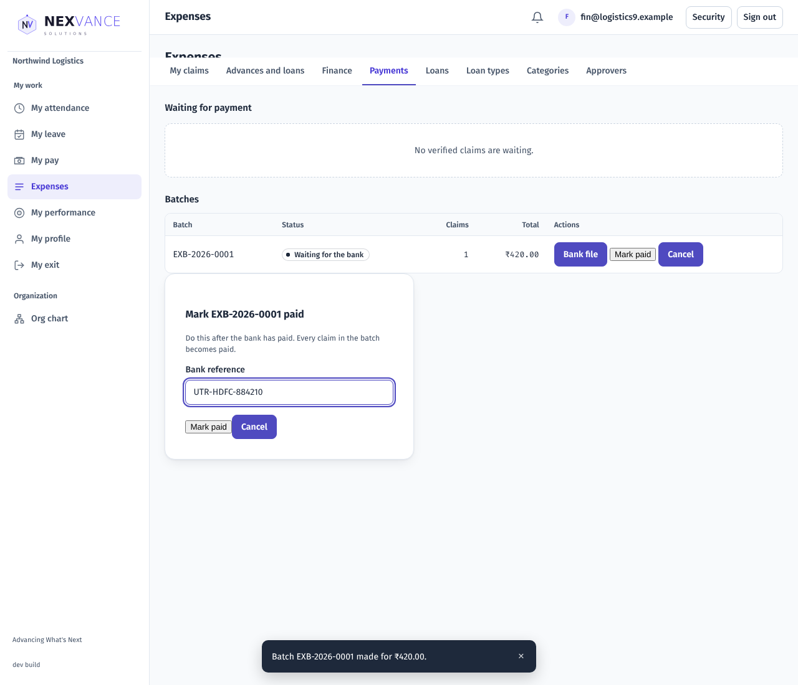
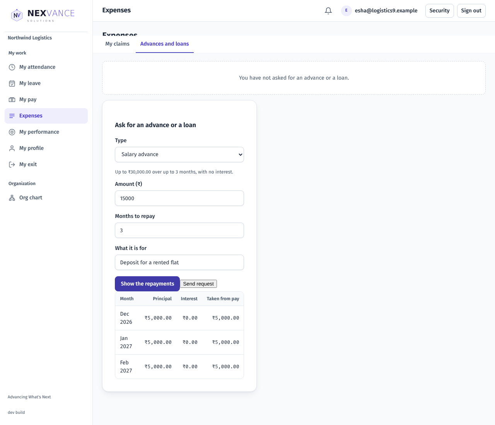
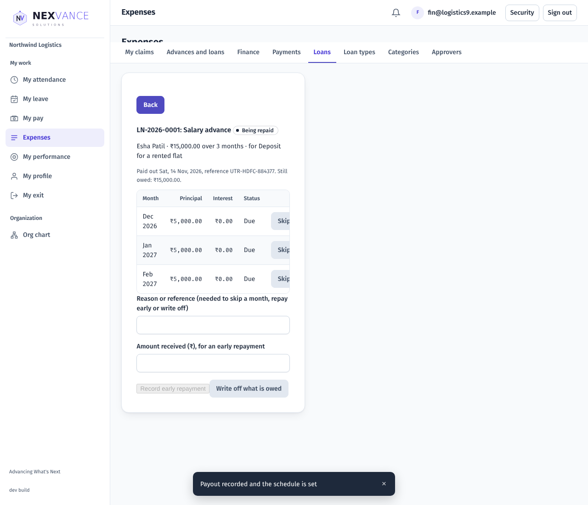
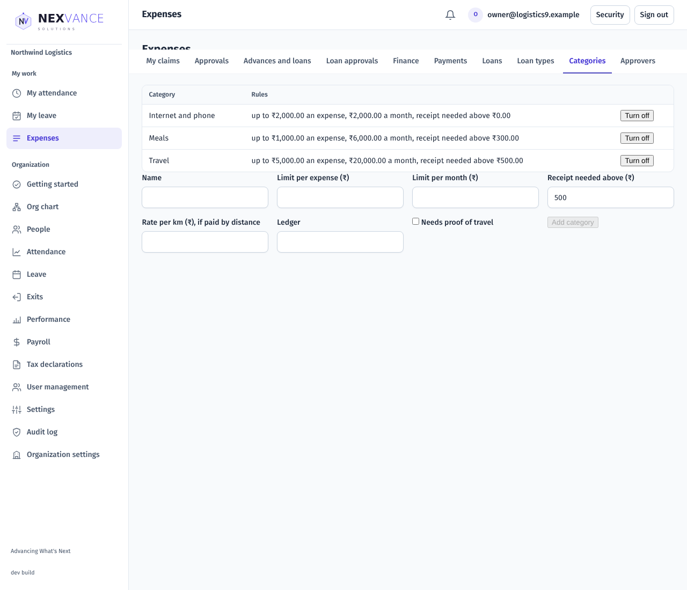
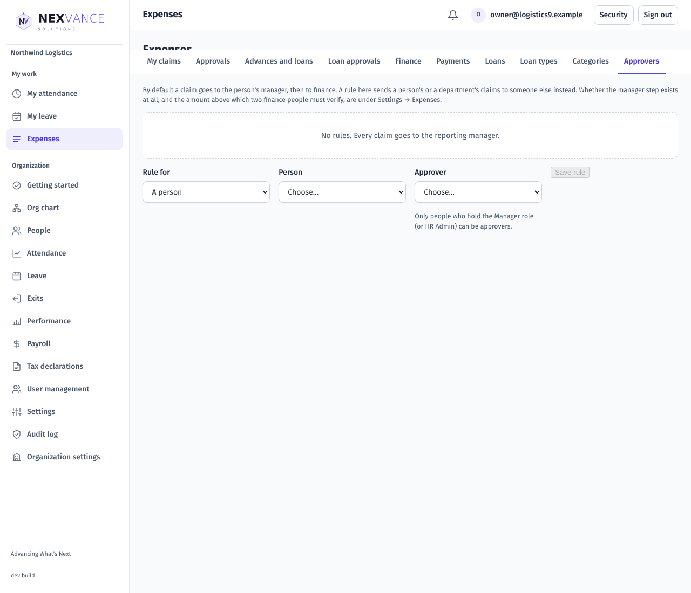
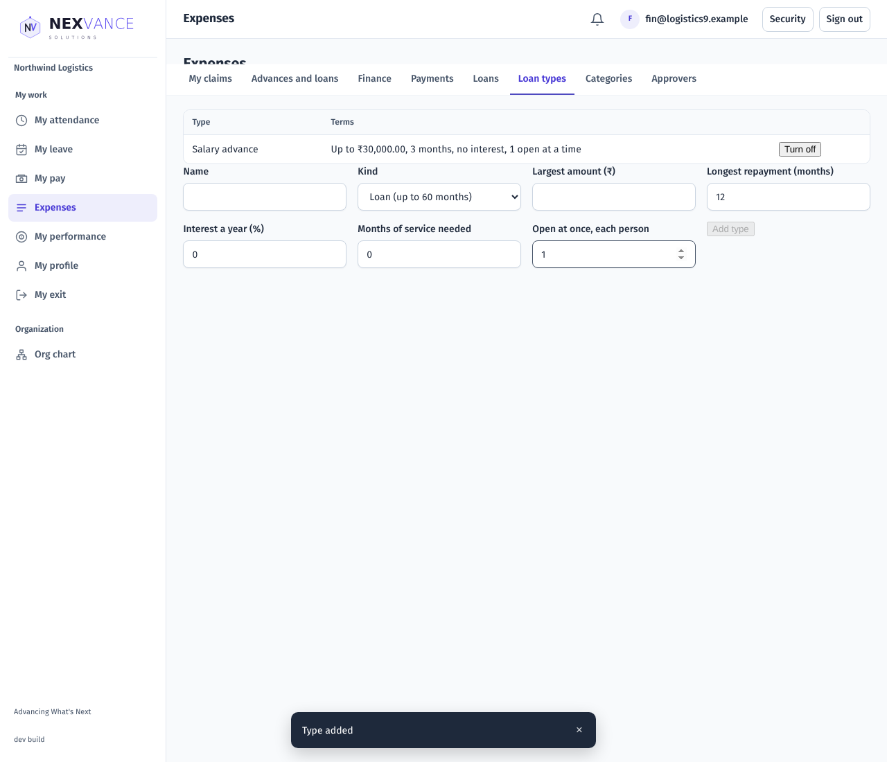

# Expenses, advances and loans: user guide

For customers. How to claim an expense, how it is approved, verified and paid, how to ask for a salary advance or a loan, and how an Organization sets all this up. Open **Expenses** from the menu; the tabs you see depend on your role. Loans and advances need the Payroll module. The screenshots come from a demo Organization (Northwind Logistics); your names will differ.

## Overview

| Role | What it is for |
| --- | --- |
| Employee | Claims expenses; asks for an advance or a loan |
| Manager, or the approver named for a person | Decides claims and loan requests of their people |
| Finance | Verifies claims, pays them, and runs loans (approve, pay out, skip, repay, write off) |
| Org Admin | Everything above, plus categories, approvers and settings. Only an Org Admin can give someone the Finance role |
| HR Admin | Can decide claims and loan requests, like a manager |

Nobody decides their own claim or loan, or puts their own claim into a payment.

## 1. Claiming an expense (My claims)

1. Choose **My claims → New claim** and give it a title.
2. Add a line for each expense: category, date, amount and a note. Attach the **receipt** (bill or invoice). The line tells you before you submit what the category needs: a receipt above its amount, proof of travel, or an approval first.
3. **Submit**. Each line must be within the submission window (60 days by default); older ones are refused with the date.

Warnings do not stop a claim but are shown to every approver: an amount over the category's limit (give a reason), a possible duplicate (same amount, date and category, or the same file), or a receipt date well away from the line date. Until you submit, the claim is a draft you can change or delete. After submitting you can **withdraw** it while nobody has decided it.

A claim can be **returned** with a comment: fix it and submit again. Its status shows at each step: **With your manager**, **With finance**, **Verified**, **Scheduled for payment**, **Paid**, or **Rejected**; a returned claim says **Returned to you**, and one finance wants more evidence for says **Finance needs more**.

## 2. Approving (Approvals)

The approver sees claims waiting for them with the lines, the evidence and any warnings. They can approve, return with a comment, reject with a reason, or **cut** an amount (the line is paid at the lower figure, with a reason). Approvers are the person's manager, unless the Organization has named another approver for a person or a department, or switched the manager step off (see 5).

## 3. Finance

**Finance** lists claims the manager has approved. Finance checks the evidence line by line, then **verifies** the claim, returns it, or rejects it. Where the Organization has set a second finance approver above an amount, a larger claim needs two different people.

**Payments** pays verified claims:

1. Gather verified claims into a batch. Staff with no bank account on record cannot be included.
2. Download the bank file (it asks for a fresh confirmation of your password where required).
3. After the bank pays, **mark the batch paid** with the bank reference (3 to 60 characters). The claims become paid and show the date and reference to the employee.

**Cancel** an open batch to return its claims to verified. Paying claims through the salary run is not built yet; use batches.

## 4. Advances and loans

### Asking (Advances and loans)

Choose a type, an amount and the number of months, and give a reason. **Preview** shows the monthly instalments. A salary advance is 1 to 3 months and carries no interest; a loan can run longer and carries simple interest on the reducing balance. Types have limits on the largest amount, the longest term, months of service needed, and how many you may have open; the screen says which limit stopped you. You can withdraw a request until it is decided.

### Approval and payout

The manager (or named approver) decides first, then Finance (**Loan approvals**, **Loans**). Then Finance records the payout with the bank reference. The schedule is fixed then: equal principal each month plus that month's interest, starting no earlier than the month after the payout.

### Repayment

Payroll takes each instalment from salary as **Loan or advance recovery**. Deductions in a month cannot take more than half of gross pay: the instalment gives way, the payroll run shows a warning, and the rest stays due at the end of the schedule. Approving the run records what was taken. Pay that is held is not settled; its instalments are taken in the run after release.

Finance can also:

- **Skip** a month: the schedule gains a month at the end.
- Record an **early repayment**: the remaining instalments are worked out again over the same months.
- **Write off** the balance with a reason; this needs someone other than the person who paid it out.

### When an employee leaves

The exit settlement shows verified claims not yet paid as an amount to pay, and the loan principal still due as an amount to ask back. These come from Expenses at the time, and refresh when the settlement is prepared again. Amounts HR has typed by hand are kept.

### Tax on cheap loans

A loan charged less than the State Bank of India rate gives the employee a taxable benefit, but only when their loans together are above ₹2,00,000. When it applies, the benefit appears on the payslip as an information line, is included in tax deducted, and shows on the year-end tax certificate as "of which perquisite". Finance can mark a loan exempt (for example, treatment of a specified illness), with a reason and where the evidence is kept. The rate is set once a year (see 5); with no rate set, the payslip warns and no benefit is worked out.

## 5. Setting up (Org Admin and Finance)

| Where | What |
| --- | --- |
| **Categories** | Name, ledger, receipt-above amount, per-kilometre rate, limits, and which evidence is needed |
| **Approvers** | A named approver for a person or a department. The approver must be allowed to approve; a rule that makes someone approve their own claims is refused |
| **Loan types** | Largest amount, longest term, rate, months of service, how many open |
| **Settings** | See below |

Settings (Organization level, changed with your password; weakening some needs a second person):

| Setting | Default | Meaning |
| --- | --- | --- |
| `expenses.submit_within_days` | 60 | How old an expense may be when claimed |
| `expenses.manager_step` | on | Claims go to the manager before Finance |
| `expenses.second_finance_above` | 0 (never) | A second finance approver above this many rupees |
| `expenses.when_no_approver` | refuse | What to do for a person with no manager or approver: refuse, or send to finance |
| `loans.perquisite_rate_bp` | 0 | State Bank rate in hundredths of a percent (940 is 9.40%), from 1 April. Ask your payroll consultant for the figure |

## Questions to settle with your payroll consultant

- Whether the half-of-pay limit counts gross pay or "wages" under the Code on Wages, and whether a voluntary instalment counts toward it.
- Whether a loan balance is asked for separately at exit (as built) or taken from final wages.
- The State Bank rate to enter, and the ₹2,00,000 threshold.

## Still to come

Payment of claims through the salary run; a second finance approver for large loans; expense advances set against claims; alerts for instalments carried two months.
