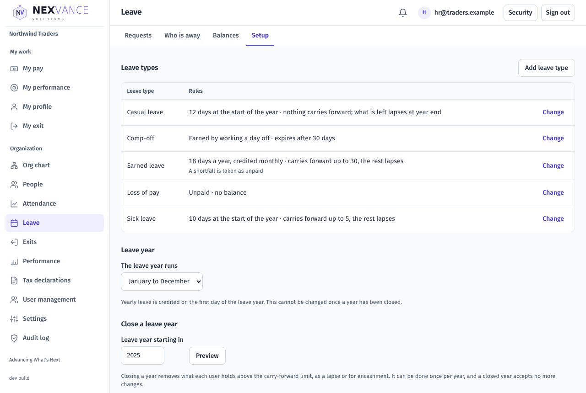
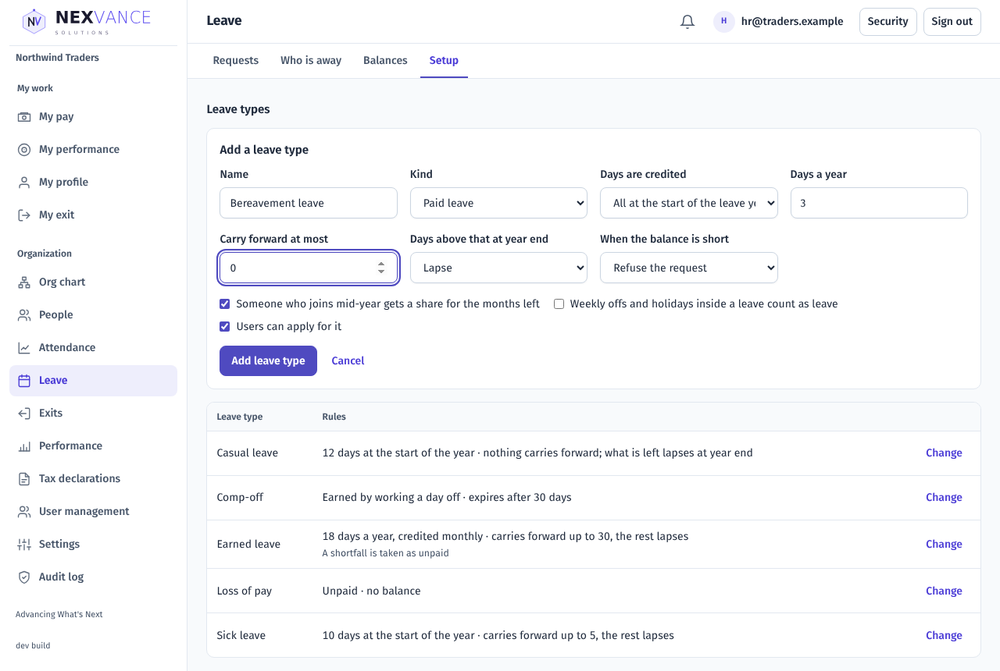
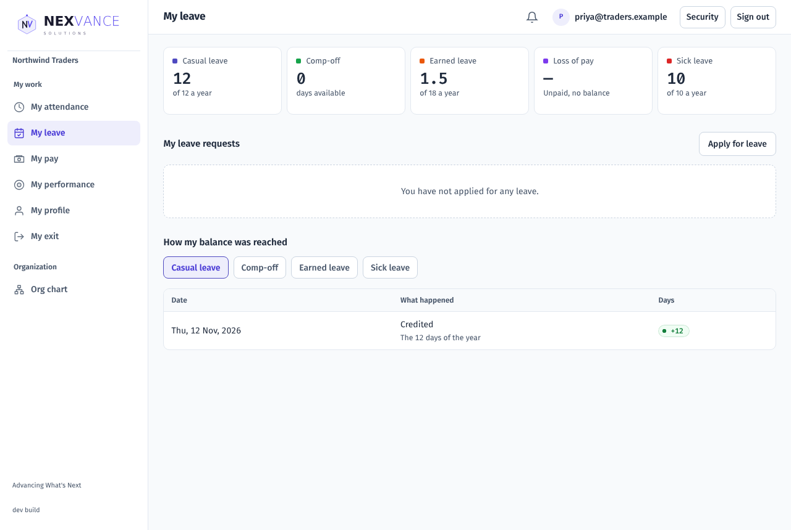
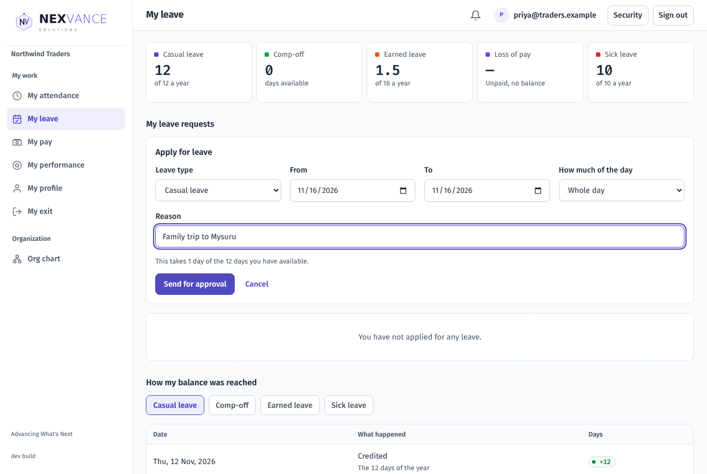
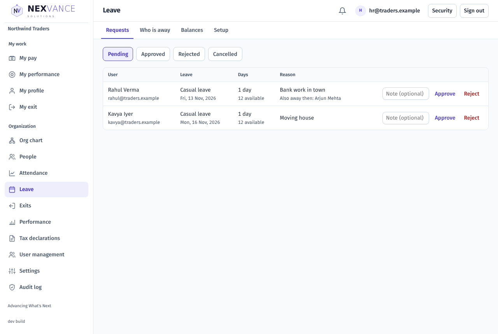
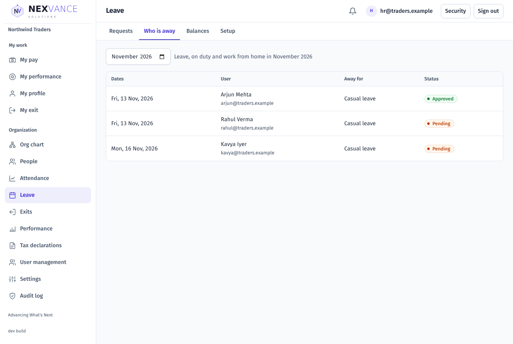
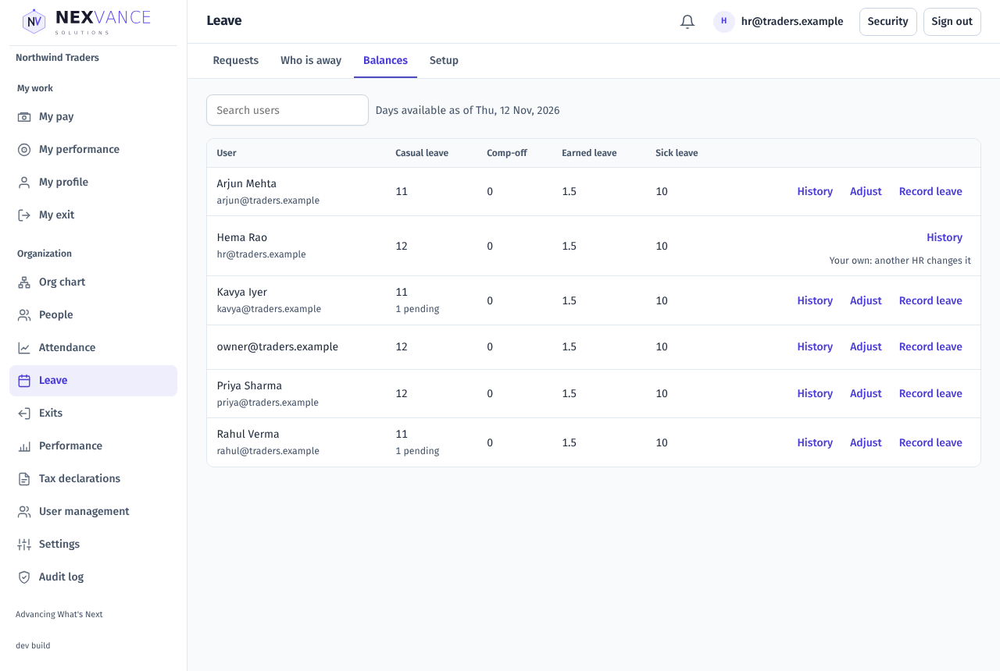
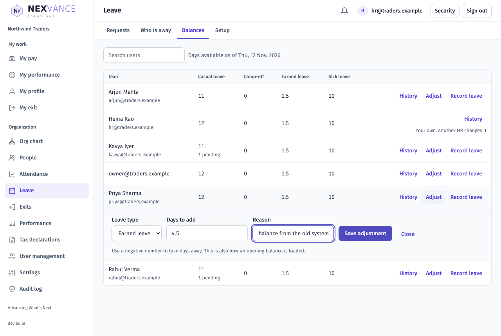
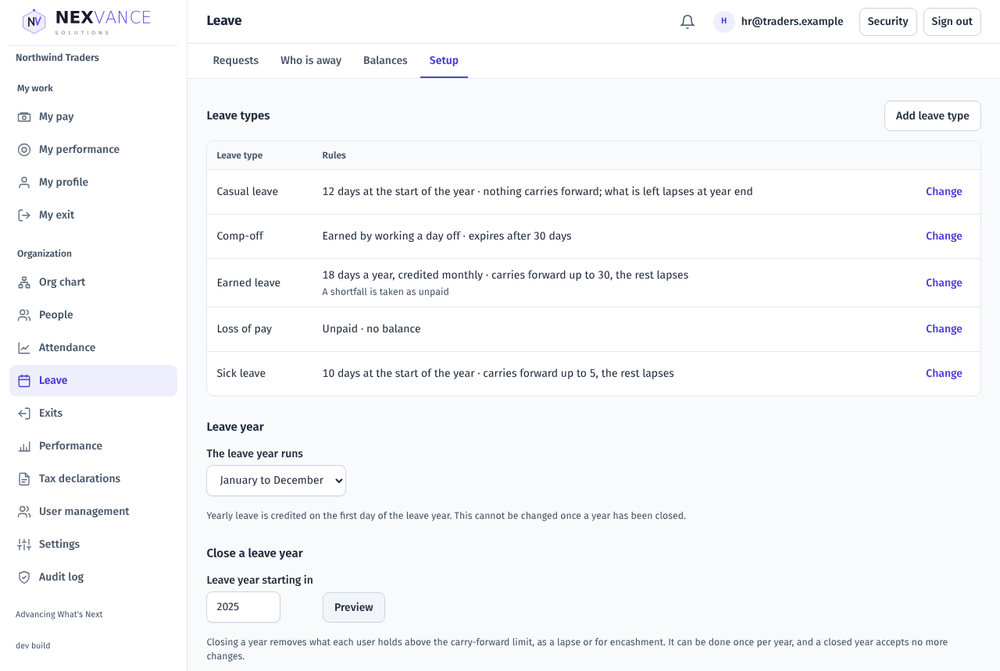

# Leave: user guide

For customers. How to set up leave types, apply for leave, approve it, and keep balances right. The screenshots come from a demo Organization (Northwind Traders); your names and leave types will differ.

## Overview

Leave keeps a balance for each person and leave type, lets people apply with a live count of the days, and sends each request to the right approver. An approved leave shows as "On leave" on the attendance board.

| Role | What you can do |
| --- | --- |
| Employee | See your balances and how they were reached; apply for leave; cancel it |
| Manager | Approve or reject your team's leave; see who is away |
| HR Admin / Owner | Everything above for everyone, plus leave types, the leave year, adjustments, leave recorded for someone, comp-off and closing a year |
| Auditor | See everything, change nothing |

Leave is part of the **Attendance & Leave** subscription. If you do not see **Leave** or **My leave** in the menu, ask your administrator. Each person also needs a work location and shift (under Attendance → People), because leave counts working days.

## Setting up (HR Admin)

Open **Leave → Setup**.

### Leave types

Choose **Add leave type** and fill in:

| Field | Choices | What it does |
| --- | --- | --- |
| Name | Up to 60 characters, unique | Shown to employees |
| Kind | Paid leave · Unpaid leave (loss of pay) · Comp-off | Unpaid leave has no balance; every day of it is unpaid. Comp-off is earned by working a day off. The kind cannot change later |
| Days are credited | All at the start of the leave year · A part each month · Only when HR adds them | How the balance grows |
| Days a year | 0 to 366, in whole or half days | Needed unless credited only by HR |
| Carry forward at most | Empty for no limit, or a number | What a person keeps into the next leave year |
| Days above that at year end | Lapse · Are marked for encashment | What happens to the rest when you close the year |
| When the balance is short | Refuse the request · Take the rest as unpaid | Whether someone can go below zero |
| Expires after (days) | 1 to 366, comp-off only | How long an earned comp-off day lasts |
| Someone who joins mid-year gets a share for the months left | Tick box | Prorates the yearly credit for joiners |
| Weekly offs and holidays inside a leave count as leave | Tick box | Normally only working days count |
| Users can apply for it | Tick box | Untick to retire a type without losing its history |

Each type shows its rules in plain words in the list. Choose **Change** to edit one.

### The leave year

**The leave year runs** January to December or April to March. Yearly credits arrive on the first day of the leave year. You cannot change this once you have closed a year.

### How far back and ahead people can apply

Two Organization settings under **Settings → Attendance**: how far back (0 to 90 days, default 31) and how far ahead (30 to 730 days, default 365) employees may apply. HR can record older leave for someone (see below).

## Everyday use for employees

Open **My leave**.

Each tile shows what you have available and how much is waiting for approval. Choose a leave type under **How my balance was reached** to see every credit, leave taken, adjustment and year-end entry.

### Apply for leave

1. Choose **Apply for leave**.
2. Pick the leave type and the dates. For a single date you can take the first or second half.
3. The form tells you how many days the leave takes and what you have available. Weekly offs and holidays inside the dates are not counted, unless your Organization counts them for that type.
4. Give a reason (at least 5 characters) and choose **Send for approval**.

The request is refused when:

- you do not have enough balance and the type does not allow unpaid days;
- you already have leave on one of those dates;
- the dates are all days off;
- the dates are outside the allowed window;
- you are serving notice and that type is not allowed during notice.

### Cancel

You can cancel a request that is waiting, or an approved leave that has not started. The days go back to your balance. Once a leave has started, ask HR to cancel it.

## Approving leave (managers and HR)

Open **Leave → Requests**. Managers see their team; HR sees everyone.

Each row shows the days, the person's available balance (with a **not enough** badge if it no longer covers the request), and who else is away then. Add an optional note, then **Approve** or **Reject**. A rejection asks you to confirm, and the note is shown to the employee. Nobody can decide their own leave.

Use the **Approved**, **Rejected** and **Cancelled** filters to look back. HR can cancel someone's approved leave from the Approved list with **Cancel this leave**, even after it has started; the days are returned.

### Who is away

**Leave → Who is away** lists leave, on-duty days and work-from-home days in the month you pick.

## Balances (HR)

**Leave → Balances** has a row per person and a column per leave type. Search by name or email.

On each row:

- **History** shows how that person's balance was reached.
- **Adjust** adds or takes away days with a reason. Use a negative number to take away. This is also how you load opening balances from an old system.
- **Record leave** enters leave for the person, approved straight away, for any date in a leave year that is still open.

You cannot adjust your own balance or record your own leave; another HR person does that.

### Comp-off

When someone works on a weekly off or a holiday, the day appears under **Days off that were worked** on the Balances tab (last 90 days). Choose **Grant** to add it to their comp-off balance: one day if they worked a full day, half a day otherwise. Each day can be granted once, and only a day off that was actually worked can be granted. Unused comp-off expires after the days set on the comp-off type.

## Closing a leave year (HR)

At the end of a leave year, open **Leave → Setup → Close a leave year**, pick the year and choose **Preview**. You see the days that will lapse, the days to encash, and each person above the carry-forward limit. Nothing changes until you choose **Close this leave year…** and confirm.

A year can be closed once it has ended and no request in it is still waiting. After that, nothing dated in the closed year can be added or cancelled; a late correction is an adjustment in the open year.

## Common questions

| Problem | What to check |
| --- | --- |
| No Leave menu | The Attendance & Leave module is off. Ask your administrator. |
| "No leave types are set up yet" | HR adds them under Leave → Setup. |
| "No work location and shift are assigned" | HR assigns one under Attendance → People. |
| "Those dates are all days off" | The dates are weekly offs or holidays; no leave is needed. |
| Not enough balance | Apply for fewer days, choose another type, or ask HR. |
| "There is already leave on one of those dates" | Cancel or change the other leave first. |
| "This leave has started" | Ask HR to cancel it. |
| A manager does not see a request | The person's manager is set on their employee record (People). |
