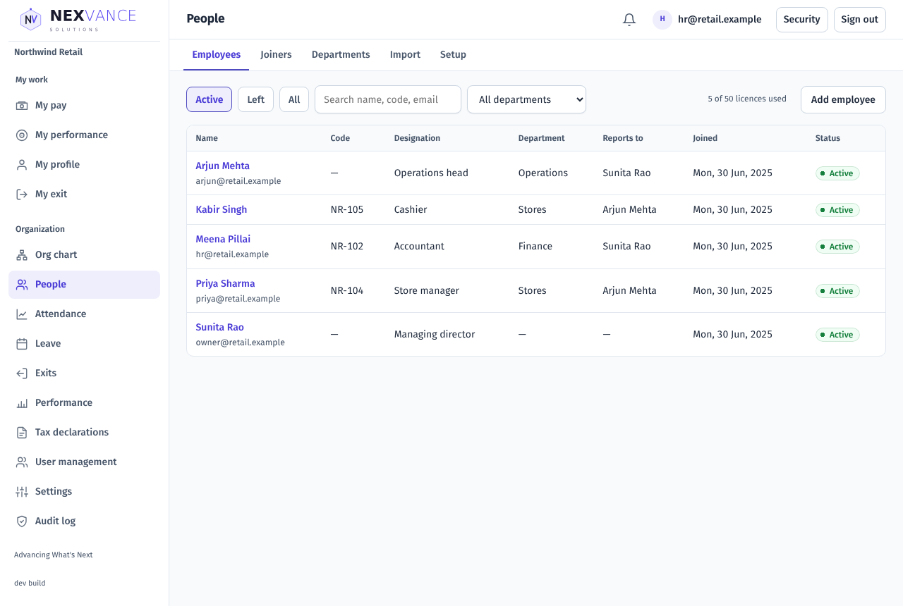
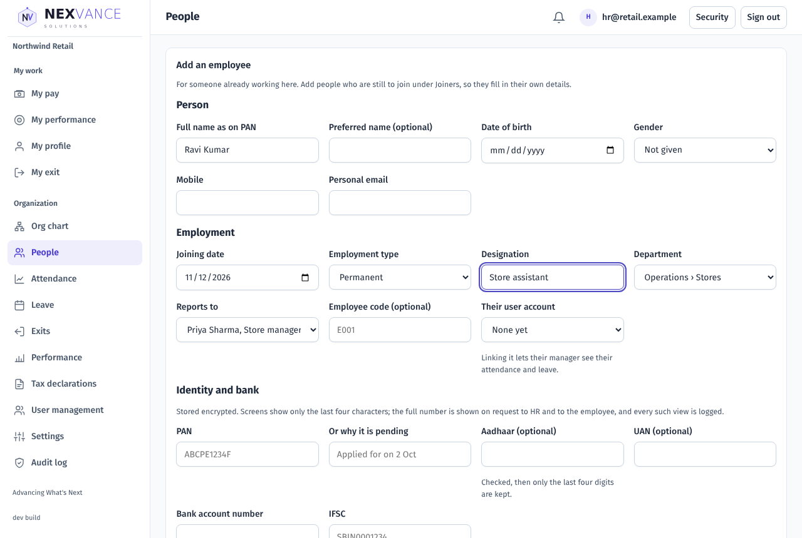
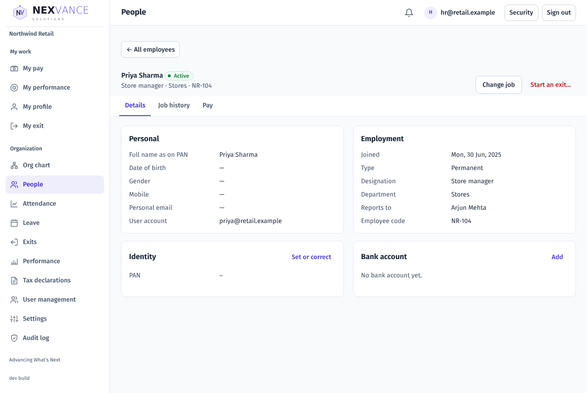
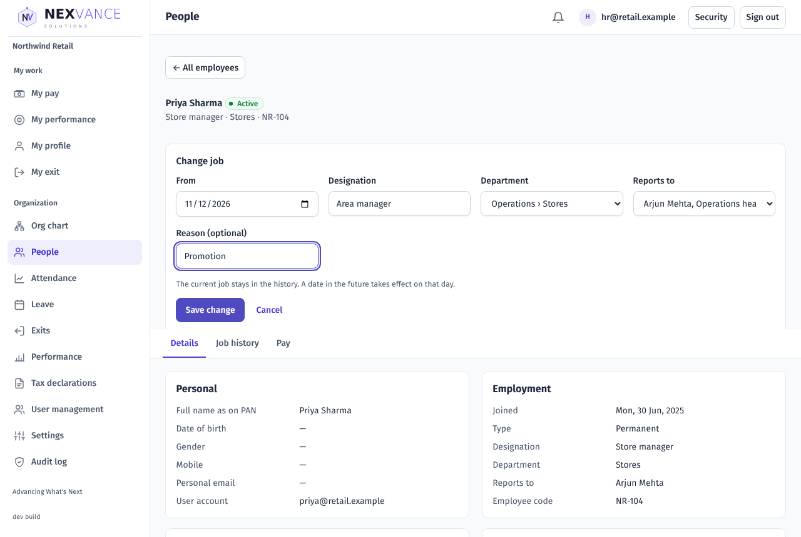
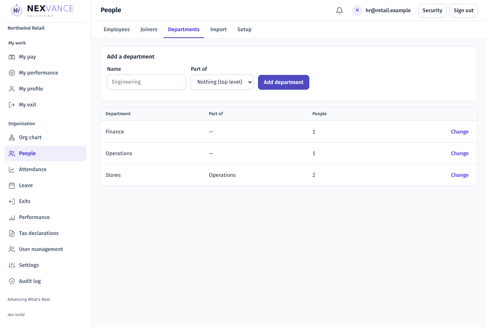
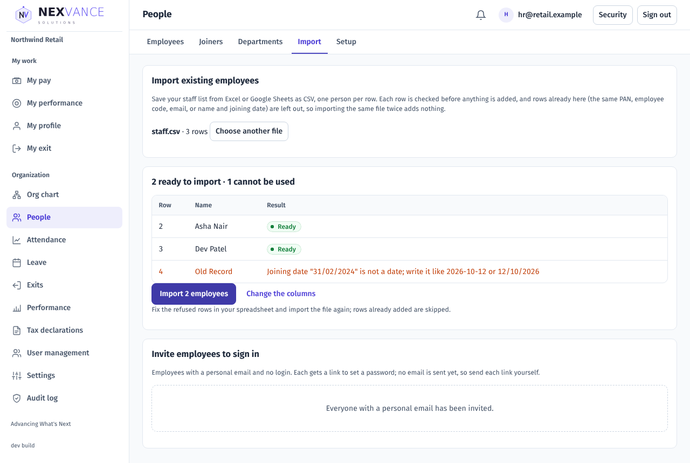
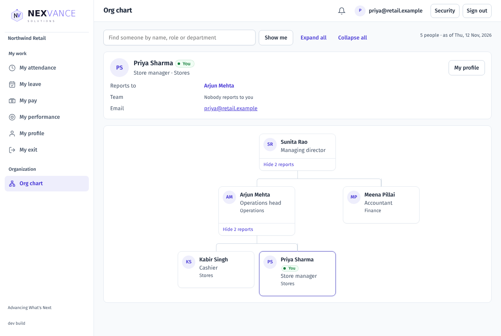
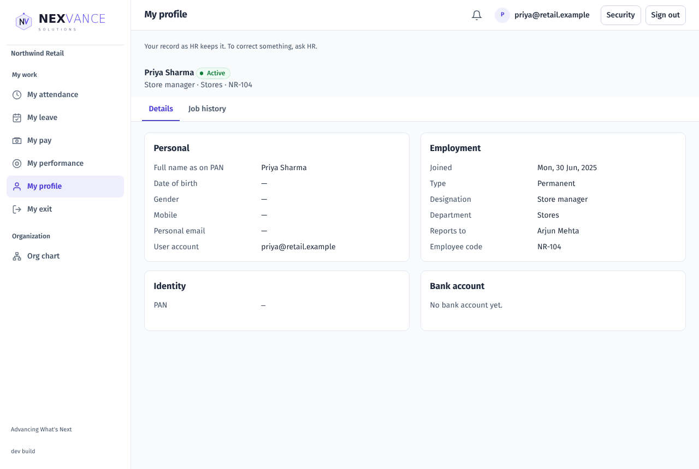

# People and org chart: user guide

For customers. How to keep employee records: adding people, identity and bank details, job changes, departments, importing existing staff, and the org chart. The screenshots come from a demo Organization (Northwind Retail); your names will differ.

## Overview

An employee record holds who someone is, their job, who they report to, and the identifiers payroll needs. Reporting lines decide what managers see in Attendance, Leave and Performance.

| Role | What you can do |
| --- | --- |
| Employee | See the org chart and your own record (My profile) |
| Manager | See your team's records (People → My team) |
| HR Admin / Owner | Add and change records, departments, import, link logins, show identifiers in full with a reason |
| Auditor | Read records; cannot change them or show identifiers in full |

## Employees

Open **People**. The list shows active people; use **Left** for those who have gone and **All** for both. Search by name, preferred name, code, email or designation, and filter by department.

If your plan has a licence limit, the list shows "N of M licences used". At the limit, **Add employee** is switched off; ask Nexvance for more licences.

### Add an employee

Choose **Add employee**.

| Section | Fields | Rules |
| --- | --- | --- |
| Person | Full name as on PAN, preferred name, date of birth, gender, mobile, personal email | The name is required. Someone under 14 on the joining date is refused |
| Employment | Joining date, employment type, probation end, contract end, designation, department, reports to, employee code, their user account | Joining date and designation are required. A fixed-term employment needs a contract end. The manager must be an active employee. Linking the user account lets their manager see their attendance and leave |
| Identity and bank | PAN (or why it is pending), Aadhaar, UAN, bank account (typed twice), IFSC, account holder | PAN: five letters, four digits, a letter, and the fourth letter must be P (a person). The same PAN cannot be on two records. Aadhaar is checked, then only the last four digits are kept. UAN has 12 digits. A bank account has 9 to 18 digits |

### An employee's record

Choose a name in the list.

- **Identifiers** show only their last four characters. Choose **Show** and give a reason (at least 5 characters) to see a PAN, UAN, PF or ESI number or bank account in full; the reason is kept in the audit log. Aadhaar cannot be shown in full.
- **Set or correct** changes an identifier; the earlier value is kept as history.
- **Add** or **New account** records a bank account and the date pay goes into it from.
- **Change job** records a new designation, department or manager from a date. A change cannot be dated before the joining date, and nobody can end up reporting to themselves. **Job history** lists every change with its reason.
- **Link user account** connects a record to someone's login, if it was not linked when the record was added. A login can have only one record.
- **Start an exit…** opens Exits with the person chosen.

## Departments

**People → Departments**: add a department, optionally inside another. Choose **Change** to rename it, move it, or switch it off. A department cannot sit inside itself or one of its own sub-departments.

## Import existing staff

**People → Import** loads a CSV of your current staff.

1. Choose the file. The columns are matched to fields from their names; check each one. Next time the same column names are remembered.
2. Choose **Check every row**. Each row says **Ready** or why it cannot be used (for example "is not a date", or a code already in use). New departments are added as needed, and "reports to" can point to someone in the same file.
3. Choose **Import N employees**. Rows already imported before are skipped, so loading the same file again does no harm.
4. Under **Invite employees to sign in**, tick people with a personal email and invite them.

## Org chart

Everyone can open **Org chart** to see who reports to whom. Search for a name, choose a person to see who they report to, their team and email. Managers' records are not opened from here.

## My profile

Employees with a record see **My profile**: their record as HR keeps it, read only. To correct something, ask HR.

## Common questions

| Problem | What to check |
| --- | --- |
| "Add employee" is greyed out | All licences are in use. |
| The PAN is refused | Check the format, and that the fourth letter is P. A company's PAN cannot be used. |
| "already recorded" on a PAN | Another record has that PAN. |
| A manager cannot see someone | Set "Reports to" on the person's record (Change job). |
| A person cannot see their attendance or leave | Link their user account to the record. |
| An import row is refused | Read the reason on the row, fix the file, and import again; rows already in are skipped. |
