# Performance: user guide

For customers. How goals, one-to-ones, feedback, probation reviews, review cycles, calibration, outcomes and improvement plans work, screen by screen. The screenshots come from a demo Organization (Northwind Sales); your names will differ.

## Overview

Performance turns a year of goals and check-ins into decisions the HRMS carries out for you: a confirmation, a promotion as a dated job change, an increment as a dated pay revision, or an improvement plan.

| Role | Where | What you can do |
| --- | --- | --- |
| Employee | **My performance** | Set and update your goals, read one-to-one notes, give and ask for feedback, reply to probation check-ins, write your self review, read and acknowledge your released review, acknowledge an improvement plan |
| Manager | **Performance** (Team, Reviews, Probation, Improvement plans) | Everything above for your team: agree goals, hold one-to-ones, write probation check-ins and recommendations, write reviews, draft improvement plans |
| HR Admin / Org Admin | **Performance**, all tabs including **Setup** | Set up, run review cycles, calibrate, decide probations and plans, prepare and approve outcomes |
| Auditor | **Performance** | Read everything; change nothing (no Setup tab) |

Nobody agrees, reviews, calibrates, approves or decides anything about themselves.

## Setup (HR Admin)

Open **Performance → Setup**.

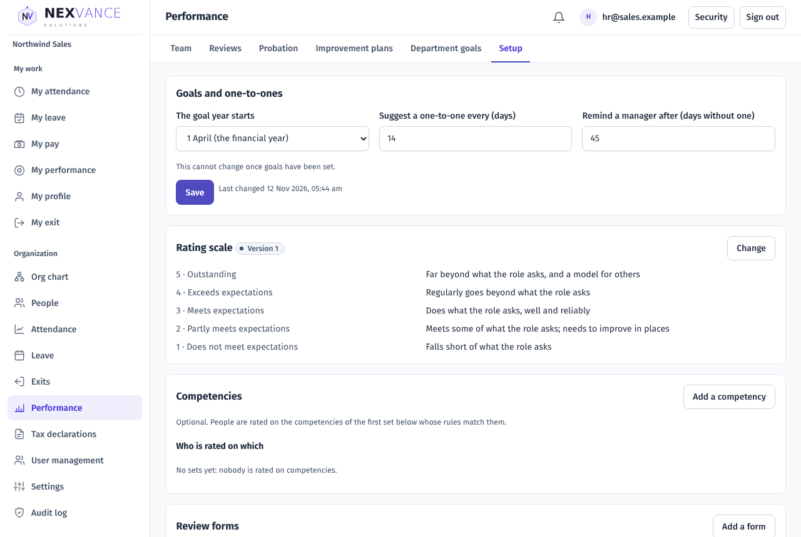

| Section | Setting | Choices and limits | Default |
| --- | --- | --- | --- |
| Goals and one-to-ones | The goal year starts | 1 April (the financial year) or 1 January; cannot change once goals are set | 1 April |
| | Suggest a one-to-one every (days) | Days | 14 |
| | Remind a manager after (days without one) | Days | 45 |
| Rating scale | Levels | 3 to 7 levels, each with a name and what it looks like | 5 levels, 3 is "Meets expectations" |
| Competencies | Name, description, and who is rated on which set | Names are unique | None (nobody is rated on competencies) |
| Review forms | Questions for the self review and the manager's review | 1 to 30 questions; each text or a rating | A standard form |
| Probation | Check-ins, in days from joining | A list of days | 30, 60, 90 |
| | Ask for the recommendation this many days before the end | 7 to 90 days | 21 |
| Calibration guide and merit table | Guide (% of people) and increment per rating | The guide is shown in calibration, never enforced | — |

Choose **Save** in each section; you see **Saved.** when it has worked.

Changing the probation check-in days applies to probation reviews made after the change; reviews already running keep their check-ins.

## Goals (employee and manager)

Open **My performance → Goals** and choose **Add a goal**: a title and a weight. The weights must add up to 100 before you choose **Send to my manager**; the page shows how far you are ("60 of 100"). The goals then show **Waiting to be agreed**.

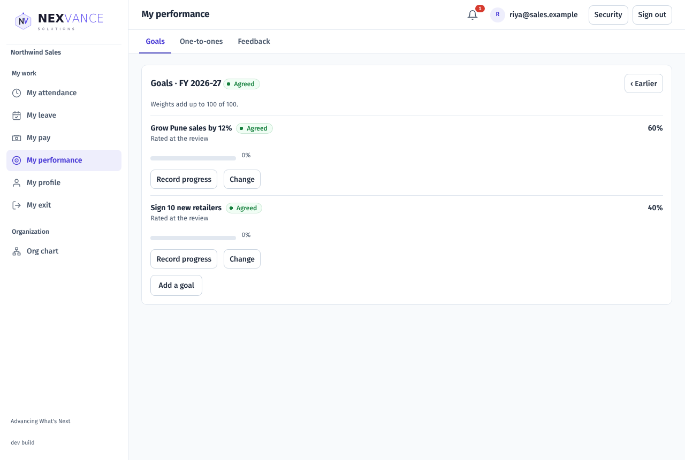

The manager opens **Performance → Team**, picks the person and chooses **Agree the goals** (or returns them with a note). Progress is recorded with **Record progress** once a goal is agreed. Changing an agreed goal makes a new version that needs agreeing again.

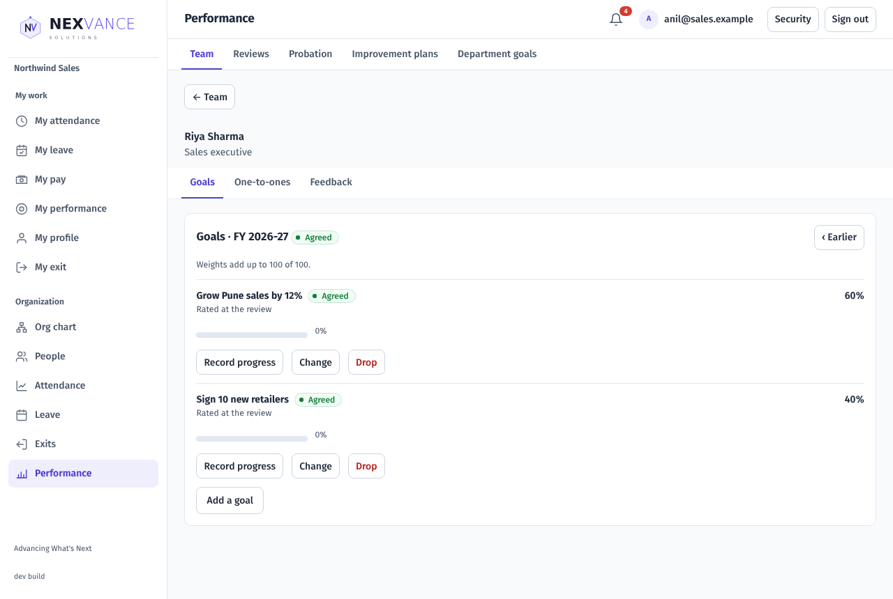

## One-to-ones

The manager opens **Performance → Team → person → One-to-ones → New one-to-one**. **Shared notes** are read by both; **private notes** stay with whoever wrote them. Only a manager and their own report hold one-to-ones.

## Feedback

Open **My performance → Feedback**.

- **Give feedback**: choose the colleague, **Praise** (they read it) or **Private** (only their manager and HR read it), and optionally share praise with their manager. You can change it for a day; after that you can only withdraw it, which removes the words and keeps the date.
- **Ask for feedback**: pick one to five colleagues and what it is about, then **Ask**. Each colleague answers or declines with a reason, and you see which under **You asked**.

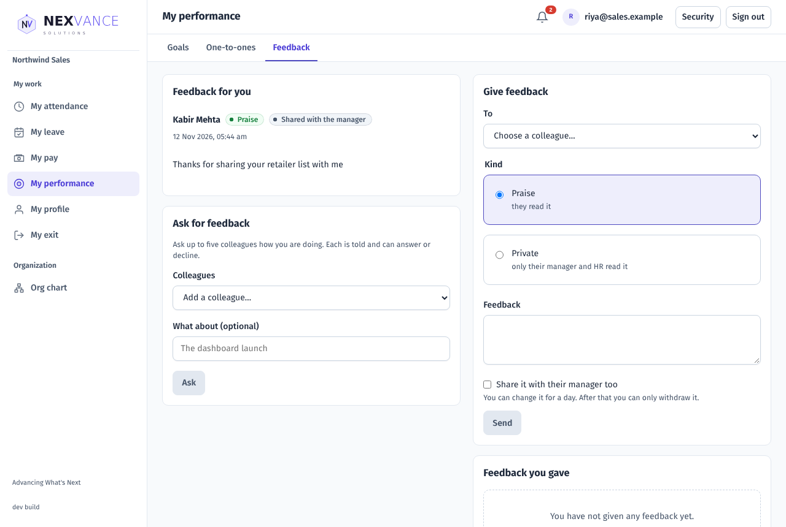

Nobody gives feedback to themselves.

## Probation reviews

Everyone with a probation end date gets a probation review. The manager opens **Performance → Probation** and picks the person. For each check-in day, choose **Write the check-in**, pick **On track**, **Some concerns** or **Not on track**, write a note and **Save the check-in**.

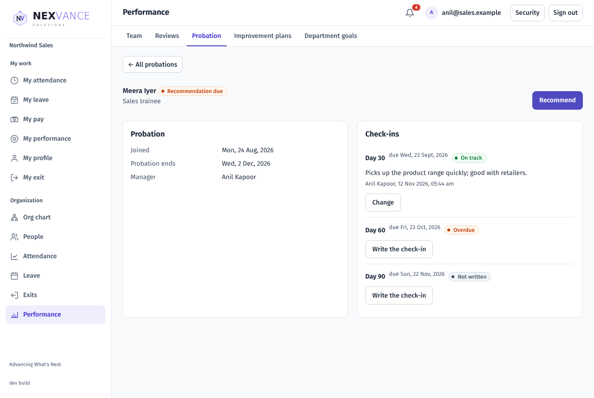

The employee sees the check-ins under **My performance → Probation** and can **Reply** once to each.

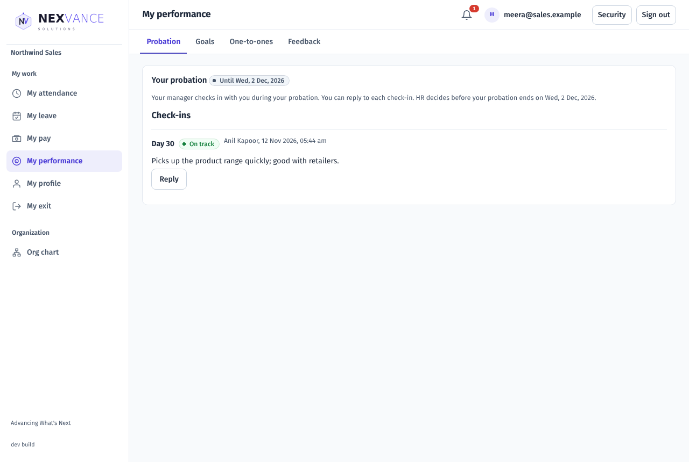

From the set number of days before the end, the manager chooses **Recommend**: **Confirm**, **Extend the probation** (1 to 6 months) or **Do not confirm**, with a note, then **Send to HR**. HR chooses **Decide**:

| Decision | What happens |
| --- | --- |
| Confirm | Confirmed from the day after the probation ends; the confirmation letter is issued and the employee is told |
| Extend the probation | Needs a reason of at least 20 characters. The probation end moves, the extension letter is issued, and a new review starts with check-ins every 30 days |
| Do not confirm | Needs a reason and a last working day, and the exit.manage permission. A termination for performance starts under Exits. Take legal advice first |

A probation is decided once.

## Review cycles (HR Admin)

Open **Performance → Reviews → New cycle**.

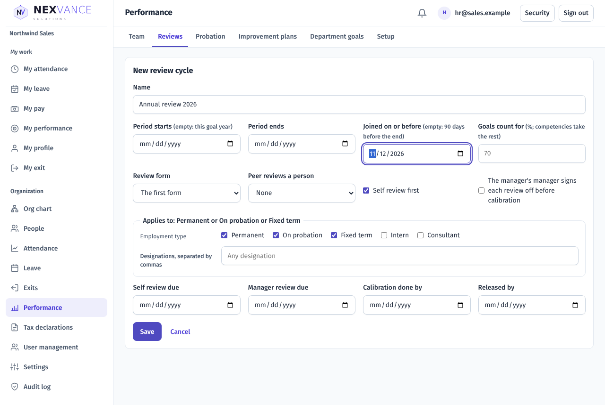

| Field | Meaning |
| --- | --- |
| Name | Shown to everyone in the cycle |
| Period starts / ends | Empty means this goal year |
| Joined on or before | People who joined after this are left out (empty: 90 days before the end) |
| Goals count for | Percentage of the overall rating from goals; competencies take the rest |
| Review form | The questions asked |
| Peer reviews a person | None, or up to five |
| Self review first | The employee writes a self review before the manager |
| The manager's manager signs each review off | Adds a sign-off step before calibration |
| Applies to | Employment types and designations |
| Due dates | Self review, manager review, calibration, release |

Choose **Save**. The cycle shows how many reviews starting will create; choose **Start the cycle**. A cycle that matches nobody cannot start. HR can add people, withdraw a review, or move a review past the self review, each with a reason.

### Self review (employee)

Open **My performance → Reviews**. Rate each goal, answer the questions and choose **Send to my manager** (or **Save a draft**). Once sent it cannot change unless your manager returns it, which they can do once.

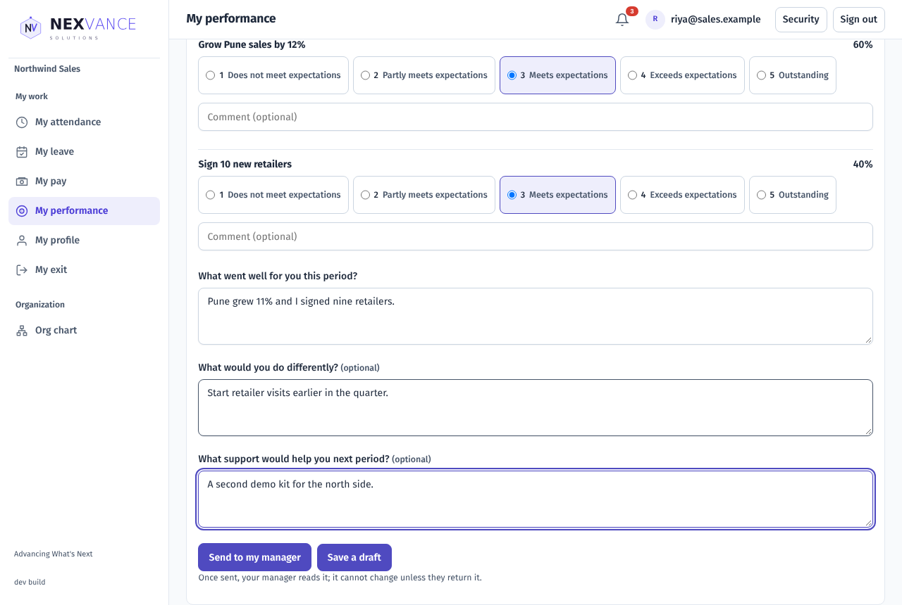

### Manager's review

Open **Performance → Reviews** and pick the person under the reviews to write. Rate each goal (and competency), answer the questions and read the overall rating **worked out** from your ratings. To give a different overall rating, write a reason of at least 20 characters. Tick **Recommend a promotion** if you wish, then **Send the review**.

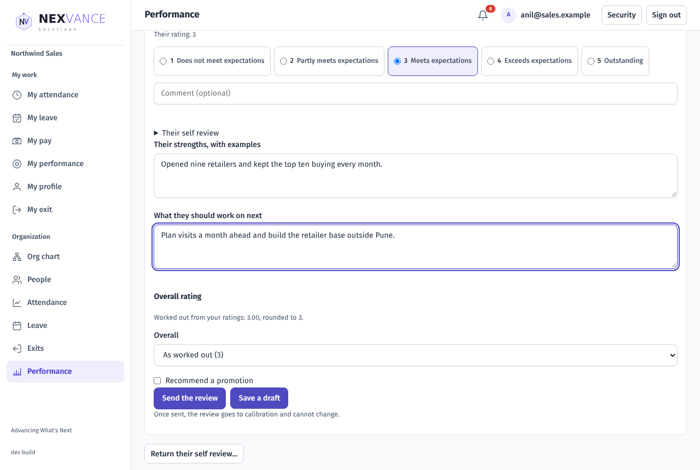

With sign-off on, the manager's manager then signs it off or sends it back with a note.

## Calibration (HR Admin)

Open the cycle and choose its **Calibration** tab. Name a session and choose **Open a session**. The session shows the spread of ratings now, what managers gave, and your guide. To change a rating choose **Change rating**, pick the level and write a reason of at least 20 characters; the manager is told. **Close the session** makes its reviews ready. Then choose **Release to everyone**.

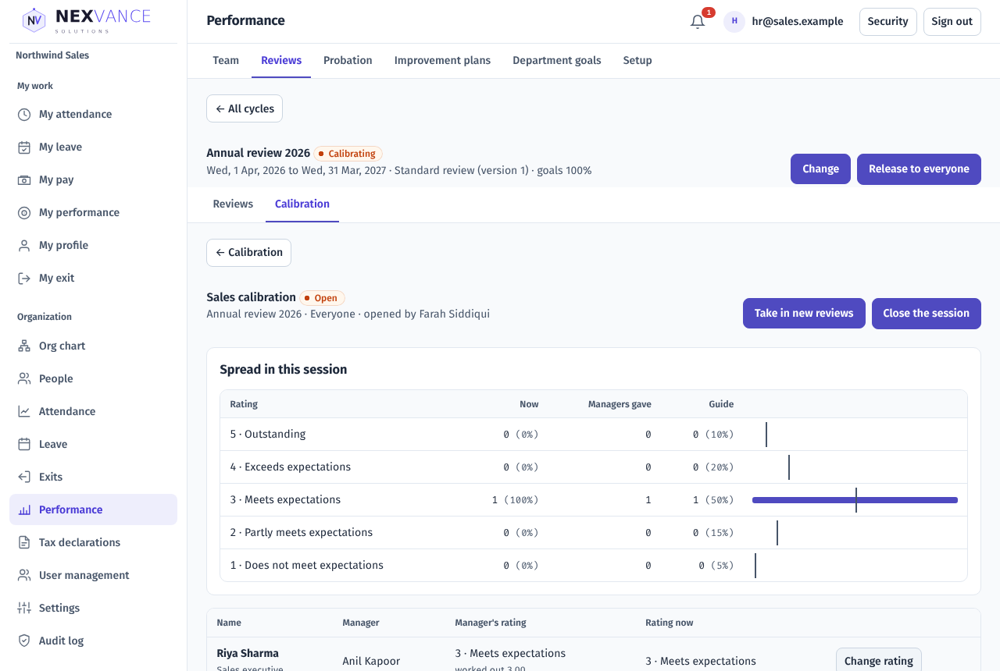

The employee reads the released review and its final rating, and chooses **Acknowledge** once, with a comment if they wish.

## Outcomes (HR Admin and an approver)

After release, open the cycle's **Outcomes** tab. Each released review has an outcome: the increment from the merit table, a promotion (prefilled from the manager's recommendation), a bonus, and the date it takes effect, which is the first of a month (default: next month). Choose **Change** to edit one; a different increment needs a note. Someone with no pay recorded cannot get an increment.

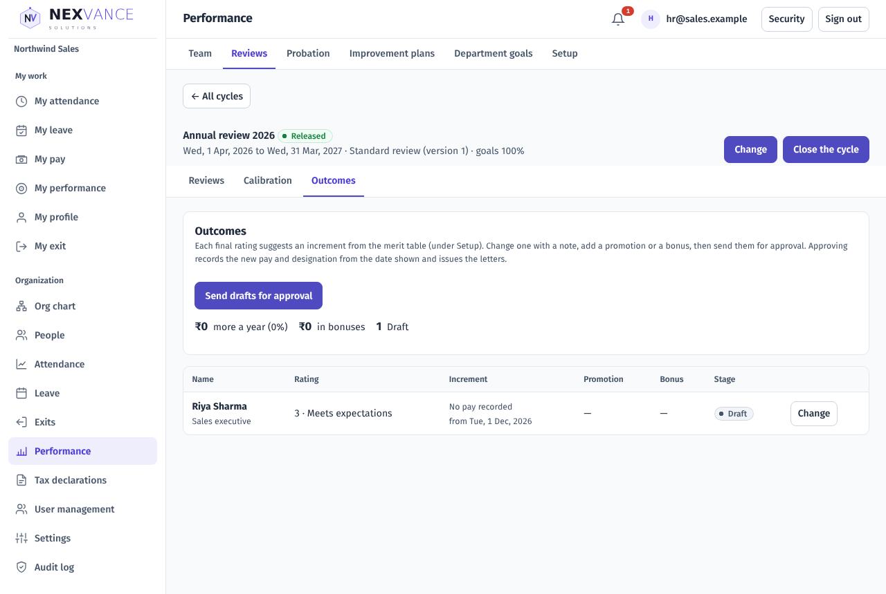

Choose **Send drafts for approval**. Someone other than the sender approves them (or sends them back with a note). Approving records the pay revision and the promotion **from the effective date**, and issues the letters; until that date the employee's current designation and pay stay as they are.

## Improvement plans

The manager (or HR) opens **Performance → Improvement plans → New plan**: why (at least 20 characters), one to six objectives each with how it is measured, the support offered, 14 to 120 days, and a check-in every 7 to 31 days. Choose **Save the draft**. A person has one plan at a time.

HR opens the draft and chooses **Start the plan**: the check-ins are scheduled (with one on the last day), the plan letter is issued and the employee is told.

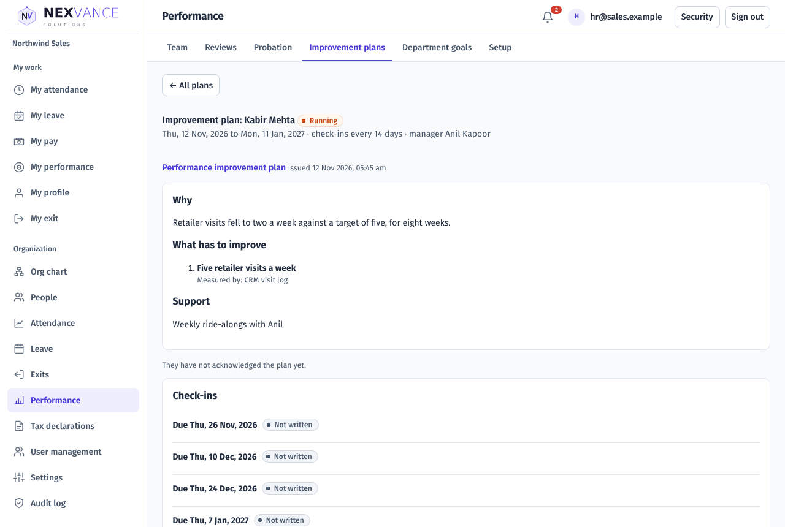

The employee opens **My performance → Improvement plan** and chooses **I have read it**, with a response if they wish; acknowledging is not agreeing. At each check-in (open from a week before it is due) the manager rates every objective with a note, and the employee may reply once.

HR decides: **completed** (at any time), **extended** once by 14 to 60 days, or **not met**, which needs the plan to have ended with at least one check-in written and starts a termination with the last working day given. A plan can be cancelled with a reason.

## Common questions

| Problem | What to check |
| --- | --- |
| "… make them add up to 100" | Change the goal weights so they total 100. |
| Cannot record progress | The goals are not agreed yet. |
| "Nobody matches this cycle's rules" | Widen the employment types, designations or the joining date. |
| The manager cannot give a different overall rating | Write a reason of at least 20 characters. |
| "… so someone else approves it" | The person who sent outcomes cannot approve them; ask another approver. |
| "… no pay recorded" | Record the person's pay under Payroll first, or give no increment. |
| "An outcome takes effect from the first of a month" | Pick the 1st. |
| "The plan runs to …" | A plan is decided as not met only after its end. |
| "This check-in is due on …" | Check-ins open a week before they are due. |
| The new probation check-in days do not show | They apply to probation reviews made after the change. |
